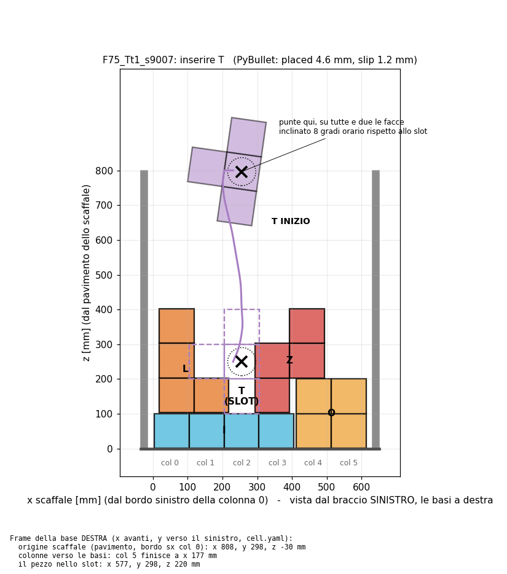
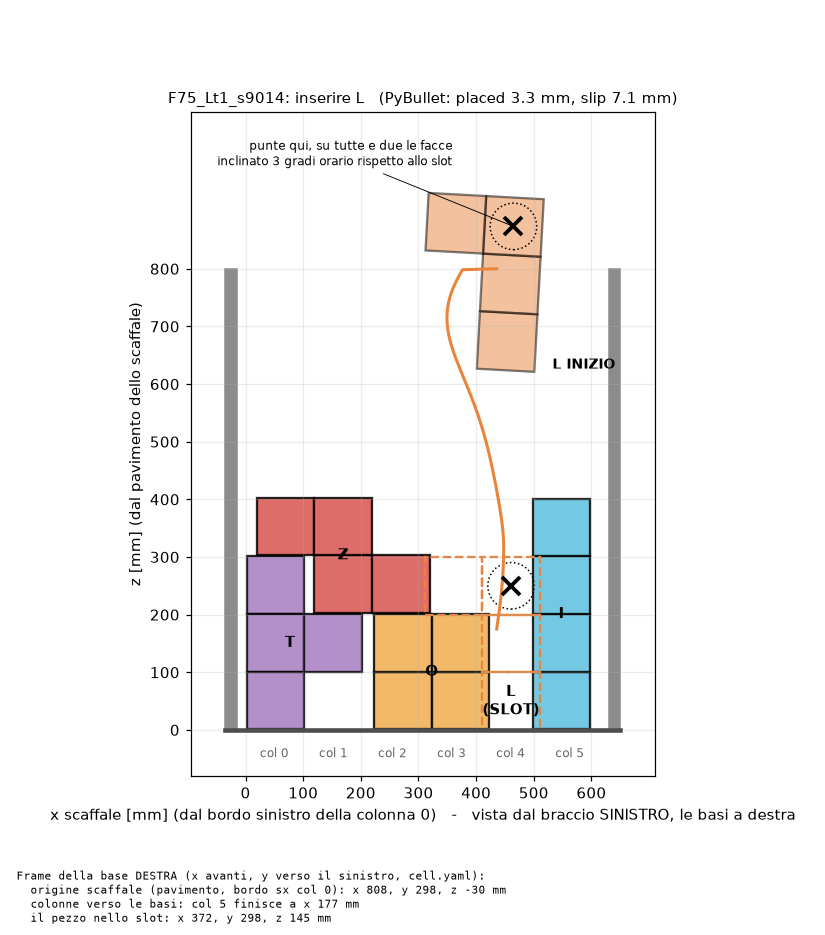
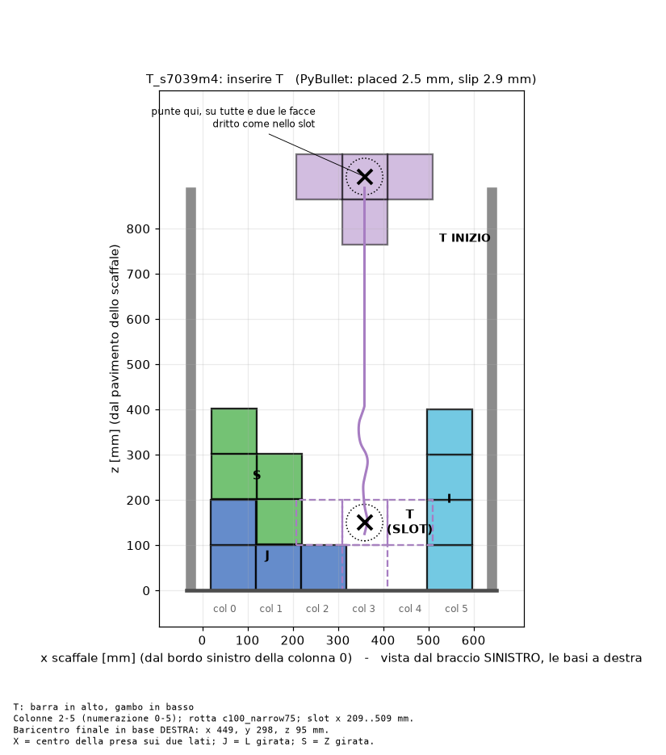
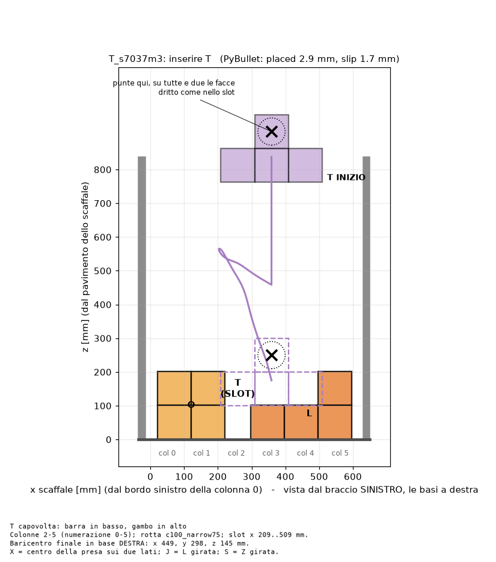
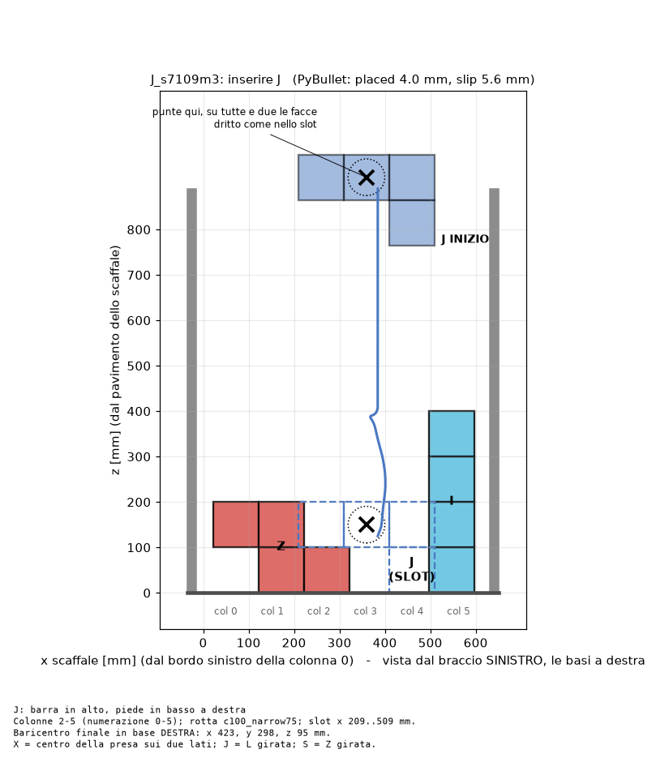
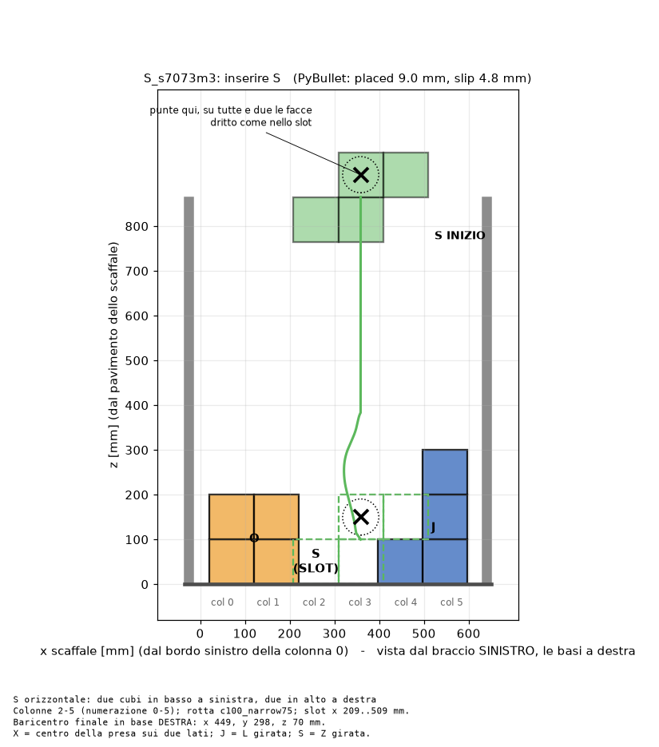
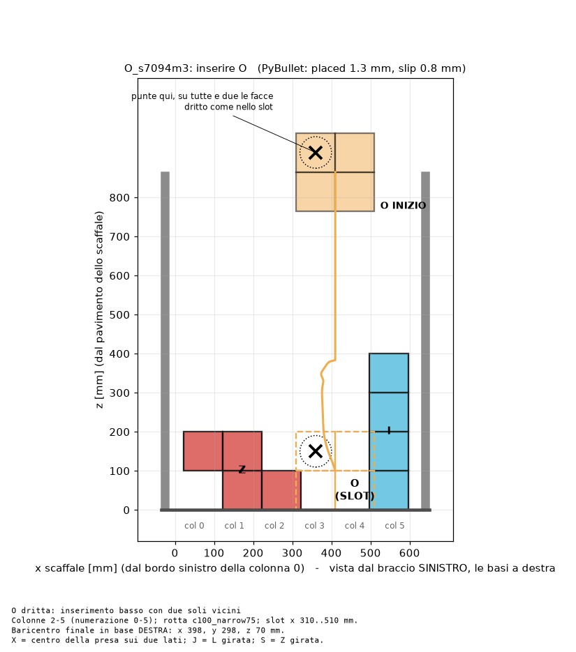

# Guida unica: due Kinova + ATI, inserimento DMP (23/10/2026)

Unica guida operativa. Le precedenti (AVVIO_FULL_WRENCH, ESEMPI_*, SETUP_PC_ROBOT, HANDOFF)
sono state rimosse: tutto quello che serviva è qui.

**In breve**
- `follow_two_arms` = solo il percorso a mani vuote. Inserimento con integratore: `main insert`; variante PI: `insert_pi insert`.
- `insert` = SOCP + stretta scalare. `insert --twist` = **full wrench**: stretta + twist opposto attorno all'asse dei pad,
  chiuso sugli ATI. Senza ATI su entrambi i bracci `--twist` si rifiuta di partire.
- Con gli ATI **non serve più la baseline del wrench**: la forza arriva dai sensori, non dalle coppie dei giunti.
- Le rotte DMP sono **2D**: piano x-z dello scaffale (y costante), una sola rotazione, attorno all'asse dei pad (y).
  Il twist del full wrench è proprio attorno a quell'asse.
- Per ogni rotta: prima `insert` (scalare), poi `insert --twist`, stessa board e stesso pezzo: due dati confrontabili.

**Dati salvati a ogni prova** (`logs/`, e il rosbag in `~/lorenzo/bags/`):
- `<W>_<R>_<data>.csv`, 100 Hz richiesti (frequenza effettiva dai timestamp): comandi; pose misurate;
  forze e momenti usati dal controllo; **ATI prima del bias**, mediato (assi sensore, N/Nm);
  **stima Kinova grezza**; offset; wrench completo chiesto dal SOCP anche nelle prove scalari;
  `t_wall` per allinearlo al bag. Dal branch di revisione del 23/10: anche q/dq/effort dei 7 giunti per braccio,
  timestamp e freschezza delle sorgenti, intervallo del controllo e stato dell'ultima allocazione.
- `<W>_<R>_<data>_meta.json`: config usata (con `local.yaml`), comando, commit git, unità e seriale degli ATI,
  bias e rumore di ogni tare, esito. La revisione registra anche i parametri letti dai controller
  (`cart_k`, `cart_d` ecc.), il gain effettivo, la modalità di esecuzione e il file del profilo offline.
  `control_hz` è un parametro richiesto: non certifica la frequenza reale del loop.
- `follow2_<W>_<data>.csv`: giri a vuoto, con l'ATI grezzo.
- Il rosbag: tutto `/left_arm/*` e `/right_arm/*`, cioè joint states, target, stima Kinova e ATI
  mediato a **200 Hz**; ATI grezzo a 1 kHz soltanto con `ati_raw:=true` (più carico CPU).

**Revisione per il laboratorio del 23/10:** [analisi, formulazione e prove a 1500 N/m](docs/CONTROL_REVIEW_20261023.md).
Codice sul branch `codex/controller-review-20261023`; i default del launch e del gain storico restano invariati.

## Prove di venerdì: integratore e PI

Sul PC robot deve esserci il branch `codex/controller-review-20261023` aggiornato con
`kinova_dual_arm_dmp_insertion/insert_pi.py`. I comandi sotto si eseguono **sul PC robot**.
Calibrazione ATI e controlli del percorso restano quelli delle sezioni 2 e 3.

**T1 — bracci + ATI, terminale normale senza `env.sh`.** Avvia una sola istanza.
Per queste prove: rigidezza traslazionale 1500, rotazionale 20; damping 60/7.

```bash
source /opt/ros/jazzy/setup.bash
source /home/nvidia/ros2_ws/install/setup.bash
ros2 launch /home/nvidia/lorenzo/kinova_dual_arm_dmp_insertion_fullwrench/launch/robot.launch.py cart_k:="1500 1500 1500 20 20 20" cart_d:="60 60 60 7 7 7"
```

**T2 — registrazione, lascialo aperto per tutte le prove.**

```bash
source ~/lorenzo/env.sh
mkdir -p "$LORENZO/bags"
cd "$LORENZO/bags"
ros2 bag record -e "/(left_arm|right_arm)/.*|/rosout" -o sessione_$(date +%Y%m%d_%H%M%S)
```

**T3 — prove, un comando alla volta.** Esempio con la Z; cambia `W` per il tuo pezzo.

```bash
source ~/lorenzo/env.sh
cd "$LORENZO/kinova_dual_arm_dmp_insertion_fullwrench"
git branch --show-current
export W=F75_Zt1_s9012 R=c100_five_cut800
```

Prima **dry run PI**, senza movimento dei robot:

```bash
python -m kinova_dual_arm_dmp_insertion.insert_pi check "$W" --arm "$R" --slow 3
```

**A — integratore precedente, gain 0.25:**

```bash
python -m kinova_dual_arm_dmp_insertion.main insert "$W" --arm "$R" --slow 3 --squeeze-gain 0.25
```

**B — nuovo PI, stessa board e pezzo rimesso all'inizio:**

```bash
python -m kinova_dual_arm_dmp_insertion.insert_pi insert "$W" --arm "$R" --slow 3
```

**C — nuovo PI con SOCP offline, sempre con feedback ATI:**

```bash
python -m kinova_dual_arm_dmp_insertion.insert_pi insert "$W" --arm "$R" --slow 3 --offline
```

Per confrontare anche il twist, aggiungi `--twist` **a entrambi A e B**.
`--wrench-channels forces` aggiunge invece il feedback tangenziale interno già esistente;
il nuovo PI regola solo la stretta normale. Se scegli `--no-bending`, usalo in tutte le prove confrontate.

**PI iniziale:** P = **0.1 mm/N**, I = **1 mm/(N·s)** sull'errore di forza **sommato delle due mani**.
Velocità massima della correzione **2 mm/s per mano**; correzione dopo la presa **±6 mm per mano**.
Usa il tempo effettivo e l'anti-windup. Se la presa non si stabilizza entro 6 s, si ferma prima di chiederti
di lasciare il pezzo; intervallo PI oltre 100 ms: stop. Sono valori iniziali da verificare sul robot.
Nel modulo PI **`--squeeze-gain` non cambia la stretta normale**: usa `--pi-kp` e `--pi-ki`
solo per prove di taratura. Non cambiare gain, impedenza e modalità contemporaneamente.

**T3 — analisi, dopo ogni prova.** Sostituisci il percorso con il CSV stampato a fine esecuzione:

```bash
python -m kinova_dual_arm_dmp_insertion.audit_run logs/NOME_PROVA.csv
```

I log PI hanno `_pi_` nel nome; il meta distingue SOCP online/offline e salva i gain PI.
Nel CSV ci sono errore, P, I e saturazioni `pi_*`, oltre a wrench, pose e joints.
Confronta oscillazioni **e** cali della forza; dry run riuscito non certifica stabilità reale.
Per tornare al vecchio controllo usa il comando **A**: non serve cambiare file.

---

## 0. Una volta sola sul PC robot (se già fatto, salta)

Terminale **normale**. Crea `~/lorenzo/env.sh` (cartella separata: il PC è condiviso), venv e copia del codice:

```bash
mkdir -p ~/lorenzo/home ~/lorenzo/bags && cat > ~/lorenzo/env.sh <<'END'
LORENZO="$(cd "$(dirname "${BASH_SOURCE[0]}")" && pwd)"
export HOME="$LORENZO/home"
export HISTFILE="$LORENZO/bash_history"
export ROS_LOG_DIR="$LORENZO/ros_log"
export PATH="$HOME/.local/bin:$PATH"
source /opt/ros/jazzy/setup.bash
[ -d "$LORENZO/venv" ] && source "$LORENZO/venv/bin/activate"
PS1="(lorenzo) $PS1"
END
```

```bash
source ~/lorenzo/env.sh && python3 -m venv --system-site-packages "$LORENZO/venv" && source "$LORENZO/venv/bin/activate" && pip install "cvxpy<1.7" clarabel "numpy<2" && cd "$LORENZO" && git clone https://github.com/lorenzopen/kinova_dual_arm_dmp_insertion_fullwrench.git
```

I **bracci** (home e impedenza) girano con il controller del laboratorio in `~/ros2_ws` (`kinova_controller_pkgs`),
quello delle prove del 15–20/10. Gli **ATI** usano solo `ft_raw` di **`tele_ros2`**, lanciato dal suo file sorgente:
il workspace di tele_ros2 **non si carica mai**, perché ha pacchetti `kinova_*` con lo stesso nome di `ros2_ws`.
Verifica che `ros2_ws` sia compilato e che il sorgente di `ft_raw` ci sia:

```bash
source /opt/ros/jazzy/setup.bash && source /home/nvidia/ros2_ws/install/setup.bash && ros2 pkg prefix kinova_control && ls /home/nvidia/tele_ros2/src/ati_ft_tools/ati_ft_tools/ft_raw.py
```

Il controller di tele_ros2 **non va usato**. Il 21/10 il .200 è andato in fault e ha dato uno scatto due volte su due,
e sul .107 l'azione Home dava `DATABASE_ERROR`. Il controller di `ros2_ws` non usa l'azione Home del robot: entra
in coppia dalla posa in cui si trova e va in home **in impedenza**. A ogni uscita rimette il braccio in posizione.

**Una volta sola: la velocità del .132.** `ft_raw` vuole 1000 pacchetti/s. Il 21/10 il .131 era a 1000 e il .132 a
**7000**, con il segnale in ritardo e a scalini. L'impostazione resta salvata nel NetBox. Deve stampare
`<comrdtrate>1000`:

```bash
curl -s "http://192.180.0.132/comm.cgi?comrdtrate=1000" >/dev/null; curl -s http://192.180.0.132/netftapi2.xml | grep -o "<comrdtrate>[0-9]*"
```

---

## 1. Ogni sessione: 3 terminali

**T1, bracci + ATI** (terminale normale, **senza** `env.sh`: il controller usa `kortex_api` di `/home/nvidia/.local`).
Mano sull'E-stop, niente sotto le punte, zona libera.

```bash
source /opt/ros/jazzy/setup.bash && source /home/nvidia/ros2_ws/install/setup.bash && ros2 launch /home/nvidia/lorenzo/kinova_dual_arm_dmp_insertion_fullwrench/launch/robot.launch.py
```

`launch/robot.launch.py` di questo repo avvia, nell'ordine:
- i due `ft_raw`: sinistro (.200) NetBox **.132**, seriale FT54940; destro (.107) NetBox **.131**, seriale FT49595.
  Sono montati al contrario rispetto alla mappa di tele_ros2;
- il **destro**: va in home in impedenza (8 s) e poi la tiene;
- dopo 14 s il **sinistro**, quando il destro è già fermo in home.

I default sono `cart_k` **1500/20** (dal 23/10; prima 1000/20), `cart_d` **60/7**. Con 1500 e `--squeeze-gain 0.5` la Z del 22/10 alle 20:20 ha avuto forza giusta e sinusoide 0,10 N.
Fino alla prova del 22/10 alle 15:28 il damping era 5/1. Attrito e Kalman sono accesi di default.
Nei dati la sinusoide a circa 1,2–1,5 Hz compare anche nel comando di stretta; il gain più basso la riduce,
ma a 0,25 si osservano anche cali della forza. Il default di `main insert` resta 0,5;
per il confronto di venerdì il comando A richiede esplicitamente 0,25.
L'impedenza è su `end_effector_link`, cioè **sulla flangia**. L'URDF è **`urdf/gen3_ati_tool.urdf`** di questo
repo: `gen3.urdf` più quello che è montato sulla flangia (ATI, adattatori, molla e tri-pad), **150 g** in tutto.
Senza quella massa la compensazione di gravità non vede il tool. Se cambi tool, aggiorna massa e baricentro
in quel file.

Opzioni: `arms:=right` o `arms:=left` per un braccio solo; usalo **la prima volta e dopo ogni scatto**.
`arms:=none` avvia solo i due ATI, senza bracci. `home:=false` fa partire i bracci dalla posa in cui sono.
`kalman:=false` e `friction:=false` spengono il filtro di Kalman e la compensazione d'attrito, che di default
sono accesi come nelle prove del 15–20/10. Spenti, il braccio è più passivo e qualche mm meno preciso; le forze
degli ATI non cambiano. Il loop del controller gira a circa 280 Hz (`joint_states` circa 70 Hz, una pubblicazione
ogni 4 cicli): servono a misurare se spegnerli lo velocizza.

**Più velocità.** Sulla Jetson (15 W) la CPU si adatta al carico; per tenerla alla frequenza massima, una volta
per accensione del PC, lancia `sudo jetson_clocks`: torna com'era al riavvio. Il 21/10, con `jetson_clocks` e
`kalman:=false`, `joint_states` è passato da 70 a 100 Hz, cioè un loop a circa 400 Hz. Il controller di tele_ros2 (`publish_thread`) qui non va più veloce:
provato il 21/10, 308 Hz, perché ogni ciclo aspetta comunque circa 2 ms la risposta del robot.

Ctrl-C in T1 ferma tutto, e i bracci tornano in posizione e restano fermi.

**T2, registrazione** (lasciala andare tutta la sessione, Ctrl-C alla fine):

```bash
source ~/lorenzo/env.sh && cd "$LORENZO/bags" && ros2 bag record -e "/(left_arm|right_arm)/.*|/rosout" -o sessione_$(date +%Y%m%d_%H%M%S)
```

**T3, lavoro** (aggiorna il codice e scegli la rotta, tabella in fondo):

```bash
source ~/lorenzo/env.sh && cd "$LORENZO/kinova_dual_arm_dmp_insertion_fullwrench" && git pull --ff-only && mkdir -p logs
```

```bash
export W=F75_Tt1_s9007 R=c100_five_cut800
```

```bash
ros2 topic hz /left_arm/ft_data_avg
```

Ripeti per `/right_arm/ft_data_avg`: devono dare circa **200 Hz**. Poi `/left_arm/joint_states` e
`/right_arm/joint_states`: circa 70 Hz, 100 Hz con `jetson_clocks` e `kalman:=false`. Ctrl-C dopo qualche
secondo. Tutti i terminali devono avere lo stesso `echo $ROS_DOMAIN_ID`.

**Perché `ft_data_avg`.** In Python, sulla Jetson, ricevere l'ATI a 1 kHz costa circa un core intero. Il 21/10,
dentro il processo di `insert`, bloccava il loop a 100 Hz e il SOCP: tick da 30 a 260 ms e bracci a scatti. Il carico in
più faceva anche scadere il timeout di 3 ms dei controller durante la home (`Homing tick error`). Ogni ATI ora gira con
`ati_node.py` di questo repo: è `ft_raw` di tele_ros2 (stessi servizi e stessa calibrazione) senza il suo timer a
2 kHz. Legge i pacchetti in un thread e pubblica la media di 5 campioni a **200 Hz** su `ft_data_avg`, usando circa il
10% di un core. È il topic che legge il nostro codice (`ft_topic` e `ft_rate_hz: 200` in `cell.yaml`), e finisce
nel bag. Il grezzo a 1 kHz su `ft_data_raw` c'è solo con `ati_raw:=true` in T1, che costa più CPU.

---

## 2. Solo la prima volta con gli ATI montati (T3, bracci fermi in home)

**a. Misure a mano**, da salvare (in `config/local.yaml`, fuori da git; ogni comando la legge):
- pesa ciò che sta **oltre** ogni sensore: adattatore, molla e tri-pad, in kg. Molla più tri-pad pesano 40 g,
  che è già il valore in `cell.yaml`; manca l'adattatore lato tool;
- dalla flangia del Kinova al fronte delle sfere ci sono **100 mm** su entrambi i bracci (21/10). Quindi
  `pad_x` = 0.100 − 0.015 = **0.085**, già in `cell.yaml`. Rimisuralo solo se cambi il tool.

```bash
python -m kinova_dual_arm_dmp_insertion.ft_check --tool-mass 0.050 0.050 --pad-x 0.085 --save
```

(sostituisci le due masse con quelle pesate: sinistra, destra).

**b. Orientamento e segno dei sensori:** tre prese a mano per braccio, ciascuna mantenuta per circa 2 s.
Nell'ordine: niente contatto; premi la faccia del tri-pad verso la flangia; premi il tri-pad **verso il basso,
sulla parte davanti**.

```bash
python -m kinova_dual_arm_dmp_insertion.ft_check --calibrate --save
```

Salva `ft_in_ee` e `ft_sign` e ti avvisa se i due ATI sono scambiati.

**c. Verifica dal vivo** (stesso codice di `insert`):

```bash
python -m kinova_dual_arm_dmp_insertion.ft_check
```

Su ciascun braccio: premendo la faccia del pad **fn > 0**; premendo verso il basso **F z > 0**;
ruotando il pad **in senso orario visto dalla faccia** **Tn > 0**; a riposo, tutto vicino a 0.
Ogni pressione deve comparire **solo sul suo braccio**. Il tare stampa il rumore (sd a 1 kHz, senza filtro): qualche centesimo di N va bene; sopra 0,2 N controlla cavi e fissaggio.
Rifai a, b, c solo se smonti o ruoti un sensore o un tool.

---

## 3. Per ogni rotta (T3), un comando alla volta

Board e pezzi: figure e quote nell'appendice. Mano sull'E-stop: non c'è controllo collisioni fra gli avambracci.

```bash
python -m kinova_dual_arm_dmp_insertion.main check "$W" --arm "$R" --slow 3
```

Nessun movimento: deve stampare `SOCP ok N/N` e `seat_found True`. Il `cart_k` suggerito dal dry run
viene dal config e non legge T1; i parametri reali sono registrati nel meta delle prove hardware.

```bash
python -m kinova_dual_arm_dmp_insertion.follow_two_arms "$W" --routes "$R" --cell --gap 0.20 --lift 0.10
```

In aria, **senza board**, punte a 20 cm. **Ometti `--lift 0.10`** dove la tabella dice "no lift".

```bash
python -m kinova_dual_arm_dmp_insertion.follow_two_arms "$W" --routes "$R" --cell --gap 0.20
```

Quota vera, **board montata**, mani vuote.

```bash
python -m kinova_dual_arm_dmp_insertion.follow_two_arms "$W" --routes "$R" --cell --gap 0.10
```

Distanza di presa, ancora **senza pezzo**. Stampa l'errore di inseguimento: deve stare entro pochi mm.

```bash
python -m kinova_dual_arm_dmp_insertion.main insert "$W" --arm "$R" --slow 3
```

**Inserimento vero, stretta scalare.** Due Enter: tieni il pezzo fra i pad come in figura, poi lascialo.
Misura a mano l'errore di piazzamento (cella peggiore rispetto allo slot) e annotalo.

```bash
python -m kinova_dual_arm_dmp_insertion.main insert "$W" --arm "$R" --slow 3 --twist
```

**Inserimento full wrench** (stretta + twist): stessa board, pezzo rimesso al punto di partenza.

**Separare pianificazione delle forze ed esecuzione** (`insert_open`, stessa board e stesso pezzo):

| comando | stretta | SOCP | ATI |
|---|---|---|---|
| `--offline` | feedforward normale, `ds = N*/k_eff` | risolto **prima** della prova | registrato ed eventi |
| (niente) | feedforward, `ds = f*/k_eff` | online ogni 100 ms | solo registrato |
| `--online` | anello chiuso sull'ATI, gain **0,1** (o `--squeeze-gain`) | online ogni 100 ms | in feedback |
| `--offline --online` | anello chiuso sull'ATI, stesso controllo | risolto **prima**, nessun solve durante l'esecuzione | in feedback |

```bash
python -m kinova_dual_arm_dmp_insertion.insert_open insert "$W" --arm "$R" --slow 3 --offline
```

```bash
python -m kinova_dual_arm_dmp_insertion.insert_open insert "$W" --arm "$R" --slow 3
```

```bash
python -m kinova_dual_arm_dmp_insertion.insert_open insert "$W" --arm "$R" --slow 3 --online
```

`k_eff` assiale: il modello (impedenza in serie alla molla da 2700 N/m) dà 730 N/m a 1000 e 964 a 1500, ma **misurato sulla Z il 22/10 è circa 460 a 1000 e 680 a 1500** (molla, gomma e polistirolo sono più cedevoli): per `--offline` a 1500 usa `--k-eff 680`.
Su hardware viene ricavato dal `cart_k` letto dai due controller; se non è leggibile, il feedforward richiede
un `--k-eff` esplicito e calibrato. Nel dry run viene usato il modello di `cell.yaml`. Il rapporto
misurata/chiesta non è una calibrazione della rigidezza durante contatti o errori di larghezza.
Il profilo offline conserva **target normale e tutti i 12 componenti dei wrench**, riferiti al centro di presa.
Una fase mancante o un solve non fattibile impediscono l'esecuzione del profilo.
`--twist` abilita il feedback dei momenti solo con `--online`, anche combinato con `--offline`.
`--wrench-channels forces` abilita, sempre con feedback, stretta più **ripartizione tangenziale interna**,
senza anello dei momenti; è una modalità pilota con offset limitati a **2 mm per mano**, da provare prima
di usarla per i dati finali. `--wrench-channels contact` aggiunge il twist assiale alle tangenziali;
`--no-bending` vincola a zero la flessione al pad nel SOCP, conservando torsione e momenti di leva alla flangia.
Questi canali interni non regolano il wrench ambientale risultante. Tutte le modalità mantengono
gli eventi di sicurezza, jam e appoggio; nei modi senza `--online` l'ATI non regola la stretta.

Per analizzare i dati senza ricostruire il SOCP con un modello diverso da quello della run:

```bash
python -m kinova_dual_arm_dmp_insertion.audit_run logs/NOME_RUN.csv
```

Salva rapporto JSON, tracking, **6 componenti del wrench per mano** e, nei nuovi CSV, joints.
I momenti misurati sono trasportati al centro di presa prima del confronto. `analyze_run` rimane disponibile
per la ricostruzione dei vecchi log: ricalcola il SOCP con il codice/config forniti, non recupera le soluzioni storiche.

**In alternativa: presa automatica dall'angolo** (`insert_pick`, stessi log con `_pick` nel nome). Non devi più tenere
il pezzo in mano alla quota di partenza. Il pezzo si appoggia sul pavimento dello scaffale, **nell'orientamento dello
slot** (il tratteggio della figura), **in mezzo allo scaffale** (centrato tra le due pareti di fondo; `check` stampa
la distanza dalla parete vicina ai Kinova), a **board vuota**. Con `--pick-at wall` torna contro la parete vicina ai Kinova. I bracci lo prendono, lo
portano alla posa di partenza della rotta e lo tengono lì mentre monti i vicini. Poi parte l'inserimento normale.

```bash
python -m kinova_dual_arm_dmp_insertion.insert_pick check "$W" --arm "$R" --slow 3
```

Stampa **dove mettere il pezzo**: distanza dalla parete, eventuale spessore sotto, se sta in piedi da solo.
Calcolato per tutte le rotte: T, L, Z, I (F75) a **15 mm dalla parete** (usa un blocchetto da 15 mm come distanziatore);
O (F75) e le cinque `c100_narrow75` **appoggiate alla parete**; sempre sul pavimento, nessuno spessore.
J e T barra in alto vanno tenute con la mano finché i pad chiudono. Il robot non vede il pezzo: lo prende dove
deve essere, quindi uno spostamento lungo la parete o un orientamento storto se lo porta fino allo slot.
Controlla anche che i tri-pad non tocchino parete e pavimento, e la cinematica inversa di tutte le pose.

```bash
python -m kinova_dual_arm_dmp_insertion.insert_pick insert "$W" --arm "$R" --slow 3
```

Tre Enter: bracci dalla home dritti alla quota di presa, aperti (metti il pezzo tra i pad senza toccarli); pezzo portato su (**monta la board**, mani via);
poi tutto come `insert`. Aggiungi `--twist` per il full wrench. **Il primo giro fallo senza board e con la mano
sull'E-stop**: la presa in basso vicino alle basi è la posa più vicina ai bracci di tutta la prova.

Ctrl-C ferma lo streaming e i bracci tengono l'ultimo target; l'arresto del robot resta l'E-stop.
Il codice si ferma da solo sopra 60 N per mano o con 4 cm di errore.

**Fine sessione:** Ctrl-C in T2 (bag), poi T1. Dal **PC Windows** (PowerShell) copia i dati:

```powershell
$d = "C:\Users\Lorenzo\Desktop\dati_kinova_$(Get-Date -Format yyyyMMdd)"; New-Item -ItemType Directory -Force $d | Out-Null; scp -r nvidia@<IP_PC_ROBOT>:~/lorenzo/kinova_dual_arm_dmp_insertion_fullwrench/logs nvidia@<IP_PC_ROBOT>:~/lorenzo/bags $d
```

---

## 4. Tutte le rotte

| # | Pezzo | `W` | `R` | Primo giro | Vicini da montare |
|---|---|---|---|---|---|
| 1 | T | `F75_Tt1_s9007` | `c100_five_cut800` | `--lift 0.10` | I, O, Z, L |
| 2 | O | `F75_Ot0_s9005` | `c100_five_cut800` | no lift | L, I, T, Z |
| 3 | L | `F75_Lt1_s9014` | `c100_five_cut800` | `--lift 0.10` | O, T, Z, I |
| 4 | Z | `F75_Zt1_s9012` | `c100_five_cut800` | `--lift 0.10` | I, T, O, L |
| 5 | I | `F75_It1_s9001` | **`c100_five_cut700`** | no lift | L, T, S (= Z girata), O |
| 6 | T barra in alto | `T_s7039m4` | `c100_narrow75` | no lift | J (= L girata), I, S |
| 7 | T capovolta | `T_s7037m3` | `c100_narrow75` | no lift | L, O |
| 8 | J orizzontale | `J_s7109m3` | `c100_narrow75` | no lift | Z, I |
| 9 | S orizzontale | `S_s7073m3` | `c100_narrow75` | no lift | O, J |
| 10 | O, due vicini | `O_s7094m3` | `c100_narrow75` | no lift | Z, I |

Inizia dalla 1 (T, già inserita il 16/10). La 4 (Z) è la più delicata delle prime cinque; la 9 (S) è vicina
alla soglia PyBullet: lasciala per ultima. Si cambia rotta solo con la riga `export W=... R=...` in T3.

Altre rotte esportate: `python -m kinova_dual_arm_dmp_insertion.main list`. Non sono provate sui robot.

---

## Appendice: board

**Cella** (già in `config/cell.yaml`): basi parallele, sinistra .200 a y = +600 mm dalla destra .107;
pavimento dello scaffale 30 mm sotto le basi, profondo 125 mm. Misurato il 15/10 da x = 175 a 825 mm
davanti alle basi; poi la board è stata avvicinata (prove del 19 e 20/10: origine a 747,5 mm). Rimisurato il 21/10:
pavimento **da x = 120 a 770 mm**, con l'origine (colonna 0) a **x = 752,5 mm**. Le colonne crescono **verso le basi**. Se sposti
scaffale o bracci, correggi `shelf_in_base` (la x vale per tutti e due i bracci).

Quote in mm nel frame dello scaffale: x dal bordo sinistro della colonna 0, z dal pavimento.
Le figure sono **viste dal braccio sinistro** (.200). Il pezzo pieno in alto mostra come presentarlo
fra le punte, già inclinato; la **X** è il punto di pressione delle punte; il tratteggio è lo slot.
I vicini sono fuori griglia, entrano di circa 12-18 mm nello slot: **fissali con biadesivo**.
J = L girata sul retro, S = Z girata sul retro. Monta solo i vicini elencati.

**1. T `F75_Tt1_s9007`**: 
I 5–405 / 0–100 · O 412–612 / 0–200 · Z 293–493 / 103–403 · L 18–218 / 103–403 · **slot T 106–306 / 100–400**.
Inizio: baricentro x 231, z 800, ruotato 8° in senso orario; punte sul cubo centrale della barra.

**2. O `F75_Ot0_s9005`**: 
L 293–493 / 0–300 · I 18–118 / 0–400 · T 397–599 / 0–300 · Z 395–599 / 205–504 · **slot O 105–305 / 0–200**.
Inizio: x 205, z 800, dritto; punte sul cubo in alto a sinistra. No lift: con +10 cm il braccio supera la portata.

**3. L `F75_Lt1_s9014`**: 
O 223–423 / 0–200 · T 2–202 / 0–300 · Z 19–319 / 203–403 · I 498–598 / 0–400 · **slot L 311–511 / 0–300**.
Inizio: x 436, z 800, ruotato 3° in senso orario; punte sul cubo d'angolo, in alto.

**4. Z `F75_Zt1_s9012`**: 
I 5–405 / 0–100 · T 397–597 / 0–300 · O 3–203 / 103–303 · L 123–323 / 104–405 · **slot Z 310–510 / 100–400**.
Inizio: x 410, z 800, ruotato 3° in senso antiorario; punte sul cubo centrale in alto a destra.

**5. I `F75_It1_s9001`**: 
L 16–216 / 0–300 · T 311–611 / 0–200 · S 191–491 / 103–303 · O 292–493 / 305–505 · **slot I 104–204 / 100–500**.
Inizio: x 154, z 700, ruotato 38° in senso antiorario; punte sul secondo cubo dall'alto. Usa `cut700`
perché con `cut800` supererebbe la portata.

**6. T barra in alto `T_s7039m4`**: 
J 19–319 / 1–201 · I 497–597 / 1–401 · S 21–221 / 103–403 · **slot T 209–509 / 0–200**.
Inizio: dritta, baricentro x 359, z 890; punte sul cubo centrale della barra alta.

**7. T capovolta `T_s7037m3`**: 
L 296–596 / 1–201 · O 21–221 / 1–201 · **slot T 209–509 / 100–300**.
Inizio: dritta, x 359, z 837; punte sul cubo singolo in alto.

**8. J orizzontale `J_s7109m3`**: 
Z 21–321 / 1–201 · I 497–597 / 1–401 · **slot J 209–509 / 0–200**.
Inizio: dritta, x 384, z 890; barra da tre in alto, piede in basso a destra; punte sul cubo centrale della barra.

**9. S orizzontale `S_s7073m3`**: 
O 21–221 / 1–201 · J 397–597 / 1–301 · **slot S 209–509 / 0–200**.
Inizio: dritta, x 359, z 865; coppia bassa a sinistra; punte sul cubo in alto a sinistra.

**10. O con due vicini `O_s7094m3`**: 
Z 22–322 / 1–201 · I 498–598 / 1–401 · **slot O 310–510 / 0–200**.
Inizio: dritta, x 410, z 865; punte sul cubo in alto a sinistra.

Le prove reali del 16/10 (T riuscita, Z a metà) con i loro log: [docs/runs/](docs/runs/README.md).
Il metodo (SOCP full wrench, margini di attrito): [FULL_WRENCH.md](FULL_WRENCH.md), [docs/FRICTION_MARGIN.md](docs/FRICTION_MARGIN.md).
