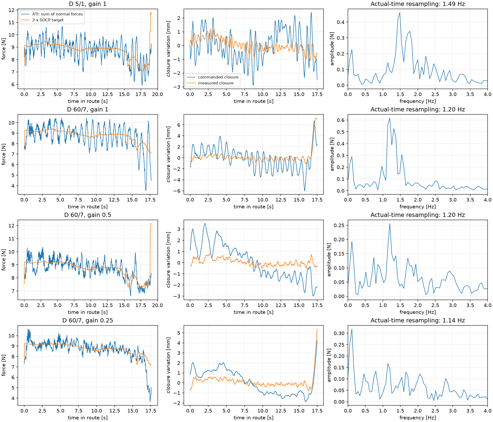

# Tetris, ATI e tripad elastico: revisione per il laboratorio del 23 ottobre

Branch: `codex/controller-review-20261023`, derivato da `main` a `71c6ee2`.
La revisione riguarda il codice locale e dati Kinova già registrati. Non sono state eseguite prove fisiche.

## Decisione pratica

**1500 N/m e squeeze gain 0,25 sono una prova pilota sensata, non una configurazione già validata.**
La molla riduce la rigidezza assiale a circa **964 N/m per mano**; a 1000 N/m erano circa **730 N/m**.
Il cambiamento effettivo è +32%, non +50%. I default del launch, del gain storico e dei margini non sono stati cambiati.

Per l'offline bisogna distinguere due problemi: calcolare un wrench fattibile e realizzarlo con il tool.
Il SOCP già comprendeva forze tangenziali e momenti; l'esecuzione offline conservava solo il massimo
carico normale delle mani e lo trasformava in una chiusura. Non era l'esecuzione vettoriale completa del paper.
Ora il profilo conserva tutti i wrench ed è possibile combinarlo con feedback ATI.
Questo corregge l'inseguimento dei riferimenti selezionati, ma **un profilo fisso non può conoscere nuovi carichi
di contatto che non erano nel modello**.

La prova di modello più interessante è `--no-bending`: evita che il solver si affidi alla flessione del tripad.
Su 30 geometrie campionate dalla Z reale, il normale mediano ricalcolato passa da **4,40 a 5,38 N per mano**;
tutte le 60 allocazioni di confronto sono fattibili. Non è una prova sul robot e non dimostra che sia il modello
esatto della molla, ma è una modifica fisicamente più motivata dell'aumento arbitrario di rho.

## Cosa mostrano i dati reali

Fonte: i quattro CSV della Z del 22 ottobre, tre in `docs/runs/20261022_F75_Zt1_s9012_squeeze_gain/`
e la run delle 15:28 in `docs/runs/20261022_F75_Zt1_s9012_twist_ati/2_1528_riuscita/`.
Wrench source: **ATI su entrambe le mani**, verificato nei rispettivi meta JSON.

| Run | D traslazione/rotazione | Gain stretta | Picco nella banda 0,8–2,5 Hz | Ampiezza picco | Minimo normale complessivo | Esito registrato |
|---|---:|---:|---:|---:|---:|---|
| 15:28 | 5 / 1 | 1 | 1,49 Hz | 0,46 N | 6,18 N | entrata |
| 17:22 | 60 / 7 | 1 | 1,20 Hz | 0,62 N | 3,52 N | Ctrl-C in route |
| 17:34 | 60 / 7 | 0,5 | 1,20 Hz | 0,26 N | 6,59 N | entrata |
| 17:44 | 60 / 7 | 0,25 | 1,14 Hz | 0,17 N | 3,65 N | Ctrl-C in route |

Finestra comune: primi 17,5 s di route. Spettro: ricampionamento sui timestamp effettivi, rimozione del trend
cubico, finestra di Hann. I numeri differiscono leggermente dal vecchio `plot_squeeze.py`, che applicava una FFT
ai campioni irregolari usando il solo intervallo mediano. L'oscillazione rimane evidente con il tempo corretto.
I picchi non sono una singola sinusoide perfettamente stazionaria: frequenza e ampiezza cambiano lungo la route.



Il comando di chiusura oscilla insieme alla forza, mentre il riferimento SOCP non presenta quella sinusoide.
Le componenti normali delle due mani sono fortemente correlate (circa 0,96–0,99 dopo detrending).
Il quadro è compatibile con un'oscillazione dell'anello di stretta accoppiato al robot elastico.
Non identifica separatamente ritardi, attrito, filtro di velocità e dinamica del tool.

Il gain 0,25 attenua la componente periodica ma nell'ultimo mezzo secondo registrato della sua prova
la stretta mediana scende a **4,61 N complessivi**. La mediana sull'intera route nasconde questo evento.
La prova è stata interrotta: non dimostra un fallimento di inserimento né una probabilità di successo inferiore.
Anche il minimo di forza da solo non dimostra slittamento.

I CSV giravano a circa **93–94 Hz effettivi**. Gli intervalli al percentile 99 erano circa 20–22 ms,
con massimi 27–35 ms. La sinusoide a circa 1,2 Hz ha già decine di campioni per periodo.
Registrare a 1 kHz non la elimina; sulla Jetson può aumentare il carico e peggiorare il controllo.
Il percorso attuale ATI usa blocchi di 5 campioni a 200 Hz e ne media circa due nel backend a 100 Hz.
Questa media di circa 10 ms non basta, da sola, a spiegare una dinamica a circa un secondo.

Il meta della run 17:34 riporta 207 risultati accettati su 208 richieste avviate. Con il solver asincrono
questo **non dimostra un solve fallito**: un risultato può essere ancora da applicare quando termina il controllo.
La revisione registra separatamente i fallimenti e la presenza di un risultato non applicato.

## La molla e il significato di 1500

Modello assiale quasi statico, una mano:

\[
\frac{1}{k_{eff}}=\frac{1}{k_{arm}}+\frac{1}{k_{spring}},\qquad k_{spring}=2700\;N/m.
\]

| Impedenza del braccio | k effettivo | Offset totale per 3 N | Per 4 N | Per 6 N |
|---:|---:|---:|---:|---:|
| 1000 N/m | 729,7 N/m | 4,11 mm | 5,48 mm | 8,22 mm |
| 1500 N/m | 964,3 N/m | 3,11 mm | 4,15 mm | 6,22 mm |

La sola molla si accorcia di 2,22 mm a 6 N in entrambi i casi. La parte restante è deformazione virtuale
dell'impedenza del robot. La deformabilità del polistirolo e altre cedevolezze non sono identificate da questa formula.
Il valore nominale della molla è ora esplicito in `tool.spring_axial_N_per_m` nel config.

Un errore di larghezza totale di 2 mm equivale, simmetricamente, a 1 mm per mano: circa **0,73 o 0,96 N per mano**
di errore di forza. La stima di rigidezza ricavata dal solo rapporto forza misurata/chiesta durante l'inserimento
confonde rigidezza, larghezza, inclinazione e contatti; quel rapporto non viene più presentato come calibrazione.

2700 N/m è una rigidezza **assiale**. Non determina rigidezza laterale o torsionale. I numeri approssimativi
su flessione e torsione nei commenti storici del config non sono stati usati come calibrazione del controllo.
La piastra può inclinarsi rispetto alla flangia: il modello geometrico attuale non misura questa inclinazione.
Anche il polo ATI va misurato: `ft_check --calibrate` identifica rotazione e segno, conservando l'xyz fornito.
Nei meta esaminati l'xyz è zero. Non ne deduco un offset reale, ma va verificato rispetto al centro del sensore:
un errore di leva di 20 mm con 1 N produce 0,02 Nm di errore nel momento. Un offset puramente assiale
non cambia la torsione lungo l'asse, mentre cambia le componenti di flessione. Non ho inventato una traslazione di calibrazione.

Il controller Kinova copiato nei Download usa:

\[
w_{arm}=K(u-x)-D\dot x,\qquad
\tau=J^T w_{arm}+g+\tau_{friction}-B\dot q.
\]

Non usa la velocità del riferimento nel termine viscoso. Con D=60 Ns/m e velocità nominale massima
0,085/3 m/s, il termine Dv può arrivare a circa 1,7 N; per compensarlo occorre circa 1,7 mm di errore
posizionale a K=1000 o 1,1 mm a K=1500. Sono scale rilevanti per uno slot stretto.
Questo non significa che tutte le forze misurate abbiano quell'errore: mostra perché la formula statica
u=p+F/K non garantisce tracking durante il moto. Il controller basso livello non è stato modificato.

Aumentare K con D invariato non garantisce maggiore smorzamento. In un modello scalare con massa efficace
invariata, il rapporto di smorzamento varia come D/sqrt(K), quindi diminuisce di circa il 18% passando
da 1000 a 1500. Sul robot reale servono la dinamica e i tempi effettivi: il parametro `control_hz=1000`
non dimostra che il loop giri a 1 kHz. La guida documenta circa 280–400 Hz e joint states circa 70–100 Hz.

## Confronto con i riferimenti

| Riferimento | Forze/calcolo | Esecuzione | Cosa trasferire al Tetris |
|---|---|---|---|
| `friction_cone.pdf`, Keeping Contact | SOCP per angolo, margini di distanza in spazio delle forze; campionamento 0,1 gradi | punto di equilibrio **vettoriale** p + K^-1 f*, eq. 28 | margini coerenti; non ridurre f* alla sola normale se si vuole rivendicare esecuzione completa |
| Tesi e codice Vitus | SOCP online nominalmente a 50 Hz, feedback dell'angolo e gravità, costo dalla precisione umana; due forze 3D e pivot | ghost = posizione corrente + forza/K, K=800 nel codice; PD simulato K=800, D=50 | separare obiettivo del task, allocazione ed esecuzione; non copiare i guadagni sul tripad reale |
| Wong, Industrial Dual-Arm Box Handling | stima inerziale online, ottimizzazione dei wrench, reazioni/contatto modellati; traiettoria raffinata offline | eq. 48: riferimento + K^-1 w*; eq. 49–50: correzione PID limitata, soprattutto nella stretta | feedback con ATI e modello di autorità dei contatti; zero bending al pad nella sua formulazione |
| Questo Tetris | 6 forze puntuali 3D, equilibrio completo, precisione umana sui 12 componenti di wrench | percorso DMP + stretta, eventuali canali interni selezionati | il calcolo include Ft e momenti, ma la realizzazione dipende dai canali e dal tool |

Il paper Wong è di **Kenzhi Iskandar Wong, Lin Yang, Qian Ying Lee e Domenico Campolo**.
Il suo restringimento relativo con r_s e la superficie ellissoidale non sono il margine additivo rho del
paper Keeping Contact. Non ho reintrodotto il cono al 70% né mescolato i due margini.
Ho usato lo zero bending come confronto di **modello del contatto**, mantenendo i margini di distanza attuali.

Vitus va letto con attenzione. `robot_control/run_simulation.py` importa `robust_bio_inspired.py`.
Nel suo percorso TILT, `current_tilt` viene aggiornato e passato al solver, che calcola
`d_theta=(theta_curr-self.current_tilt)/0.02`: in quel percorso la differenza è zero. Il termine D dichiarato
non è quindi una derivata utile. La versione `robust_bio_inspired_v2.py` usa invece `theta_dot` e permette
una posizione di riferimento legata al box; nel wrapper in modalità estimated quel campo viene però
esplicitamente impostato a NaN. Non è una base da copiare senza verificare entry point e observer.
Il bridge `haption_interface.py` ispezionato contiene inoltre un harness con solve SOCP lasciato come placeholder.

La tesi di Vitus, nelle conclusioni, indica il trasferimento ai robot fisici come lavoro futuro.
Il confronto qui è con **codice e simulazione**, non con un controllo Kinova reale certificato da quella tesi.
Anche la sua stima del box da mani assume contatti senza slip: non misura la deformazione del nostro tripad.

## Formulazione matematica del codice

f_i è la forza della mano sull'oggetto al punto i; n_i è la normale uscente dall'oggetto verso la mano.
Tutte le grandezze devono essere nello stesso frame e i momenti rispetto al polo dichiarato.

\[
N_i=-n_i^T f_i,\qquad t_i=(I-n_i n_i^T)f_i.
\]

Il programma risolve, con 18 incognite e geometria fissata:

\[
\min_f\;\tfrac12 (Hf)^T D^T Q(q)D(Hf)
\]

\[
G_C f+w_g+\hat w_e=0,
\qquad N_i\ge0,
\qquad \|t_i\|\le\mu N_i-\rho_i\sqrt{1+\mu^2}.
\]

G_C costruisce il wrench totale al CoM creduto; H costruisce i due wrench alle flange;
D li ruota nel frame del prior umano e Q è la precisione del prior.
Il termine aggiuntivo di sforzo puntuale è disabilitato (`w_force=0`).
Nel codice `w_ext` della rotta è il carico da **compensare**, cioè -w_e: il target è peso compensato + `w_ext`.
Il solver non ha un sensore diretto dei carichi dei vicini.

Per i margini attuali, con A uguale alla mappa di equilibrio sulle forze attive:

\[
f_{task}=A^+w_{load},\qquad
\rho_{task}=0.25\|f_{task}\|+1\;N,\qquad
\rho_i=\|(A^+A)_i\|_2\rho_{task}.
\]

È l'estensione 3D dichiarata nel progetto del principio del paper, non la sua specifica formula planare
applicata senza adattamenti. Rho è una scelta progettuale, non una stima misurata dell'incertezza del robot.
Il normale minimo al singolo punto, a tangenziale nulla, è rho_i sqrt(1+mu²)/mu.
Con 50 g, il peso totale è 0,4905 N: in aria la stretta di alcuni newton è dominata dal margine,
non dal solo peso. Durante i contatti conta anche w_e.

Con `--no-bending` si aggiunge, per ogni mano:

\[
(I-aa^T)\sum_j(p_j-p_{pad})\times f_j=0.
\]

Questo azzera la flessione **al centro del pad**, conserva la torsione lungo a e conserva il momento
alla flangia dovuto al braccio delle forze. Non significa azzerare tutti i momenti ATI.
Nel progetto queste uguaglianze entrano anche nella mappa usata per distribuire rho: il confronto numerico
no-bending comprende tale variazione coerente del margine, non soltanto il divieto di flessione a rho_i fissati.

L'online storico regola la somma dei normali:

\[
N^*=\max(N_L^{SOCP},N_R^{SOCP},1N),\quad
e_N=2N^*-(N_L^{ATI}+N_R^{ATI}),
\]

\[
d_{k+1}=\mathrm{clip}\{d_k+
\mathrm{clip}[\alpha e_N/(4\cdot1500),\;\pm0.2mm]\}.
\]

Aggiornamento richiesto ogni 20 ms; il gain è **per aggiornamento**, non moltiplicato per il dt misurato.
Ho conservato questa legge per non retarare implicitamente i dati storici; ora il dt effettivo è loggato.
A gain 0,25 il coefficiente è 0,0417 mm/N per aggiornamento. Il limite globale di d resta da -12 a +60 mm.
Un solo d non regola indipendentemente i due normali e non regola le tangenziali.

I nuovi canali tangenziali usano l'errore interno al polo comune:

\[
e_{int}=\tfrac12(\hat w_L-w_L^* -\hat w_R+w_R^*),\qquad
e_t=(I-aa^T)e_{int,F}.
\]

Correzioni traslazionali opposte, -gain e_t a sinistra e +gain e_t a destra, con passo a norma limitata
e offset totale **2 mm per mano**. `forces` non attiva momenti; `contact` aggiunge il twist assiale già disponibile.
La proiezione è nel null space del wrench totale al polo comune; l'effetto fisico delle pose è approssimativamente
interno se i due tool rispondono in modo simile. Non è un regolatore del risultante ambientale né del moto reale del pezzo.
Il gain del twist storico resta separato dal gain della stretta.

## Perché il tratto a contatto può divergere

1. **Modello del carico.** `route.py` scala le reazioni esportate con la massa: per la Z passa da 0,14468 a
   0,050 kg, fattore **0,3456**. La gravità scala così; una forza da errore geometrico contro un vicino non deve
   necessariamente scalare così. Nella fase route la massima forza orizzontale risultante delle mani arriva a circa
   1,1–1,7 N, contro circa 0,384 N del riferimento. Sono indizi di mismatch, non una misura indipendente del contatto.
2. **Fine della route.** `insert()` azzera `w_ext` prima di `slow_seat`. Il modello torna a sola gravità,
   mentre i contatti reali possono persistere o crescere. Anche una perfetta regolazione di quel riferimento
   non rende corretta la previsione del carico.
3. **Esecuzione incompleta e compliance.** Il vecchio offline usa solo N*/k_eff; Ft e momenti sono lasciati
   alla meccanica e al percorso. In una run riuscita a gain 0,5, la torsione sinistra desiderata ha mediana
   assoluta circa 0,036 Nm contro circa 0,013 Nm misurati; RMS dello scarto circa 0,025 Nm.
   La flessione richiesta al centro pad ha mediana circa 0,029 Nm. Aver inserito il pezzo non prova tracking dei wrench.
4. **Geometria e stato.** I sei contatti sono assunti attivi e la piastra è considerata solidale alla flangia.
   Inclinazione della molla o perdita di uno dei tre contatti non sono osservate direttamente.

Se per “non segue” si intende **la traiettoria**, la distinzione è altrettanto importante: il CSV misura le flange
via FK, non la posa reale del Tetris. Aumentare K riduce la deformazione del braccio, ma non elimina la deformazione
del tool, lo slip o errori dei vicini. Il centro delle mani è una stima del pezzo, non una misura indipendente.
Anche gli eventi vanno letti in questo senso: a circa 4,4 N per mano, mu=1 e con i parametri attuali,
la soglia JAM nella route vale circa 1,8 x 3 x (8,8-0,4905) = **44,9 N**. Il minimo configurato di 8 N
non è la soglia effettiva in quel tratto. `jammed:false` non prova che i vicini siano rimasti fermi.
Inoltre, se entrambe le forze diventano nulle, la formula del risultante ambientale restituisce mg:
senza una verifica del pezzo non distingue un oggetto caduto da un oggetto appoggiato. Non ho abbassato
le soglie di contatto o aggiunto una stima di presenza non calibrata; l'esito fisico va annotato indipendentemente.

La reazione ambientale si potrebbe stimare quasi staticamente dal risultante dei wrench ATI e usarla,
filtrata e con limiti, per un'allocazione online informata dal contatto. Richiede però verifica di bias, segni,
accelerazioni e autorità del tool; non ho aggiunto questa retroazione adattativa prima della raccolta finale.
Alzare rho o aumentare il gain non sostituisce tale verifica. L'offline puro rimane il confronto di modello;
l'offline con feedback serve a separare un errore di realizzazione da un errore del piano delle forze.

## Modifiche implementate sul branch

- Profili offline completi: target più 12 componenti, interpolazione nella fase, hash e provenienza nel meta.
  Fasi mancanti o allocazioni non fattibili impediscono l'esecuzione, senza riusare un wrench di un'altra fase.
  Il SOCP offline usa i contatti sulle facce nominali: la precompressione f/k_eff viene rimossa dalla geometria
  di pianificazione. Il backend ideale metteva le flange sui target di equilibrio, includendo la deformazione
  virtuale del braccio: trattarli come punti di contatto spostava artificialmente i contatti dentro l'oggetto.
  Ora la geometria pianificata non dipende dalla precedente chiusura comandata; il backend serve a pacing/eventi.
- `--offline --online`: piano fisso con feedback ATI. La presa usa il contatto misurato del controllo originale.
  `--wrench-channels forces` e `contact` sono opzioni pilota; `--no-bending` seleziona il modello del contatto.
- Wrench desiderati loggati anche nei modi scalari/feedforward; momenti riferiti esplicitamente al centro di presa.
- Parametri letti dai due controller ROS prima della prova. Il feedforward usa il cart_k letto, non una copia YAML
  potenzialmente diversa; se non leggibile richiede un k_eff calibrato esplicito. Nessun parametro del robot viene scritto.
- CSV estesi con q, dq ed effort dei 7 giunti, nomi nel meta, stamp e freschezza delle sorgenti, dt del controllo,
  stato/età dell'allocazione. Una sola FK per mano e lettura, comune alle trasformazioni di posa e wrench.
- Arresto per joint states stantii oltre 100 ms; resta l'arresto ATI a 50 ms. Un solve fallito ferma lo streaming
  mantenendo l'ultimo target, invece di saltare alla stretta nominale della simulazione da 25 N.
- Prima compilazione SOCP mentre le mani tengono ancora la posa, prima di avviare il clock del moto.
  Il profilo offline usa lo stesso clock del generatore di moto; non riparte da zero al primo feedback,
  che sul robot può arrivare con un intervallo diverso dal dry run.
- Confronto dry run sui centri delle facce: l'export Z usa circa 28,3 mm flangia-faccia, il tool reale 100 mm.
  Il confronto grezzo delle flange scambiava questa differenza per circa 70 mm di errore. È sempre un confronto
  di percorso comandato, non un test dell'inseguimento fisico.
- Nuovo `audit_run`: legge direttamente quanto registrato, confronta i momenti allo stesso polo, usa il tempo
  effettivo per lo spettro e salva grafici dei wrench, tracking, joints e rapporto JSON. Il vecchio `analyze_run`
  resta disponibile e invariato: ricostruisce il SOCP con solver/config correnti, quindi non è la verità storica della run.

## Prove proposte domani

Prima trasferire questo branch/commit sul PC robot e verificarlo con `git branch --show-current` e `git status`.
Un `git pull` di main non seleziona automaticamente queste modifiche. Non sostituire `config/local.yaml`
del robot con quello di un'altra macchina: conserva la calibrazione ATI del montaggio attuale.

I comandi seguenti sono **per l'operatore**, non sono stati eseguiti sui robot durante questa revisione.
Usare la procedura di avvio e registrazione di `GUIDA.md`.

Per la prova richiesta a 1500, avviare T1 specificando davvero l'impedenza:

```bash
ros2 launch /home/nvidia/lorenzo/kinova_dual_arm_dmp_insertion_fullwrench/launch/robot.launch.py \
  cart_k:='1500 1500 1500 20 20 20' cart_d:='60 60 60 7 7 7'
```

Cambiare `cell.yaml` da solo non cambia il controller. Controllare i valori `ACTUAL controller` stampati
e salvati nel meta. La rigidezza rotazionale rimane 20; non portarla implicitamente a 1500.

Prima prova: stesso pezzo, stessa board e stessi canali della run riuscita storica, cambiando K/gain dichiarati:

```bash
python -m kinova_dual_arm_dmp_insertion.insert_open insert "$W" --arm "$R" --slow 3 \
  --online --squeeze-gain 0.25 --twist
```

Fare prima una tenuta in aria e una prova pilota, poi verificare normali, momenti, pose e saturazioni.
Se la stretta rimane liscia ma scende ai contatti, non etichettare la prova come buona solo perché lo spettro è basso.
Il gain 0,5 a K=1000 è il confronto riuscito disponibile. Se c'è tempo, una matrice K=1000/1500 e gain=0,25/0,5
con D e altri parametri fissi separa meglio gli effetti; evitare di cambiare insieme attrito, Kalman, rho e geometria.

Dopo aver scelto il controllo stabile, confronto di modello a parità di tutti gli altri parametri:

```bash
python -m kinova_dual_arm_dmp_insertion.insert_open insert "$W" --arm "$R" --slow 3 \
  --online --squeeze-gain 0.25 --twist --no-bending
```

Per valutare anche il feedback tangenziale, una prova pilota separata:

```bash
python -m kinova_dual_arm_dmp_insertion.insert_open insert "$W" --arm "$R" --slow 3 \
  --online --squeeze-gain 0.25 --wrench-channels contact --no-bending
```

`contact` aggiunge le tangenziali interne al twist; non serve aggiungere `--twist`.
Una correzione che raggiunge il limite di 2 mm con errore persistente indica tracking insufficiente:
non aumentare il limite durante la serie finale per far sembrare buoni i dati.

Per separare piano delle forze ed esecuzione, dopo le prove pilota:

```bash
# Piano offline e feedback ATI, mantenendo gli stessi canali scelti nel confronto online
python -m kinova_dual_arm_dmp_insertion.insert_open insert "$W" --arm "$R" --slow 3 \
  --offline --online --squeeze-gain 0.25 --twist --no-bending

# Offline puro: confronto di feedforward normale, non esecuzione vettoriale completa del paper
python -m kinova_dual_arm_dmp_insertion.insert_open insert "$W" --arm "$R" --slow 3 \
  --offline --no-bending
```

Non mescolare nella stessa statistica finale modelli, modalità o gain diversi. Fissata la configurazione,
ripetere le stesse condizioni più volte e conservare anche tentativi interrotti e falliti, con la causa.

Per ogni run conservare CSV, meta, profilo offline se presente, rosbag a 200 Hz ATI e misura indipendente
di slip, spostamento dei vicini e errore finale di piazzamento. Registrare anche una breve verifica in aria:
il residuo dopo compensazione gravitazionale deve restare piccolo durante gli orientamenti usati.
Pesare tutto ciò che sta oltre l'ATI, adattatore incluso: a 50 g la soglia di appoggio è soltanto
0,6 mg = **0,294 N**, quindi un bias gravitazionale residuo può cambiare l'evento di seating.

```bash
python -m kinova_dual_arm_dmp_insertion.audit_run logs/NOME_RUN.csv
```

Il JSON è un controllo dei dati, non un certificato di riuscita fisica. `seat_found` e `believed_mm`
sono eventi/stime del controller; non sostituiscono la misura finale del pezzo.
I joints nel CSV possono ripetersi perché la sorgente pubblica meno spesso del logger: i suoi stamp distinguono
i campioni nuovi. Nella stessa riga, la posa è il comando già inviato, la misura arriva dopo `wait`, mentre
ds/target/wdes aggiornati valgono per i comandi successivi. È dichiarato nel meta; non è una sincronizzazione
perfetta di tutte le sorgenti e non va interpretato come tale.

## Verifiche e riproduzione

Test unitari e di integrazione sul backend senza robot, più analisi di CSV veri. Il backend dry run non ha
vicini, ritardi dinamici, slip né reale trasmissione dei momenti: le sue riuscite non validano stabilità o inserimento.
I test ROS usano doppi di messaggi e servizi: il collegamento ROS reale va verificato sul PC robot.
Sono passati **35 test automatici** e **36 sequenze dry run** (T, Z, L; 1000/1500 N/m; sei modalità).
Sono stati inoltre verificati il comando offline con `--no-bending` e l'analizzatore su una run ATI reale.
Gli avvisi numerici di CVXPY non sono considerati prove di fattibilità: resta la verifica dei residui nel solver.

```bash
python -m unittest discover -s tests -v
python docs/analysis_20261023/analyze_runs.py
python docs/analysis_20261023/model_sensitivity.py
python docs/analysis_20261023/validate_execution.py
```

I tre script salvano metrica/spettro, confronto no-bending e matrice dry run. I profili temporanei della matrice
vanno in `tmp/`. Servono le dipendenze del progetto; Matplotlib serve soltanto per i grafici.
Risultati e limiti sono registrati accanto agli script. Non ho effettuato una modifica al controller basso livello,
identificato una rigidezza laterale/torsionale né validato una configurazione nuova sui Kinova.

## Sorgenti controllate

- `PAPERS/friction_cone.pdf`: eq. 3–8 e 23–28, sezione Robot Execution e impostazioni sperimentali.
- `PAPERS/2026 Industrial Dual Arm Box Handling.pdf`: pp. 5–6, eq. 33–50, soprattutto zero bending,
  bias di impedenza e feedback; implementa un contatto diverso dal tripad su molla.
- `PAPERS/2026-03 MA_thesis_vitus_becker 3.pdf`: pp. stampate 79–84, 99; eq. 5.12–5.32 e limiti del trasferimento hardware.
- `C:/Users/Lorenzo/Downloads/dual_arm_box_tilting_Vitus-main/dual_arm_box_tilting_Vitus-main/Data_Analysis_And_Control/robot_control/`:
  `robust_bio_inspired.py`, `robust_bio_inspired_v2.py`, `run_simulation.py`, `pybullet_simulation.py`, `haption_interface.py`.
- `C:/Users/Lorenzo/Downloads/kinova_controller_pkgs-20261012T072226Z-1-001/kinova_controller_pkgs/kinova_control/scripts/kinova_controller.py`:
  legge di impedenza e pubblicazione ogni quattro cicli. È la copia disponibile: non certifica la revisione live del PC robot.
- Dati, meta e calibrazione archiviata delle quattro run sopra. Metriche complete in
  `analysis_20261023/metrics.json`; confronto di modello in `model_sensitivity.json`.
- Sul ruolo di compliance e ritardi nel controllo di ammettenza: [Keemink et al., 2018](https://journals.sagepub.com/doi/10.1177/0278364918768950).
