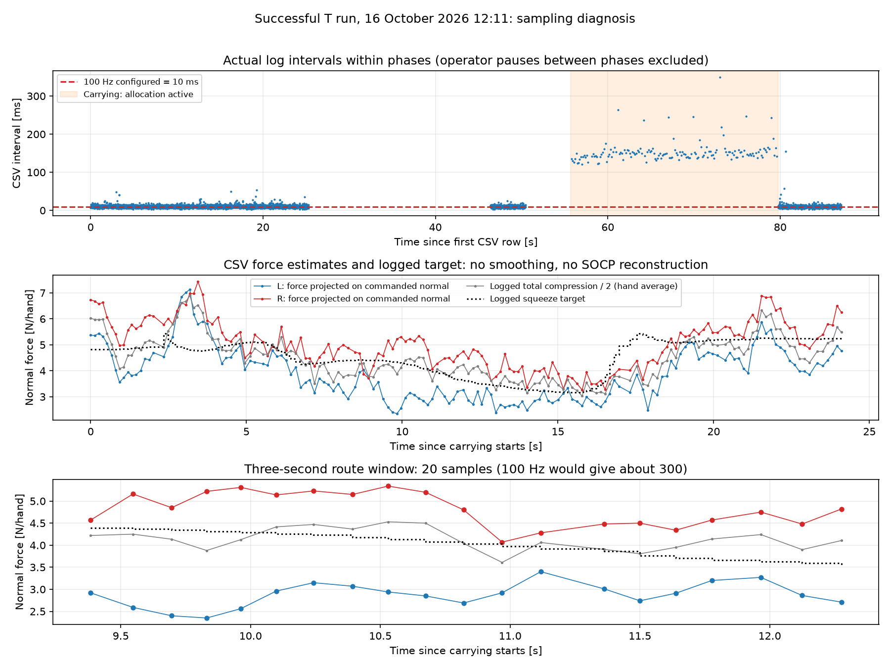

# Forze ondulate nella T riuscita: verifica del 20 ottobre 2026

Analizzato esclusivamente il log della **T riuscita del 16 ottobre, ore 12:11**:
`docs/runs/20261016_1211_F75_Tt1_s9007_riuscito/F75_Tt1_s9007_c100_five_cut800_20261016_121150.csv`.
La Z con esito parziale non e' usata per queste conclusioni. I risultati non
vanno estesi automaticamente ad altre run riuscite di cui non ci sono qui i log.

## Risultato principale

La forma larga a onda e' presente anche nel target di presa registrato: durante
`route` il target varia da **3.16 a 5.44 N/mano**. Le forze stimate delle mani
seguono in parte questo andamento. Non e' una sinusoide imposta dal plot.
Non basta questo log per distinguere oscillazioni fisiche veloci, rumore della
stima e aliasing: il campionamento durante la traiettoria e' molto piu' lento
di quello configurato.

Il config della run richiede `rate_hz: 100`, ma i timestamp effettivi dicono:

| Fase | Campioni | Intervallo mediano | Frequenza effettiva |
|---|---:|---:|---:|
| Movimento iniziale (`to_open_pose`) | 2436 | 10 ms | 96.3 Hz |
| Stretta iniziale (`squeeze`) | 407 | 10 ms | 98.9 Hz |
| Verso ingresso (`to_mouth`) | 16 | 135 ms | 7.44 Hz |
| Traiettoria (`route`) | 123 | 149 ms | 6.45 Hz |
| Discesa finale (`slow_seat`) | 17 | 156.5 ms | 6.23 Hz |
| Ritiro (`retreat`) | 528 | 10 ms | 99.3 Hz |

I 123 campioni di `route` coprono 18.902 s. Il 95esimo percentile degli
intervalli e' 217 ms; il massimo e' **349 ms**. In una finestra di tre secondi
ci sono soltanto **20 campioni**, contro circa 300 attesi a 100 Hz.

Questo spiega perche' le linee unite possono sembrare onde regolari pur
descrivendo pochi punti e non documentano bene vibrazioni di pochi hertz.
I campioni mancano gia' nel CSV: disegnare o interpolare piu' punti non li recupera.
Non si puo' ricostruire univocamente la frequenza fisica di un'oscillazione
veloce da questi dati lenti e irregolari.



## Percorso del codice e limiti dei grafici vecchi

1. `Insertion.tick` invia i due target, attende, legge il backend, esegue
   `_control` e solo dopo scrive una riga tramite `Log.row`.
2. `_control` chiama `_allocate` e il solver nello stesso ciclo. Un ritardo
   dell'allocazione o di un'altra operazione sincrona rallenta quindi sia i
   prossimi comandi di posa sia le righe del CSV. Il collasso di frequenza
   coincide con le fasi in cui e' attiva l'allocazione. E' un forte indizio di
   carico nel ciclo, **non una misura del tempo del solo solver**: il log non
   contiene durate separate di lettura, GMR, compilazione e soluzione SOCP.
3. Il controllo di coppia a basso livello e' un altro processo. I 6.45 Hz qui
   misurati riguardano il ciclo esterno e il suo log; non dimostrano che anche
   il controllo di coppia del robot giri a 6.45 Hz.
4. Il timestamp `t` e' letto quando viene scritta la riga, dopo il controllo,
   mentre la misura era stata letta prima. Non sono salvati gli header stamp
   dei wrench o delle pose: quindi non e' un timestamp di acquisizione del sensore.
5. `analyze_run.py` usa `plot(t, y)`, senza spline, smoothing o sinusoidi. Pero'
   le normali per mano vengono ricostruite da forze stimate e **quaternioni
   comandati**. Il controllore calcola invece `fn_N` usando gli orientamenti
   misurati, non presenti nel log. Durante `route`, la differenza fra somma
   ricostruita e `fn_N` arriva a **1.02 N**, p95 **0.725 N**. Il plot per mano
   e' quindi un'approssimazione, non una registrazione esatta della normale
   usata dal controllore. Nella nuova figura e' mostrato anche `fn_N/2`, che
   e' la media delle due mani, non la forza di ciascuna mano.
6. Le linee tratteggiate SOCP del vecchio grafico sono ricostruzioni offline.
   Il CSV conserva il solo `target_N`, non l'intera soluzione del solver.
   Inoltre l'analizzatore contiene `r_s=0.10` fisso e non passa le nuove opzioni
   del config; rigenerare adesso il grafico con il solver modificato non
   riproduce automaticamente il solver della run storica. Per questa diagnosi
   non e' stato ricalcolato alcun SOCP: il target mostrato e' quello registrato.
7. I segnali sono stime dai sensori di coppia ai giunti, corrette tramite
   baseline, non misure dirette di un F/T al polso. Rumore e bias dipendenti
   dalla posa possono contribuire, senza che questa prova ne separi le cause.

## Pubblicare o registrare piu' velocemente?

Prima si deve **misurare la frequenza dei topic reali e registrare in modo
indipendente dal ciclo di controllo**. La copia locale del controller del lab
prevede wrench e joint states ogni quattro tick del loop nominale a 1 kHz,
circa 250 Hz; questo e' un valore nominale da verificare sul robot.
Il CSV del giro a vuoto `wrench_20261016_112659.csv`, invece, registra circa
70.1 Hz sulla sinistra e 69.5 Hz sulla destra: anche il logger FK/CSV non
dimostra di ricevere e salvare tutti i 250 Hz nominali.

Una registrazione ROS bag in un processo dedicato dei topic wrench, joint states
e target_pose permette di conservare i messaggi e i relativi timestamp senza
aspettare ogni chiamata del solver. Bisogna verificare anche i messaggi persi.
Per analizzare separatamente la distribuzione delle forze conviene registrare
inoltre gli orientamenti misurati, la soluzione SOCP e le durate delle operazioni.

Aumentare solo `rate_hz` a 200/500 non elimina un'operazione sincrona da 150 ms.
La prima priorita' sul controllo esterno e' verificare il tempo di ogni stadio
e mantenere la pubblicazione regolare; la versione DPP attuale riduce il lavoro
di compilazione, ma i tempi sul PC del robot non sono stati misurati qui.
Questa diagnosi non cambia frequenze, guadagni o comportamento del robot.

## Riproduzione

```powershell
python -m kinova_dual_arm_dmp_insertion.inspect_sampling docs/runs/20261016_1211_F75_Tt1_s9007_riuscito/F75_Tt1_s9007_c100_five_cut800_20261016_121150.csv
```

Dipendenze: numpy, scipy, matplotlib. Risultati: `sampling.csv`, `sampling.json`
con hash del sorgente, `sampling.png`. File di ingresso e grafici storici
rimangono invariati. Il nuovo script e' una diagnostica separata.

## Wrench, traiettoria eseguita e giunti: cosa conserva il CSV

Verificato confrontando intestazioni reali e le funzioni che scrivono le righe.

| Dato | CSV di `insert` | CSV di `wrench_log` |
|---|---|---|
| Forze delle due mani | Si: `FxL/FyL/FzL`, `FxR/FyR/FzR`, assi shelf, mano sul pezzo | Si: `fx/fy/fz` assi ee e `Fbx/Fby/Fbz` assi base, convenzione del topic |
| Momenti delle due mani | **No**, anche se il backend li legge | Si: `tx/ty/tz`, assi ee e polo del messaggio |
| Posizione eseguita | Si: `mxL/myL/mzL`, `mxR/myR/mzR`, da FK sul feedback dei giunti | Si: `px/py/pz`, posizione ee da FK |
| Posizione e orientamento comandati | Si: `x/y/z` e `qx/qy/qz/qw` per mano | No |
| Orientamento misurato | No | Non scritto direttamente; ricostruibile dai giunti con URDF corretto |
| Angoli dei giunti | **No** | Si: `q1..q7` per braccio |
| Effort dei giunti | **No** | Si: `tau1..tau7` per braccio |
| Velocita' dei giunti | No | No |
| Posa reale dell'oggetto | **No** | No |

Le posizioni eseguite indicano l'origine del tool/flangia ricostruita da
cinematica diretta e calibrazione, non una misura indipendente da camera o
tracking dell'oggetto. La deformazione del tool sulle molle non viene osservata.
I quaternioni del CSV `insert` sono i target: non vanno presentati come misurati.

Il `wrench_log` disponibile per questa sessione e' il **giro a vuoto** della
baseline, non l'inserimento riuscito. I suoi giunti e momenti non descrivono
quindi il movimento con il pezzo. Il README della run cita anche una bag sul PC
del robot, `~/lorenzo/bags/sessione_1016_1211`, non copiata qui. Se quella bag
contiene i topic wrench e joint_states dell'inserimento, si possono recuperare
da li' momenti, giunti e pose complete. La presenza dei topic deve essere verificata.

Sono stati aggiunti due plot esclusivamente dei dati disponibili, senza
ricalcolare il solver o sostituire campioni mancanti:

- [Forze cartesiane delle due mani](forces_xyz.png): le sei componenti di forza
  totali (tre per mano), non due wrench completi da sei componenti ciascuno.
- [Posizione comandata ed eseguita](trajectory_xyz.png): x/y/z delle due mani
  sulle stesse righe del CSV; campionamento lento invariato.

`position_comparison.json` riporta lo scarto geometrico comando-feedback delle
righe. Non separa elasticita', errore di inseguimento e disallineamento temporale
dei messaggi, perche' mancano i timestamp di acquisizione individuali.
