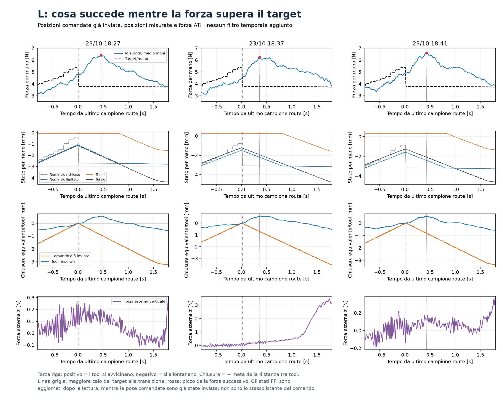

# L: cronologia della sovraelongazione nello slow_seat

Approfondimento sui CSV reali delle tre L. Archivio NVIDIA_RUNS usato solo in
lettura. Script riproducibile: `transient_diagnosis.py`; numeri completi in
`L_transient_chronology.json`.

**Il picco non coincide con un comando che continua a stringere:** il comando
è già passato all'apertura, mentre i tool misurati continuano ad avvicinarsi.
L'evento si ripete in tutte e tre le prove.

| Run | Target prima/dopo il cambio [N/mano] | Forza media mani al cambio/picco [N] | Picco dopo il cambio [s] | Apertura totale comandata fra cambio e picco [mm] | Avvicinamento totale misurato fra tool [mm] |
|---|---:|---:|---:|---:|---:|
| 18:27 | 5,36 / 3,79 | 4,80 / 6,43 | 0,446 | 1,88 | 1,10 |
| 18:37 | 5,36 / 3,79 | 4,48 / 6,23 | 0,339 | 1,44 | 1,17 |
| 18:41 | 5,36 / 3,79 | 4,93 / 6,61 | 0,413 | 1,60 | 1,10 |

Il piano chiede più stretta alla fine della route e poi diminuisce bruscamente
il target entrando in slow_seat. Il nominale applicato passa all'apertura a
2 mm/s per mano; il movimento misurato, invece, continua temporaneamente verso
una distanza fra tool inferiore. La forza cresce ancora e raggiunge il massimo
dopo circa 0,34–0,45 s. È evidenza di una risposta transitoria di inseguimento
della presa caricata, compatibile con la risposta ritardata al comando precedente.
Non è, da sola, un'identificazione di un ritardo puro o di una sua singola causa.

Durante il tratto fra calo del target e picco il trim I resta invariato in tutte
e tre le prove. Nel codice il feedforward ha priorità sul budget di velocità
complessivo. Mentre il nominale apre già a 2 mm/s, l'I non può aggiungere altra
velocità di apertura. Aumentare il suo gain non supera questo vincolo.
Non si tratta di trim a fondo corsa: al picco il trim vale circa −0,061, +0,264
e +0,327 mm contro il limite ±3 mm. Non è una prova di windup.

Il solo cambiamento di forza richiesto, 5,36 → 3,79 N/mano, corrisponde nel
modello a 1,57/680 = 2,31 mm di apertura per mano, cioè circa 1,15 s al limite
di 2 mm/s, senza contare la dinamica del basso livello. Il piano inverte quindi
la richiesta molto più rapidamente di quanto il nominale possa assestarla.

La forza esterna verticale al picco è circa 0,20, 0,15 e 0,13 N. Non si vede
un aumento verticale paragonabile al picco della stretta nelle prime e terze
prove; nella seconda un forte carico verticale cresce più tardi. Non attribuisco
quindi automaticamente tutta la sovraelongazione a un urto con la board.
Un contatto o un momento potrebbero comunque contribuire: i soli log non li
escludono in ogni direzione.

La distanza euclidea fra tool è usata qui per confrontare comando e movimento
misurato. La sua metà è una **chiusura equivalente**, non la misura diretta
della compressione di ciascuna molla: orientamenti e geometria di contatto cambiano.
Non uso questi incrementi per identificare una rigidezza assoluta del pad.

Non possiamo isolare da queste sole tre prove quanto della dinamica derivi da
servo di posizione, attrito, filtri, elasticità o interazione col pezzo. Possiamo
però distinguere il meccanismo osservato: richiesta nominale che sale e poi
scende rapidamente, movimento reale ancora in chiusura dopo l'inversione del
comando, limite di velocità che impedisce all'I di aggiungere apertura.

La verifica successiva motivata è il raccordo temporale di quella richiesta,
preservando le forze necessarie al compito, e la misura della risposta del
movimento normale caricato. Non è giustificato cambiare alla cieca KI o superare
il limite di velocità soltanto per inseguire quel picco.

