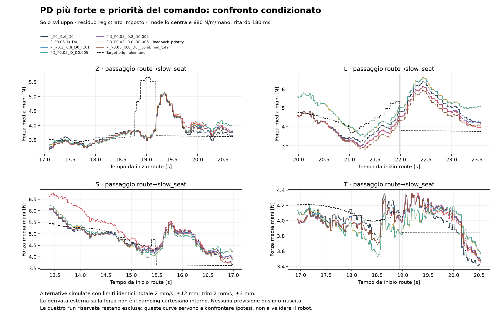
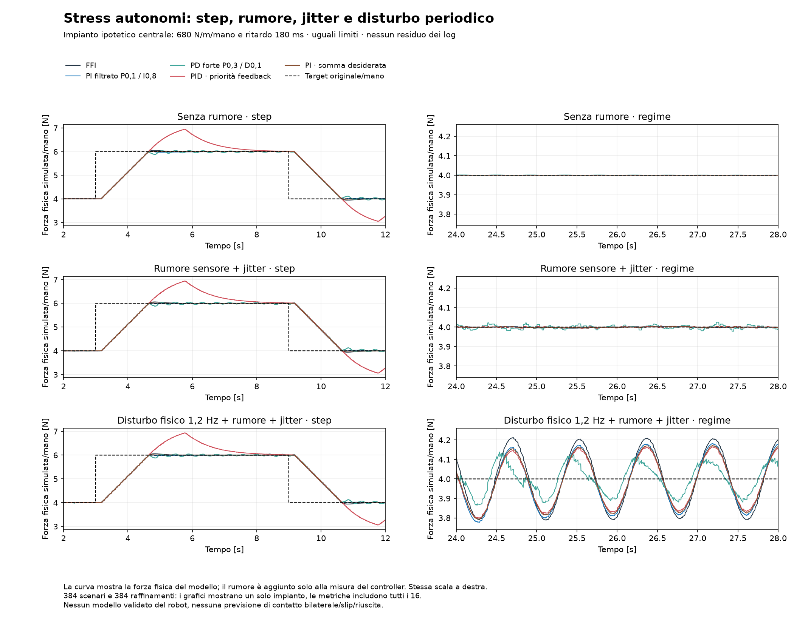

# PD più forte, filtraggio e priorità di velocità

**Esito: nessun nuovo controllore sostenuto dai dati. Nessun cambio al robot.**

Confrontati 112 candidati ×16 modelli ×8 run di sviluppo = **14,336 replay condizionati**. La griglia comprende P fino a 0,8 mm/N, D fino a 0,1 mm s/N, I 0/0,4/0,8 mm/(N s), filtro D 50ms e un ulteriore roll-off P+D 30/100ms. Le leggi iniziali restano nel confronto. Il kernel esteso riproduce tutte le 5.888 combinazioni precedenti: quattro metriche confrontate, differenze numeriche esattamente zero.

Il filtro P+D è causale; I separata con antiwindup sul trim effettivamente ottenuto. Le famiglie P/PD hanno solo un bias fisso di ingresso e nessuna I nascosta. Non si filtra o sostituisce il target originale per calcolare gli errori. Il residuo delle forze reali resta imposto: nessuno dei modelli empirici aveva superato il gate di simulazione libera. Questi risultati non prevedono la forza reale dopo un cambio di controllo.

## Confronto principale: stessi limiti e priorità FFI

Il miglior punteggio aggregato è del PI P0,1/I0,8, roll-off P100ms: 11.8447 contro 11.8874 della FFI, miglioramento **0.36%**. È inferiore all'incertezza del modello, non una prova di miglioramento del robot. Lo score combina RMSE, banda, p95 e picco finale, non è una soglia fisica o di sicurezza.

| Candidato | Score robusto ↓ | Δ score vs FFI | RMSE route centrale | Banda0,8–2,5 centrale | Banda2,5–10 centrale | Picco L centrale | Minimo medio mani su tutti i modelli |
|---|---:|---:|---:|---:|---:|---:|---:|
| `I_P0_I1.6_D0` | 11.887 | +0.00% | 0.350 N | 0.101 N | 0.057 N | 6.310 N | 2.425 N |
| `P_P0.05_I0_D0` | 15.844 | +33.29% | 0.495 N | 0.081 N | 0.059 N | 6.429 N | 0.688 N |
| `PI_P0.1_I0.8_D0_R0.1` | 11.845 | -0.36% | 0.358 N | 0.093 N | 0.057 N | 6.051 N | 2.427 N |
| `PD_P0.05_I0_D0.005` | 15.775 | +32.70% | 0.495 N | 0.079 N | 0.061 N | 6.410 N | 0.640 N |
| `PID_P0.05_I0.8_D0.005` | 11.960 | +0.61% | 0.360 N | 0.086 N | 0.060 N | 6.034 N | 2.282 N |
| `PID_P0.05_I0.8_D0.005__feedback_priority` | 12.767 | +7.40% | 0.391 N | 0.087 N | 0.060 N | 6.020 N | 0.381 N |
| `PI_P0.05_I0.8_D0__combined_total` | 12.157 | +2.27% | 0.384 N | 0.090 N | 0.058 N | 5.801 N | 2.126 N |

Colonne centrali: medie delle8 run (picco L sulle due L). Score: media per run del peggiore tra16 modelli. La colonna minimi può provenire da altri scenari. Tutte le forze sono medie fra mani; non garantiscono entrambi i contatti.

Il migliore fra i PD nuovi con D≥0,03 mm s/N è `PD_P0.1_I0_D0.03_R0.1`, score17.752. L'estensione del guadagno e il roll-off non hanno prodotto un vincitore robusto nella griglia. **Nessuno** dei112 candidati rispetta tutte le soglie provvisorie su tutti i casi.

## Priorità nominale contro feedback: esperimento separato

Sei leggi predefinite sono confrontate con3 allocazioni: originale nominale-prima, feedback-prima, e proiezione della somma desiderata seguita da ripartizione a pesi uguali. In tutte: velocità FF e trim≤2mm/s, somma≤2mm/s; FF±9mm, trim±3mm, somma±12mm. Verificate240.000 proiezioni casuali raggiungibili, oltre a tutte le traiettorie simulate.

| Legge fissata | Allocazione | Δ score rispetto alla stessa legge FFI | Minimo medio mani |
|---|---|---:|---:|
| `PI_P0.05_I0.8_D0` | combined_total | +2.24% | 2.126 N |
| `PID_P0.05_I0.8_D0.005` | combined_total | +1.83% | 2.119 N |
| `I_P0_I1.6_D0` | combined_total | +5.11% | 2.399 N |
| `PID_P0.05_I0.8_D0.005` | feedback_priority | +6.75% | 0.381 N |
| `PI_P0.05_I0.8_D0` | feedback_priority | +7.95% | 0.430 N |
| `I_P0_I1.6_D0` | feedback_priority | +11.11% | 0.371 N |
| `PID_P0.3_I0.8_D0.1_R0.1` | combined_total | +0.66% | 1.881 N |
| `PID_P0.3_I0.8_D0.1_R0.1` | feedback_priority | +4.94% | 0.322 N |
| `PD_P0.2_I0_D0.015` | feedback_priority | -2.63% | 1.980 N |
| `PD_P0.2_I0_D0.015` | combined_total | +1.12% | 1.932 N |
| `PD_P0.3_I0_D0.03_R0.03` | feedback_priority | -2.03% | 2.426 N |
| `PD_P0.3_I0_D0.03_R0.03` | combined_total | +1.18% | 2.359 N |

Dare priorità al feedback può ridurre un picco locale e peggiorare offset/minimi altrove. Non basta scegliere il tracciato più gradevole sulla L. Questi sono compromessi sotto residuo fisso, non causalità osservata.

## Raffinamento: fallimento conservato

128 casi su4 pezzi/4 modelli, compreso un PD forte aggiuntivo, confrontati5→2,5ms e5→1,25ms. Il criterio iniziale era ΔRMSE<0,03N, Δbanda<0,01N e Δpicco<0,05N. **La verifica complessiva fallisce**: non è stata allargata la tolleranza.

5→2,5ms: massimo ΔRMSE0.0265N, Δbanda0.0180N, Δpicco0.0555N. 5→1,25ms: ΔRMSE0.0391N, Δbanda0.0188N, Δpicco0.0627N.

Il caso critico è `PD_P0.3_I0_D0.1_R0.1` con modello1500N/m e230ms. La shortlist moderata senza questo caso ha5→2,5ms: ΔRMSE≤0.0025N, Δbanda≤0.0006N, Δpicco≤0.0218N. Sono verifiche di un sottoinsieme, non di tutta la griglia.

Nel replay vengono arrotondati alla griglia i timestamp FFI registrati; il passo modifica anche il posizionamento degli aggiornamenti e degli scalini del residuo. La sensibilità del PD forte non dimostra da sola instabilità continua o divergenza del simulatore. I valori5ms di quel candidato non sono convergenti entro le tolleranze dichiarate. Conservati JSON dei fallimenti e script con assert originali.

## Stress autonomi: senza forza registrata imposta

Congelate8 ipotesi prima dello stress, senza ulteriore tuning:16 impianti ×3 varianti =384 casi, più384 raffinamenti. Target4→6→4N/mano; rumore sintetico0,013N/mano e tick15–35ms; terza variante con disturbo fisico sinusoidale0,15N/mano a1,2Hz da12s e offset+0,5N/mano16–22s. Il rumore è uguale fra candidati e modelli; il controllo vede solo la misura presente/passata. La forza alternativa deriva interamente da impianto, comandi e disturbo sintetici.

| Ipotesi | Variante | Peggior overshoot salita | Peggior undershoot discesa | Peggior banda finale | Peggior errore a regime | Minimo medio mani |
|---|---|---:|---:|---:|---:|---:|
| `I_P0_I1.6_D0` | clean | 1.024 N | 1.024 N | 0.000 N | 0.085 N | 2.976 N |
| `I_P0_I1.6_D0` | noise_jitter | 0.992 N | 0.991 N | 0.005 N | 0.070 N | 3.009 N |
| `I_P0_I1.6_D0` | physical_wave_noise_jitter | 0.992 N | 0.991 N | 0.274 N | 0.070 N | 3.009 N |
| `P_P0.05_I0_D0` | clean | 2.181 N | 0.093 N | 0.000 N | 1.398 N | 3.907 N |
| `P_P0.05_I0_D0` | noise_jitter | 2.184 N | 0.093 N | 0.001 N | 1.399 N | 3.907 N |
| `P_P0.05_I0_D0` | physical_wave_noise_jitter | 2.184 N | 0.093 N | 0.114 N | 1.399 N | 3.836 N |
| `PD_P0.05_I0_D0.005` | clean | 2.146 N | 0.085 N | 0.000 N | 1.399 N | 3.915 N |
| `PD_P0.05_I0_D0.005` | noise_jitter | 2.162 N | 0.084 N | 0.001 N | 1.400 N | 3.916 N |
| `PD_P0.05_I0_D0.005` | physical_wave_noise_jitter | 2.162 N | 0.084 N | 0.111 N | 1.400 N | 3.839 N |
| `PID_P0.05_I0.8_D0.005` | clean | 1.259 N | 1.259 N | 0.000 N | 0.121 N | 2.741 N |
| `PID_P0.05_I0.8_D0.005` | noise_jitter | 1.266 N | 1.271 N | 0.002 N | 0.120 N | 2.729 N |
| `PID_P0.05_I0.8_D0.005` | physical_wave_noise_jitter | 1.266 N | 1.271 N | 0.141 N | 0.120 N | 2.729 N |
| `PI_P0.1_I0.8_D0_R0.1` | clean | 1.080 N | 1.080 N | 0.000 N | 0.132 N | 2.920 N |
| `PI_P0.1_I0.8_D0_R0.1` | noise_jitter | 1.080 N | 1.081 N | 0.003 N | 0.131 N | 2.919 N |
| `PI_P0.1_I0.8_D0_R0.1` | physical_wave_noise_jitter | 1.080 N | 1.081 N | 0.202 N | 0.131 N | 2.919 N |
| `PD_P0.3_I0_D0.1_R0.1` | clean | 1.753 N | 0.436 N | 0.279 N | 0.927 N | 3.520 N |
| `PD_P0.3_I0_D0.1_R0.1` | noise_jitter | 1.745 N | 0.437 N | 0.274 N | 0.923 N | 3.504 N |
| `PD_P0.3_I0_D0.1_R0.1` | physical_wave_noise_jitter | 1.745 N | 0.437 N | 0.370 N | 0.923 N | 3.355 N |
| `PI_P0.05_I0.8_D0__combined_total` | clean | 2.305 N | 2.305 N | 0.000 N | 0.121 N | 1.695 N |
| `PI_P0.05_I0.8_D0__combined_total` | noise_jitter | 2.274 N | 2.326 N | 0.002 N | 0.136 N | 1.674 N |
| `PI_P0.05_I0.8_D0__combined_total` | physical_wave_noise_jitter | 2.274 N | 2.326 N | 0.160 N | 0.136 N | 1.674 N |
| `PID_P0.05_I0.8_D0.005__feedback_priority` | clean | 1.271 N | 1.271 N | 0.000 N | 0.337 N | 2.729 N |
| `PID_P0.05_I0.8_D0.005__feedback_priority` | noise_jitter | 1.339 N | 1.327 N | 0.002 N | 0.341 N | 2.673 N |
| `PID_P0.05_I0.8_D0.005__feedback_priority` | physical_wave_noise_jitter | 1.339 N | 1.327 N | 0.141 N | 0.341 N | 2.673 N |

Gli estremi possono appartenere a modelli diversi. Banda finale calcolata24–32s con taglio bordi1,5s; errore a regime nelle finestre7–9 e11–12s. Overshoot3–9s, undershoot9–12s. Nei JSON sono inclusi i tempi10–90%, i valori per ogni modello, la saturazione e il secondo intervallo di banda.

Raffinamento2,5→1,25ms con **identici eventi di controllo e identico rumore**: ΔRMSE massimo0.000193N, Δovershoot0.000005N, Δbanda0.000312N. Qui l'effetto del passo è contenuto; ciò non valida gli impianti ipotizzati.

Verifica indipendente della baseline autonoma con la vera classe numerica NominalIntegral estratta dal sorgente: **61.648 aggiornamenti su 48 scenari**, errore comando esattamente zero. Nessuna importazione ROS.

Nel caso PD forte alcuni impianti ipotizzati mantengono una banda di circa 0,28N RMS anche senza rumore o disturbo esterno. Questo mostra un rischio del guadagno nel modello, non identifica la causa delle onde del robot. Una maggiore reazione al rumore è visibile nel confronto a pari scala delle figure.

## Damping e prossima decisione

D esterno sulla forza e cart_d interno sulla velocità restano due interventi diversi. Nessuno di questi test risolve la mancanza del sorgente del servo interno o di un confronto D-only a FFI fissa. Rimane prioritario il protocollo DAMPING_AB_PROTOCOL.md; non sono stati cambiati K, D o sorgenti di produzione.

Le4 run riservate restano escluse. Il prossimo studio è una preview del vero profilo offline o una pianificazione fattibile in velocità, con target originale nelle metriche e senza usare il futuro della misura o gli orari futuri registrati delle fasi. Solo dopo congelare i finalisti e valutare una volta il holdout retrospettivo.

## Figure e riproduzione

Sorgenti: advanced_controllers.py, advanced_refinement.py, advanced_autonomous_stress.py e advanced_report.py; disegni congelati advanced_controller_design.json e advanced_autonomous_design.json. Kernel conditional_controllers.py esteso con roll-off opzionale e callback di allocazione; default identico ai risultati precedenti. Il kernel precedente è conservato nel checkpoint2314. Tutti gli output restano nella directory di campagna; gli originali sono solo letti.
