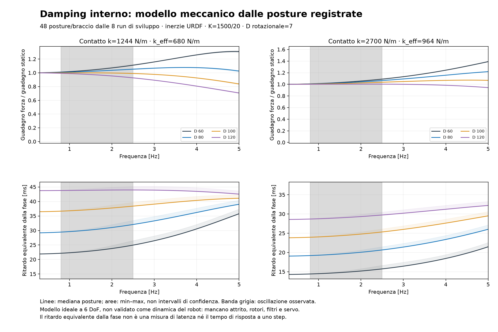
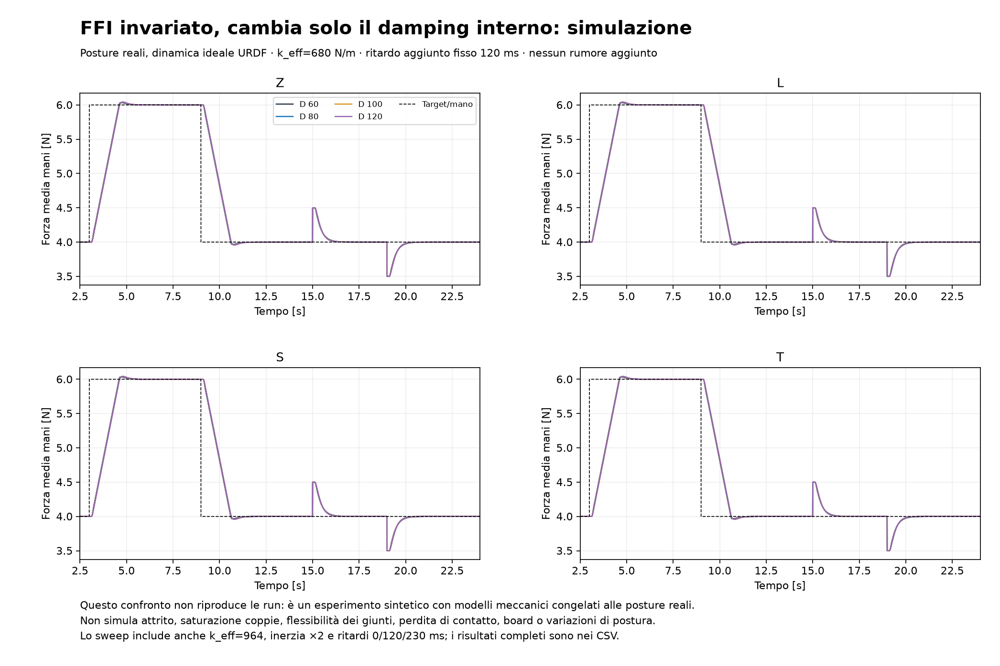
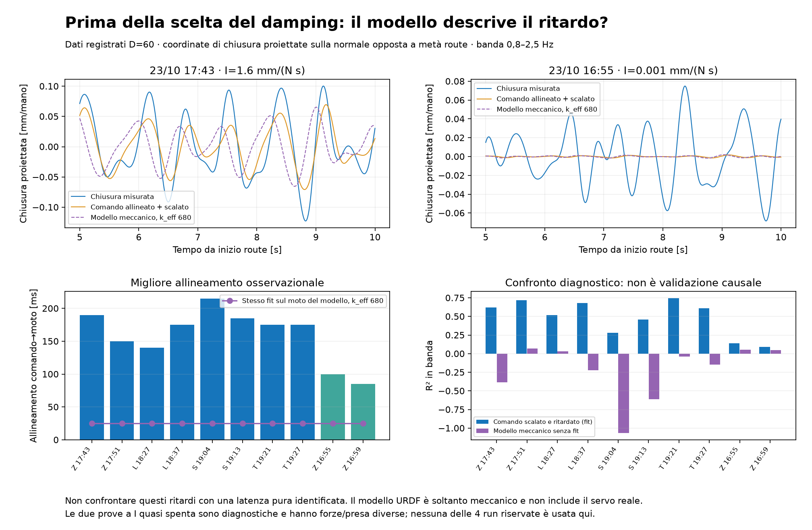

# Damping interno: risultati della prima verifica fisica

**Conclusione provvisoria: non è dimostrato che basti aumentare cart_d.** Un modello meccanico coerente con URDF e posture consente di studiare il damping, ma non descrive l’onda e il ritardo delle run. I numeri dello sweep non sono una previsione quantitativa del robot.

## Che cosa è stato verificato

- Sorgenti del controllo interno `kinova_control/kinova_controller.py` non trovati nella ricerca mirata sul Desktop. Il repository contiene launch, parametri e URDF, non l’implementazione del servo. Non si presume che parametri e legge interna coincidano con un altro robot.
- Solo 8 run FFI di sviluppo, 3 istanti per route e 2 bracci = 48 campioni di postura. Le 4 run riservate non sono state lette da questo studio. Due ulteriori Z a I quasi spenta sono diagnostiche.
- Cinematica URDF confrontata con le pose misurate dei CSV: massimo errore posizione 7.48 µm; orientamento 1.48e-05 rad. Questi scarti sono compatibili con pose/quaternioni CSV arrotondati a 5 decimali.
- Jacobiano geometrico confrontato con differenze finite su 16 posture centrali: errore massimo 2.38e-10. Matrice di massa simmetrica positiva definita in tutte le posture.
- 384 risposte in frequenza: 48 posture × 2 rigidezze di contatto × D=60/80/100/120. Poi 192 scenari autonomi FFI a due mani e 192 raffinamenti numerici.

## Modello fisico dichiarato

Matrice articolare M costruita sommando energie cinetiche di link e payload URDF, Jacobiano J al flange, inerzia cartesiana Λ=(J M⁻¹ Jᵀ)⁻¹. Il modello conserva gli accoppiamenti delle sei coordinate cartesiane; non assegna una massa scalare arbitraria a ogni asse.

`Λ ẍ + D ẋ + (K + kc b bᵀ)x = K b u`, con `F = kc bᵀ x`.

K=diag(1500,1500,1500,20,20,20); D=diag(d,d,d,7,7,7). b è la normale del tool registrata nella base del rispettivo braccio, con componenti rotazionali nulle. Contatto normale lineare che agisce lungo l’asse flange-pad, senza rigidezza di piegamento o vincoli tangenziali. Il pezzo è idealizzato come supporto fisso per ogni braccio. La dinamica del pezzo libero, i contatti con la board e la flessibilità della molla fuori asse non sono incluse.

Due ipotesi di contatto: kc=1243,9 N/m per ottenere k_eff=680 N/m dalla serie con K=1500; kc=2700 N/m è il valore nominale della molla documentato, che porta k_eff=964,3. Il primo valore è ricavato dal nominale del controller, **non** una nuova calibrazione indipendente del contatto.

Nessuna inerzia riflessa dei rotori, attrito, filtraggio velocità, servo o ritardo hardware è identificata qui. Il contatto normale lineare può ammettere forze negative: nello sweep le forze rimangono positive, ma questo non verifica unilateralità/slip o stabilità dei sei pad.

La necessità di considerare inerzia, Jacobiano e accoppiamenti nella scelta del damping è trattata nel lavoro primario [Kao e Saldarriaga, 2021](https://link.springer.com/article/10.1186/s40648-021-00199-0). Quel lavoro supporta il metodo generale, non identifica i parametri di questo Kinova.

## Quanto attenua il solo impianto ideale

La tabella riguarda **ampiezza della risposta forzata a un comando sinusoidale di posizione**, non RMS della forza reale né smorzamento di un ciclo limite autoeccitato. Intervalli sulle mediane delle posture delle due ipotesi di contatto.

| D traslazionale | Attenuazione aggiuntiva a 1 Hz vs D60 | A 2 Hz | Fase equivalente a 1 Hz |
|---|---:|---:|---:|
| 60 | 0.00–0.00% | 0.00–0.00% | 14.50–22.33 ms |
| 80 | 0.32–0.75% | 1.37–3.21% | 19.30–29.62 ms |
| 100 | 0.73–1.69% | 3.05–6.92% | 24.05–36.79 ms |
| 120 | 1.22–2.81% | 5.00–10.92% | 28.77–43.80 ms |

Il damping riduce la risonanza del modello soprattutto a frequenze più alte. A 1 Hz D80 ha un effetto piccolo sull’ampiezza forzata. Il ritardo equivalente è −fase/(2πf), non latenza pura né tempo di salita.

## FFI invariato: esperimenti autonomi

Si applicano step 4→6→4 N/mano e un disturbo additivo +0,5 N/mano tra 15 e 19 s. FFI con I=1,6 mm/(N s), nominale k_eff=680, priorità e limiti originali. Una postura centrale della prima run di sviluppo per ciascuno dei quattro pezzi; le risposte dei due bracci sono simulate separatamente e sommate nel feedback. Per ogni coppia: due contatti × inerzia URDF 1×/2× × ritardo aggiunto 0/120/230 ms × quattro D. Inerzia 2× è stress ipotizzato, non massa misurata; ritardo aggiunto è mantenuto uguale per tutte le D, senza inventare una mappa D→ritardo. Nessun rumore aggiunto in questo sweep.

Esempio Z, contatto k_eff=680, inerzia 1×, ritardo aggiunto 120 ms:

| D | Sovraelongazione salita | RMSE, inclusi transitori | Tempo al 90% dallo step |
|---|---:|---:|---:|
| 60 | 0.0336 N | 0.4944 N | 1.455 s |
| 80 | 0.0372 N | 0.4973 N | 1.465 s |
| 100 | 0.0404 N | 0.5000 N | 1.470 s |
| 120 | 0.0434 N | 0.5028 N | 1.475 s |

Qui più D aumenta leggermente il picco dell’anello FFI: il minore picco risonante del solo impianto non implica automaticamente minore overshoot dell’intero anello integrale ritardato. Questo non prova che D80 peggiorerà il robot; dimostra che non si può scegliere D dalla sola intuizione “più damping”. Le tracce complete e tutti i minimi per mano sono nei CSV/NPZ.

## Il limite decisivo: confronto con i dati

Sulle 8 FFI di sviluppo, il migliore allineamento in banda comando→moto è 140–215 ms. È un fit osservazionale di ritardo e guadagno, non una latenza causale identificata. La qualità R² varia circa 0,28–0,75, quindi un ritardo puro non descrive tutto il moto.

Sullo stesso segnale di comando, il modello meccanico ideale produce invece un allineamento di circa 15–25 ms. È stato confrontato sia con solo comando normale, sia usando tutti i sei comandi cartesiani registrati (posizione e piccolo angolo base rispetto alla postura centrale). Nessun guadagno/ritardo è tarato nel confronto diretto modello→moto misurato.

| Ipotesi di contatto | R² modello con comandi completi, min–max sulle 8 run |
|---|---:|
| k_eff 680 N/m | -1.093–0.070 |
| k_eff 964 N/m | -0.506–0.136 |

**Questo modello è insufficiente come previsore del moto registrato**. Sono state verificate cinematica e implementazione numerica; non è stata validata la dinamica del robot. Il confronto diagnostico può essere influenzato dal supporto del pezzo, dalla linearizzazione a postura fissa e dai contatti omessi: non isola da solo il servo come unica causa.

Nelle due Z con I quasi spenta, l’allineamento comando→moto ha R² soltanto 0,09–0,14: non è sensato usare quei fit per identificare una nuova latenza precisa. Il moto osservato e la forza restano invece fortemente associati. La coordinata è la chiusura della coppia proiettata su una normale fissa, **non** una misura indipendente della compressione dei pad. Le prove hanno forze iniziali diverse e sono state interrotte; non sono confronti controllati del solo gain.

Quindi la piccola attenuazione forzata prevista per D80 **non esclude** che il damping possa ridurre un’oscillazione reale autoeccitata, dovuta per esempio a dinamiche o attrito non rappresentati. Manca il modello di quel meccanismo: trasformare lo sweep in una percentuale di miglioramento reale sarebbe scorretto.

## Una variante più mirata da confrontare

Nelle 48 posture, la normale di chiusura è quasi parallela all’asse **y della base di ciascun braccio** (|n_y| minimo 0.990). La configurazione documenta K/D nelle basi dei rispettivi robot. Si può quindi confrontare anche `60 80 60 7 7 7` con `80 80 80 7 7 7`, anziché aumentare automaticamente tutti gli assi. Questa è una proposta di confronto, non una modifica applicata.

Nel modello ideale l’aumento solo su y conserva quasi tutta la variazione di risposta normale dell’aumento isotropo, evitando quasi tutta la fase aggiunta alla risposta verticale. A 1 Hz: extra ritardo verticale mediano circa 13.09 ms isotropo contro 0.0035 ms solo y. Anche questi sono risultati del modello, non misure reali.

## Protocollo minimo ancora necessario

Vedere DAMPING_AB_PROTOCOL.md: confronti ripetuti a FFI/K/target invariati, registrando insieme forza, moto e timestamp. Non è stato eseguito alcun comando al robot. L’assenza del sorgente interno e di un confronto D-only impedisce una raccomandazione quantitativa affidabile di un nuovo damping. I dati attuali giustificano un esperimento mirato, non il valore “giusto”.

## Verifiche numeriche e riproducibilità

Discretizzazione esatta ZOH del sistema lineare a 5 ms, ripetuta a 2,5 ms per tutti i 192 scenari; tick FFI 25 ms identico. Massima differenza RMSE: 0.000643 N; overshoot 0.000245 N. Limite comando 2 mm/s verificato in tutti i casi. I campioni di forza immediatamente allo step di disturbo sono discontinui per costruzione: un damping finito non rimuove una discontinuità additiva imposta all’uscita.

Sorgenti: rigid_model.py, damping_physics.py, model_consistency.py, damping_axis.py, damping_report.py. Input fisico URDF con SHA-256 in urdf_model_validation.json; q/posture in urdf_postures_development.json. Metriche complete damping_frequency_metrics.csv/json, damping_closedloop_metrics.csv/json, model_observational_consistency.json e damping_axis_metrics.json. Le figure sono state ispezionate. NVIDIA_RUNS e la baseline conservata sono immutate.
