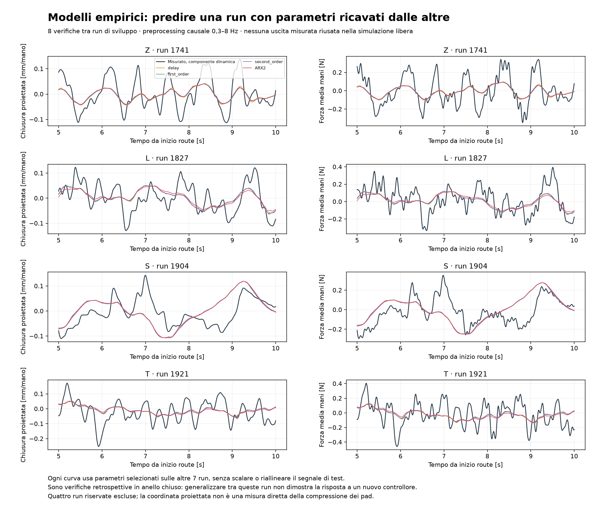
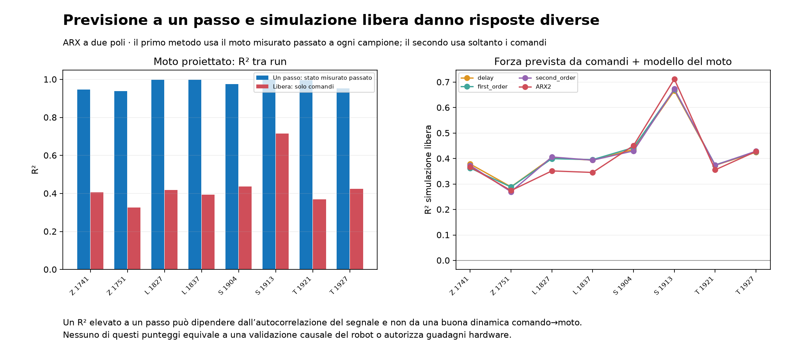
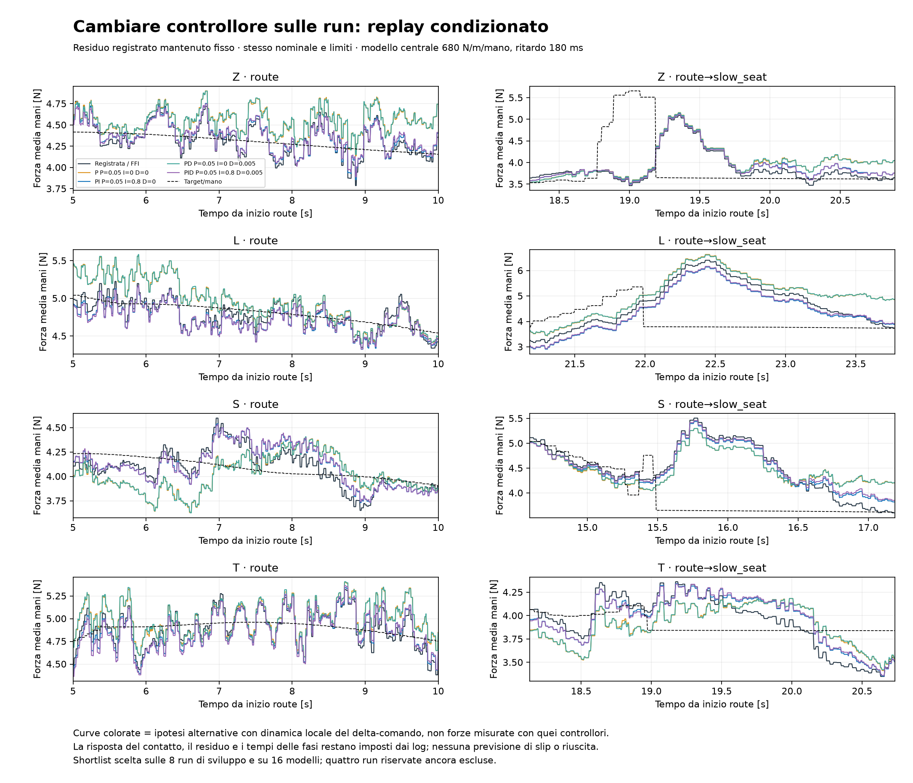

# Modelli empirici e confronto dei controllori — risultati di sviluppo

**Nessun nuovo controllore è ancora validato sul robot.** I modelli empirici migliorano la descrizione rispetto al solo URDF, ma non ricreano la maggior parte dell’onda partendo dai comandi. Nel replay condizionato, la FFI attuale e un PI più lento risultano praticamente alla pari nel criterio robusto; P/PD da soli lasciano offset importanti. Nessuna famiglia soddisfa tutti gli obiettivi provvisori nelle ipotesi esplorate.

## 1. Capacità di descrivere una run usando le altre

Si usano le otto run di sviluppo già congelate: due Z, due L, due S, due T. In ogni fold si stimano parametri sulle altre sette e si calcola l’ottava senza aggiustarne guadagno o ritardo. Quattro run riservate non sono usate in questo studio. La cross-validation è retrospettiva, nello stesso regime FFI; le run non sono esperimenti con eccitazione indipendente né un campione di tutti i tentativi.

Il comando e il moto sono la chiusura della coppia proiettata su una normale opposta fissa, definita dalla **prima** posa osservata della route. Non si usa la posa futura di metà route per definire il sistema di coordinate di questo studio. Non si tratta di una misura diretta della compressione dei singoli pad.

Campionamento ZOH causale a 100 Hz; filtro causale Butterworth ordine 2, banda 0,3–8 Hz, stato iniziale zero dopo sottrazione del primo campione. Valutazione da 3 s a fine route meno 0,5 s. Questa banda e questa coordinata differiscono dalla verifica meccanica precedente: i due R² non vanno confrontati come fossero la medesima prova.

Provati 316 modelli LTI a ritardo/polo/due poli e 54 configurazioni ARX a due poli con regolarizzazione. Ogni famiglia è selezionata per errore di **simulazione libera** sui dati di stima, con peso normalizzato uguale per run. Poli ARX instabili sono esclusi. Non si seleziona sul punteggio della run di verifica. Il rapporto forza/moto è stimato solo sulle sette run di training e poi applicato alla run di verifica.

| Famiglia | R² moto libero: min / mediana / max | R² forza da comandi: min / mediana / max | RMSE forza da comandi, mediana |
|---|---:|---:|---:|
| delay | 0.341 / 0.422 / 0.663 | 0.289 / 0.398 / 0.667 | 0.141 N/mano |
| first_order | 0.339 / 0.427 / 0.668 | 0.288 / 0.398 / 0.671 | 0.141 N/mano |
| second_order | 0.320 / 0.420 / 0.670 | 0.270 / 0.400 / 0.673 | 0.142 N/mano |
| ARX2 | 0.326 / 0.412 / 0.716 | 0.274 / 0.361 / 0.712 | 0.142 N/mano |

Tutti i modelli falliscono la soglia esplorativa dichiarata prima dello studio: mediana R² della forza ≥0,7 e peggiore run ≥0,5. Questa soglia è un filtro di qualità provvisorio della ricerca, non un criterio di accettazione della tesi.

Se invece si fornisce il **moto già misurato**, il rapporto forza/moto della componente dinamica dà R² 0.835–0.983, mediana 0.926. Questo sostiene l’associazione della variazione di forza con il moto reale e la deformazione, ma non identifica quale meccanismo generi quel moto. Non dimostra che il rumore ATI sia nullo, né che la dinamica dei sei pad sia scalare.

### Perché il fit a un passo può ingannare

ARX: mediana R² del moto **a un passo** 0.985, contro 0.412 in **simulazione libera**. Il primo usa il moto misurato passato a ogni campione; il secondo usa solo il comando e lo stato iniziale. Un segnale molto autocorrelato può quindi essere previsto bene a 10 ms senza avere un buon modello della risposta al comando.

La distinzione tra predizione con misure passate e simulazione con soli ingressi è spiegata nella [documentazione primaria MathWorks](https://www.mathworks.com/help/ident/ug/definition-simulation-and-prediction.html). Una buona verifica nello stesso regime non dimostrerebbe comunque la risposta causale a un nuovo controllore.

### Verifiche software

Su un sistema noto generato separatamente, ARX recupera il ritardo 8 campioni e i coefficienti con errore massimo 6.22e-15; simulazione su una nuova sequenza di ingresso R²=1. Sono verificati anche i prefissi causali: alterare i campioni futuri non modifica il passato del filtro o dei 316 modelli. Queste verifiche controllano il software, **non validano il robot**.

## 2. Cambiare il controllore senza fingere che il modello sia già validato

Eseguiti **5.888 replay condizionati**: 8 run × 46 candidati × 16 modelli ipotizzati. Dato il fallimento della verifica predittiva, questo è un confronto di sensibilità sotto ipotesi esplicite, non una previsione della forza che il robot produrrà.

`F_alt_sum = F_registrata_sum + G_modello[s_alt − s_FFI_registrata]`.

Il residuo registrato resta fisso anche quando cambia il controllore. Il modello locale del delta-comando esplora k=480/680/964/1500 N/m/mano e ritardi 120/180/230 ms; 1500 è uno stress di guadagno, non una nuova rigidezza identificata. Si aggiungono due primi ordini e due modelli risonanti ipotetici. Questi scenari non rappresentano cambiamenti del parametro fisico cart_d.

Target e feedforward originali, I su errore somma, trim ±3 mm, totale ±12 mm, velocità trim/totale 2 mm/s e priorità al nominale sono conservati. P e D sono correzioni assolute di posizione, non incrementi accumulati; P/PD non acquisiscono una I nascosta con l’anti-windup. D sulla forza somma misurata con filtro causale da 50 ms. L’inizializzazione mantiene lo stesso FF/trim/output registrato, con bias fisso per P/PD e I inizializzata senza salto per PI/PID.

Il replay della misura tra tick è ZOH, senza anticipare il campione successivo. I e limiti usano ffi_dt_ms registrato, già limitato; D usa gli intervalli effettivi del clock. Il segnale D ha però il rate delle letture FFI, non tutti i messaggi ATI 200 Hz: la sensibilità ad alta frequenza deve ancora essere stressata separatamente.

### Risultato robusto sullo spazio iniziale di parametri

Punteggio dichiarato prima del calcolo: media sulle 8 run del peggior modello della somma `RMSEroute/0,2 + RMSbanda/0,05 + maxerrorepositivo_primo_seat/0,25 + p95errore_route/0,5`. Se la forza media delle mani diventa ≤0, il caso viene penalizzato. Questo non verifica il contatto su ciascuna mano. I pesi riflettono obiettivi esplorativi, non un ottimo universale.

| Famiglia | P [mm/N] | I [mm/(N s)] | D [mm s/N] | Punteggio robusto | Variazione vs FFI |
|---|---:|---:|---:|---:|---:|
| I | 0 | 1.6 | 0 | 11.8874 | +0.00% |
| P | 0.05 | 0 | 0 | 15.8444 | +33.29% |
| PI | 0.05 | 0.8 | 0 | 11.8907 | +0.03% |
| PD | 0.05 | 0 | 0.005 | 15.7745 | +32.70% |
| PID | 0.05 | 0.8 | 0.005 | 11.9598 | +0.61% |

**FFI attuale e PI sono praticamente alla pari**: la differenza del punteggio è circa 0,03%, troppo piccola per una scelta robusta rispetto a incertezza di modello e discretizzazione. PD senza I non elimina il compromesso di offset/forza minima. La griglia iniziale ha P fino a 0,2 mm/N e D fino a 0,015 mm s/N: non esclude compensatori con anticipo più forte e roll-off, da studiare come fase separata.

Nel modello centrale (680 N/m/mano e 180 ms), medie sulle 8 run per route e sulle due L per il picco finale:

| Famiglia | RMS forza 0,8–2,5 Hz | RMS forza 2,5–10 Hz | RMSE forza–target route | Picco finale L |
|---|---:|---:|---:|---:|
| I | 0.101 N | 0.057 N | 0.350 N | 6.310 N |
| P | 0.081 N | 0.059 N | 0.495 N | 6.429 N |
| PI | 0.089 N | 0.058 N | 0.362 N | 6.031 N |
| PD | 0.079 N | 0.061 N | 0.495 N | 6.410 N |
| PID | 0.086 N | 0.060 N | 0.360 N | 6.034 N |

Candidati che soddisfano **tutte** le soglie provvisorie su **tutte** le run/modelli: 0. Questo esito riguarda questo insieme di ipotesi e parametri; non dimostra impossibilità di ogni altra legge.

### Che cosa il replay non può dire

Non cambia contatto, geometria, residuo, ordine o durata delle fasi, eventi di arresto e successo. Non prevede perdita di presa, slip, saturazione coppie o risposta differente dell’onda autonoma al nuovo feedback. Non simula indipendentemente le due mani; le forze minime per mano osservate sono salvate come dati reali in conditional_replay_validation.json, mentre i minimi dei casi alternativi sono solo medie delle mani. Le curve a gradini riflettono lo ZOH delle letture FFI: non sono nuove misure del rumore ad alta frequenza.

### Verifiche numeriche

Baseline identica al controller effettivo: massimo errore forza 1.78e-15 N, comando 1.73e-15 mm. Tutti i casi rispettano 2 mm/s e i limiti di corsa. La riproduzione della baseline è un controllo dell’implementazione: il residuo è imposto, quindi non è validazione del modello.

Raffinamento 5→2,5 ms su 80 casi selezionati, un run per pezzo e quattro modelli inclusi stress: massima differenza RMSE 0.0010 N, banda 0.0006 N, picco finale 0.0218 N. Quattro run riservate ancora escluse dalla selezione e dal punteggio.

## 3. Conseguenza pratica per la ricerca

Non emerge una sostituzione P/PD semplice che risolva il problema. La FFI congelata resta il riferimento più solido tra i casi attuali; un PI con I più lenta merita ulteriori confronti, senza un vantaggio già dimostrato. Occorre separare il transitorio del piano dal rigetto dell’onda e verificare le richieste di forza incompatibili con il limite di movimento.

Prossime tranche: compensatori con anticipo e roll-off dichiarati; gestione del budget nominale/feedback; preview del target disponibile realmente nel profilo offline e pianificazione sotto vincoli. Le metriche resteranno riferite al **target originale**, senza spostarlo nel grafico per ridurre artificialmente l’errore. Il clock delle fasi e gli eventuali eventi precoci richiedono attenzione per non introdurre una preview “oracolo”. Solo dopo una selezione congelata si valuteranno le quattro run riservate, con i limiti retrospettivi dichiarati.

File riproducibili: empirical_models.py, empirical_validation.py, conditional_controllers.py, conditional_refinement.py e questo generatore. Disegni congelati in empirical_design.json e conditional_controller_design.json. Metriche, parametri, controllori scartati e tracce NPZ conservati.
