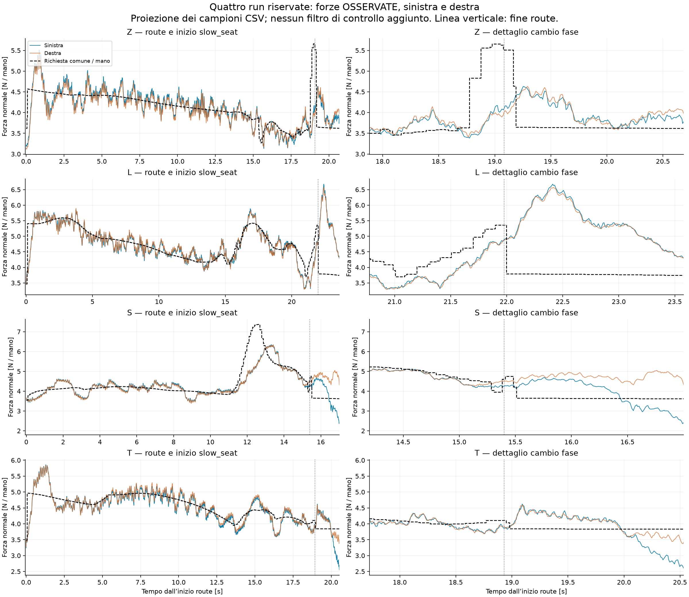
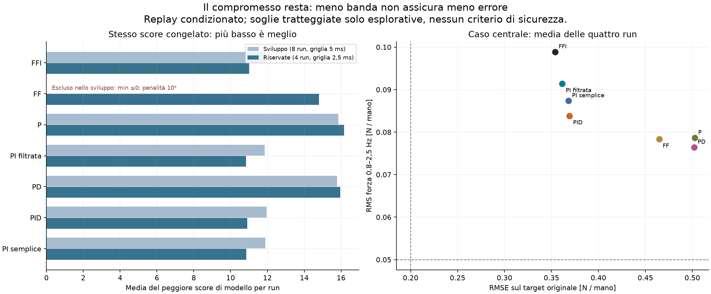
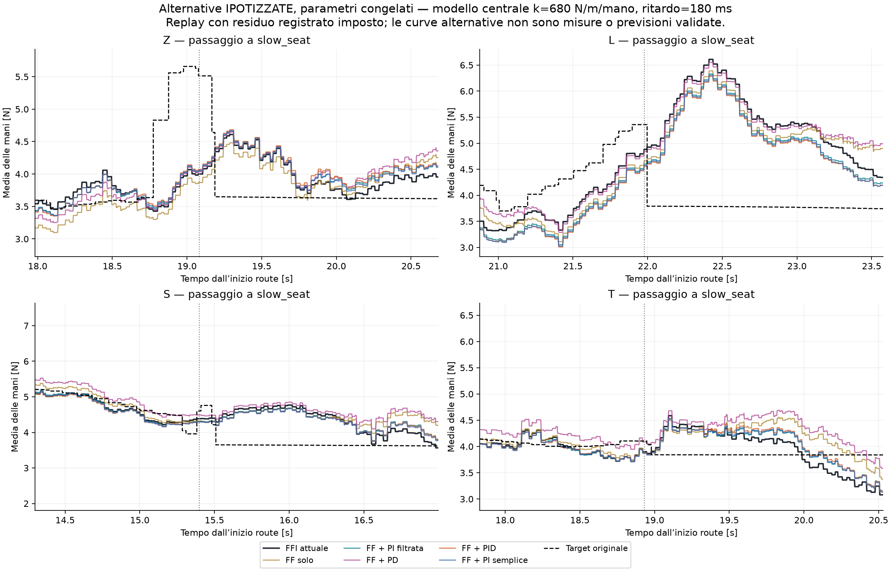

# Confronto congelato sulle quattro run riservate

**Nessun nuovo controllore validato sul robot.** Il batch fisso di **448 casi**
(7 configurazioni ×16 modelli ×4 run) è completato senza tuning dopo l'holdout.
La PI filtrata scelta sullo sviluppo cambia lo score rispetto alla FFI di
**-1.61%** sulle riservate;
la PI semplice di **-1.32%**.
Sono scarti piccoli in replay con impianti non validati. Nessuno dei 448
casi soddisfa insieme i tre obiettivi esplorativi (0 casi).
Non emerge una soluzione che elimini onde e grandi sovraelongazioni mantenendo
il tracking. Questa conclusione non equivale a dichiarare inutili gli esperimenti.

## Cosa è stato congelato e cosa significano le curve

Freeze 2026-10-23T16:59:43.682815+00:00; batch completato 2026-10-23T17:18:59.815903+00:00.
Manifest SHA-256 `c84b3ea52d1e810ebfb431c37266edfd0c4cded16c641b797da25dbdb0707b82`. Quattordici sorgenti, runtime e tutti i CSV
riservati verificati prima del batch. Risultati per run e tracce sono immutabili;
questo report legge solo i salvataggi. Baseline riprodotta con errore massimo
3.11e-15 N e 2.17e-15 mm:
è una verifica software del replay, non una validazione dell'impianto.

Le prime due run cronologiche riuscite per pezzo sono sviluppo, la terza è
riservata: Z 17:56:51, L 18:41:39, S 19:15:48, T 19:31:14 del 23/10 (timestamp
nel nome delle run). È un **holdout retrospettivo per questo tuning**: queste
run erano già state viste nelle vecchie analisi descrittive e moving average.
Non è una prova prospettica indipendente. Nessuna regolazione dopo questi esiti.

Le alternative sono replay condizionati: forza media originale + risposta
ipotizzata alla differenza di comando; residuo, fasi, moto geometrico e fine run
restano quelli osservati. Modelli: k=480/680/964/1500 N/m/mano, ritardi
120/180/230 ms; due lag 30/120 ms e due risonanti 1,5 Hz con ζ=0,3/0,7.
1500 è stress di guadagno, non rigidezza identificata. La risposta alternativa
non predice i due contatti separatamente né il successo dell'inserzione.
I precedenti modelli empirici e URDF non superano le verifiche predittive.

| Configurazione | P [mm/N] | I [mm/(N s)] | D [mm s/N] | Filtro aggiuntivo P+D [ms] |
| --- | --- | --- | --- | --- |
| FFI attuale | 0 | 1.6 | 0 | 0 |
| FF solo | 0 | 0 | 0 | 0 |
| FF + P | 0.05 | 0 | 0 | 0 |
| FF + PI filtrata | 0.1 | 0.8 | 0 | 100 |
| FF + PD | 0.05 | 0 | 0.005 | 0 |
| FF + PID | 0.05 | 0.8 | 0.005 | 0 |
| FF + PI semplice | 0.05 | 0.8 | 0 | 0 |

La derivata è sulla misura, filtrata a 50 ms. FF/P/PD mantengono il bias del trim
all'ingresso, senza I nascosta. Stesso nominale, target originale e priorità FF;
2 mm/s per componente e totale, FF ±9 mm, trim ±3 mm, totale ±12 mm.
Tutti i comandi rispettano 2 mm/s (tolleranza numerica 1e-10).

## Misure reali delle quattro run

| Pezzo | RMSE media [N] | RMS 0,8–2,5 Hz [N] | Minimo SX / DX [N] | Tempo SX / DX sotto richiesta di >0,25 N |
| --- | --- | --- | --- | --- |
| Z | 0.322 | 0.111 | 3.131 / 3.118 | 11.3% / 14.7% |
| L | 0.275 | 0.104 | 3.308 / 3.291 | 16.0% / 15.8% |
| S | 0.530 | 0.077 | 2.055 / 3.380 | 24.1% / 25.3% |
| T | 0.277 | 0.104 | 2.546 / 3.280 | 16.8% / 11.6% |

RMSE pesato sul tempo, route. Minimi su route+slow_seat, proiezione del wrench
sulla normale misurata, tagliata a zero come nel controllo. Il confronto con
la richiesta scalare comune **non è un margine full wrench/frizione** e non
stabilisce la perdita di presa. Target e sensori non hanno timestamp simultanei.
La ricostruzione di fn_N dai campioni wrench/quat differisce fino a
0.014 N sulla somma:
le due rappresentazioni osservate non sono intercambiabili al millinewton.

## Confronto a parametri fissi

| Configurazione | Score sviluppo | Score riservate | Δ vs FFI riservate | Casi con tutti gli obiettivi /64 |
| --- | --- | --- | --- | --- |
| FFI attuale | 11.887 | 11.007 | +0.00% | 0 |
| FF solo | escluso (1,25×10⁸) | 14.804 | +34.49% | 0 |
| FF + P | 15.844 | 16.158 | +46.80% | 0 |
| FF + PI filtrata | 11.845 | 10.829 | -1.61% | 0 |
| FF + PD | 15.775 | 15.955 | +44.96% | 0 |
| FF + PID | 11.960 | 10.899 | -0.98% | 0 |
| FF + PI semplice | 11.891 | 10.862 | -1.32% | 0 |

Lo score congelato è RMSE/0,20 + RMS forza 0,8–2,5 Hz/0,05 + massimo eccesso
nei primi 1,6 s di slow_seat/0,25 + p95 errore assoluto route/0,50.
Il criterio congelato assegna 10⁹ al caso con forza media simulata ≤0:
FF solo lo incontra nello sviluppo in due casi S, con minimo −0,025 N.
È un'esclusione/limite fisico del modello lineare oltre il contatto, non uno
score di errore di centinaia di milioni né una forza negativa realmente misurata.
La figura annota l'esclusione senza deformare la scala degli altri confronti;
la media penalizzata esatta resta nel JSON. Nessun caso riservato ha forza media ≤0.
Per ciascuna run si prende il peggiore dei 16 modelli, poi la media delle
quattro run. La dicitura «8 run» ereditata nella descrizione della formula
del freeze indica il precedente sviluppo: l'operatore è invariato, qui sono
quattro run. Lo sviluppo è a 5 ms, l'holdout a 2,5 ms; non si interpreta il
livello assoluto tra i due insiemi come miglioramento o peggioramento temporale.
Gli obiettivi congiunti sono RMSE≤0,20 N, banda grezza≤0,05 N ed eccesso
slow_seat≤0,25 N, solo esplorativi: non soglie di sicurezza o accettazione tesi.

Nel caso centrale (k=680, ritardo 180 ms), medie route sulle quattro run:

| Configurazione | RMSE [N] | Banda grezza / errore [N] | Picco L [N] | Eccesso L [N] | Eccesso L medio 200 ms [N] | Minimo tutti modelli [N] |
| --- | --- | --- | --- | --- | --- | --- |
| FFI attuale | 0.354 | 0.099 / 0.101 | 6.610 | 2.825 | 2.646 | 2.585 |
| FF solo | 0.465 | 0.078 / 0.082 | 6.388 | 2.603 | 2.424 | 0.708 |
| FF + P | 0.503 | 0.079 / 0.082 | 6.572 | 2.787 | 2.609 | 1.366 |
| FF + PI filtrata | 0.362 | 0.091 / 0.094 | 6.329 | 2.543 | 2.365 | 2.621 |
| FF + PD | 0.502 | 0.076 / 0.080 | 6.554 | 2.769 | 2.590 | 1.346 |
| FF + PID | 0.369 | 0.084 / 0.087 | 6.282 | 2.496 | 2.318 | 2.479 |
| FF + PI semplice | 0.368 | 0.087 / 0.090 | 6.303 | 2.518 | 2.339 | 2.481 |

Il minimo dell'ultima colonna è invece il peggiore su tutte le run e tutti i
modelli; è sempre una **media delle mani simulata**, non il minimo di un contatto.
I picchi/eccessi L sono nei primi 1,6 s di slow_seat. La media mobile causale
di 200 ms è solo una diagnostica a posteriori, non alimenta il controller e
non modifica score o criteri. Un picco più basso a scapito di tracking/minimi
non giustifica da solo la sostituzione della FFI.

| Configurazione | 0,2–0,8 Hz forza / errore | 2,5–10 Hz forza / errore | Tick velocità / trim limitati |
| --- | --- | --- | --- |
| FFI attuale | 0.180 / 0.204 | 0.056 / 0.058 | 17.2% / 17.7% |
| FF solo | 0.184 / 0.200 | 0.057 / 0.058 | 18.2% / 0.0% |
| FF + P | 0.178 / 0.195 | 0.058 / 0.060 | 13.9% / 13.9% |
| FF + PI filtrata | 0.175 / 0.196 | 0.057 / 0.058 | 14.4% / 14.4% |
| FF + PD | 0.176 / 0.194 | 0.060 / 0.062 | 17.9% / 18.4% |
| FF + PID | 0.178 / 0.201 | 0.060 / 0.061 | 18.5% / 19.6% |
| FF + PI semplice | 0.181 / 0.202 | 0.058 / 0.059 | 14.7% / 14.8% |

Tutte le bande sono in N/mano. La forza grezza contiene anche variazioni volute
del target; la banda dell'errore sottrae il target originale. Detrend cubico,
bandpass di analisi zero-phase, esclusi 1,5 s ai bordi: non un filtro causale
in anello. Le tabelle complete per run/modello sono in
[holdout_metrics.csv](holdout_metrics.csv) e [holdout_summary.json](holdout_summary.json).
Le frazioni di limitazione usano tutti i tick FFI del replay, non soltanto route:
«trim limitato» include velocità, ampiezza e allocazione disponibile, quindi
non è la sola permanenza sul finecorsa di ±3 mm.

Figura per il solo modello centrale; P è tabulata ma omessa dal grafico per
leggibilità. Le curve a gradini seguono l'ipotesi ZOH del residuo. Già conservato
un fallimento di convergenza dei massimi puntuali nei piani modificati: fino a
0,184 N tra 5 e 2,5 ms. Una verifica a eventi esatti solo per ritardo puro ha
chiarito un massimo mancato; non valida tutti i modelli né la forza reale tra
campioni. Piccoli scarti sui picchi non sono una prova di superiorità.

## Damping, rapidità e decisione possibile adesso

Tutte le 12 FFI hanno D60/7. Le due online D80/7 differiscono per altre condizioni;
questo batch non cambia il damping interno e non risponde causalmente a
«bastava alzare D». Nel modello fisico ideale D60→80 attenua la risposta forzata
di appena 0,32–0,76% a 1 Hz e 1,37–3,4% a 2 Hz; il modello non ricostruisce
bene il moto reale. Non sono previsioni delle onde misurate e ζ dei modelli
di replay non è cart_d. Il [protocollo D-only](DAMPING_AB_PROTOCOL.md) resta
la verifica prioritaria, mantenendo FFI e limiti invariati, senza eseguire il robot.

Nel nominale quasi statico k_eff×2 mm/s=1,36 N/s/mano: una variazione di 2 N
richiede almeno 1,47 s di quel comando, più ritardo. Non è un limite universale
della forza reale, che cambia anche per moto del pezzo/contatto. Le rampe del
profilo possono chiedere 59–143 mm/s al nominale: D maggiore non rimuove
quel limite software. Le prove autonome già salvate studiano rumore/jitter e
step in entrambi i versi; il replay di queste run non aggiunge una nuova
identificazione dei tempi di salita del robot.

Non viene promosso un PID o un compensatore del ritardo dai risultati riservati.
Per discriminare servono sorgente/versione della legge cartesiana interna e
un confronto D-only ripetuto con segnali comando–posa–wrench sincronizzati.
L'identificazione con piccola eccitazione nota e margini full wrench ricalcolati
rimane necessaria prima di attribuire causalità o promettere una risposta.
Originali, snapshot, codice di produzione e vecchie analisi restano intatti;
la verifica completa SHA-256 viene aggiornata al termine della tranche.
