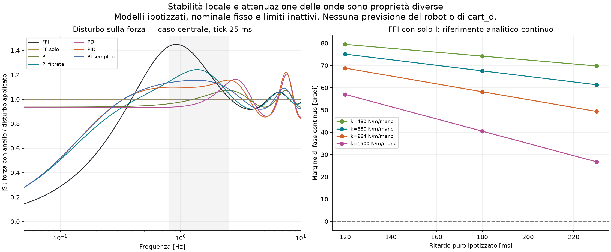

# Robustezza locale: analisi delle sette leggi congelate

Questa tranche non carica CSV né riapre il tuning: **336 modelli di anello
lineare locale**, sette leggi fisse ×16 impianti ipotizzati ×3 tick (20/25/30 ms).
Non è una nuova simulazione delle run. Il damping interno cart_d resta estraneo
ai parametri di questi impianti. Il confronto D-only resta prioritario e richiede
la semantica del servo interno e nuove prove controllate già protocollate.

## Derivazione e perimetro

Si linearizza a nominale/target costanti, contatto invariato e limiti inattivi.
Ingresso posizione per mano u, uscita forza somma y: G=2k·H·ritardo.
Con q=z⁻¹ e tick T, il regolatore della misura è

`C(q) = Ki*T/(1-q) + [Kp + Kd*(1-q)/(T+tauD-tauD*q)] * T/(T+r-r*q)`.

L'ultimo fattore è 1 se r=0; I e derivata assenti vengono rimossi, la derivata
è sulla misura. Ki integra l'errore della somma, non della media. È l'algebra
locale della legge congelata quando velocità/trim/allocazione non limitano.
Le variazioni temporali e il dt clamped del log non sono sostituiti da questi tick.

Per il ritardo puro τ, il comando tenuto dà G(q)=2k·q^ceil(τ/T), con l'intero
esatto quando τ/T è intero. Per lag/risonante, con τ=mT+δ e 0≤δ<T:

`x[n+1]=A(T)x[n]+B(T-δ)u[n-m]+A(T-δ)B(δ)u[n-m-1]`.

A e B sono esponenziali/integrali esatti del sistema continuo; non si usa Padé.
I poli vengono dalle radici di `den(G)den(C)+num(G)num(C)` in q,
trasformato in z. Una matrice di stato costruita separatamente aggiornando
controller, memoria dei comandi e impianto verifica il raggio spettrale su
tutti i 336 casi: differenza massima 5.49e-13.
Verificate anche soglie analitiche del ritardo puro con I e lag ZOH noto.
I risultati e sorgenti sono in `linear_robustness_*.json/csv` e nel design esclusivo.

| Legge | Stabili /48 | ρ peggiore | Min PM attraversamenti [°] | Max ampiezza S 0,8–2,5 Hz, modelli stabili | Ampiezza S(0) centrale |
| --- | --- | --- | --- | --- | --- |
| FFI | 48 | 0.9786 | 24.6 | 4.204 | 0.000 |
| FF solo | 48 | 0.9450 | — | 1.000 | 1.000 |
| P | 48 | 0.9549 | — | 1.176 | 0.936 |
| PI filtrata | 48 | 0.9851 | 68.7 | 1.962 | 0.000 |
| PD | 48 | 0.9585 | — | 1.411 | 0.936 |
| PID | 48 | 0.9841 | 66.9 | 1.426 | 0.000 |
| PI semplice | 48 | 0.9842 | 65.4 | 1.559 | 0.000 |

ρ<1 certifica solo stabilità del sistema discreto LTI dichiarato. Non certifica
il robot, il contatto, la risposta con saturazioni né jitter variabile.
Il PM riporta il minimo fra tutti gli attraversamenti di guadagno unitario;
se molteplici non basta da solo come criterio: la stabilità qui è decisa dai poli.
FF solo non ha anello esterno e non ha PM: si riportano i poli dell'impianto.
I massimi sono su griglia in frequenza, non una norma H∞ certificata.

## Perché un anello stabile può ancora mostrare onde

Per un disturbo aggiunto alla forza, S=1/(1+GC); per rumore aggiunto alla misura,
la forza fisica risponde con −GC/(1+GC). Queste sono due vie diverse: più onda
misurata non identifica automaticamente rumore ATI. |S|>1 amplifica una
componente sinusoidale imposta anche se tutti i poli sono stabili. |S| è un
rapporto d'ampiezza, non la RMS futura della run; la forma/spettro dei disturbi
reali cambia anche con moto, geometria e controllore. La banda della tabella
non è il band RMS del replay e non ne modifica lo score.

Con sola I e guadagno statico a=2kKi, il modello continuo a ritardo puro ha
attraversamento ω=a e PM=π/2−aτ. Con k=680 e Ki=0,0016, a=2,176 s⁻¹:
PM≈67,6° a180 ms, 61,3° a230 ms. Con k=1500, a=4,8 s⁻¹ e230 ms, PM≈26,7°.
La soglia continua è aτ=π/2: non è una stima del ritardo critico del robot.
Nel discreto esatto aT=γ, m tick di ritardo, la soglia è
`γcrit=2*sin(pi/(4*m-2))`; l'attraversamento è `Ω=2*asin(γ/2)` e
`PM=pi/2-(m-1/2)*Ω`. Queste formule forniscono controlli indipendenti del codice.

P/PD senza I lasciano una frazione DC `1/(1+2kKp)` del disturbo costante sulla
forza: con k=680 e P=0,05 mm/N è circa0,936. La D vale zero in DC.
Questo spiega un possibile compromesso del modello: meno oscillazione in una
banda può accompagnarsi a offset grande. Non identifica la causa degli offset
misurati; il nominale FF varia durante le run e non è incluso in questo test.
La I porta S(0) a0 solo nel sistema stabile idealizzato senza limiti attivi;
non promette errore nullo reale né rapidità arbitraria.

## Conseguenze per il damping e il prossimo dato utile

Non è stato scelto nessun nuovo gain dopo l'holdout. Nessuna compensazione del
ritardo emerge da questo calcolo, perché l'impianto non ha superato la verifica
predittiva. cart_d modifica il servo interno, non il parametro τ o ζ scelto qui.
Un eventuale aumento può attenuare risonanza e modificare fase/rapidità: serve
il sorgente effettivo o un confronto D-only con FFI invariata. La stabilità
locale ipotizzata non sostiene né esclude «bastava alzare il damping».

Misure minime: comando cartesiano effettivamente applicato, posa/twist misurati,
wrench ATI per mano con timestamp di acquisizione e di consumo nel controller,
stato/limiti FFI, runtime D/K e clock comune. Sono necessarie per distinguere
ritardo puro, filtro della misura, risonanza del servo e variazioni del contatto.
Con i log attuali l'effetto di un controllore alternativo resta condizionato;
nessuna acquisizione o esecuzione sul robot è stata fatta da questa analisi.
