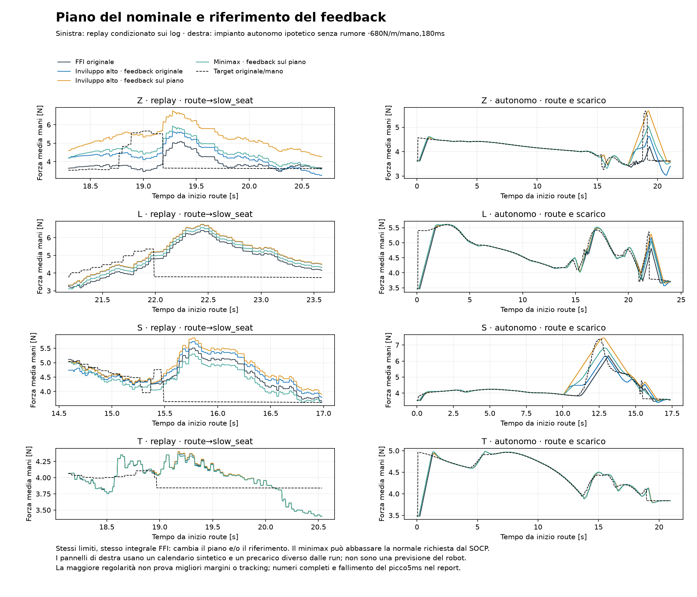
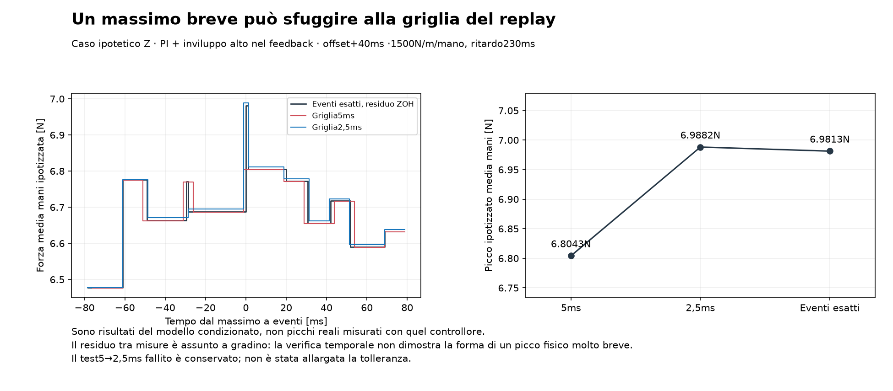

# Pianificazione del nominale e riferimento del feedback

**Nessun nuovo controllore validato. I piani a velocità limitata cambiano il compromesso, ma non risolvono insieme tracking, picchi e minimi nei confronti provati.**

## Cosa è stato confrontato

Disegno congelato:38 configurazioni ×16 modelli ×8 development = **4.864 replay condizionati**. FFI originale o PI P0,1/I0,8 con filtro P100ms. Tre piani nella fase corrente: originale, inviluppo superiore a1,36N/s, e approssimazione minimax alla stessa pendenza. Feedback sul target originale oppure sul piano. Tre offset di clock−40/0/+40ms valutati nel caso peggiore.

Questa volta si campiona il **piano assoluto**: nominale=(piano−pickup)/680, senza l’ancoraggio del precedente studio delta-preview. Sono incluse sia le baseline registrate esatte sia il lookup del piano originale come controllo della ricostruzione del clock. Non bisogna attribuire al planner una differenza dovuta al solo clock non registrato.

I piani maggiorante/minimax rispettano2mm/s nel nominale dentro ogni fase; gli estremi sono liberi e le transizioni possono ancora saturare. Il controllore applica sempre gli stessi limiti componenti/somma e la stessa priorità FF. Non sono usate misure future o futuri orari delle fasi dei log.

L’inviluppo superiore non abbassa il target scalare del profilo allo stesso clock. Questo non garantisce la forza reale di ciascuna mano o i margini del full wrench. Il minimax può richiedere meno normale dell’originale: è un confronto diagnostico, non un piano accettabile con i vecchi margini dichiarati invariati.

## Replay condizionato: risultato e controllo del clock

Le forze alternative mantengono il residuo registrato fisso. Nessun modello empirico aveva superato il gate di previsione libera; quindi questi numeri non prevedono una nuova run reale. Lo score resta quello congelato, calcolato sul target originale. Le differenze nei picchi del calcolo5ms sono inoltre soggette al fallimento numerico documentato sotto.

| Legge | Piano | Feedback | Score robusto5ms ↓ | Δ rispetto al lookup originale con stesso feedback/clock | Massimo abbassamento del piano rispetto al profilo |
|---|---|---|---:|---:|---:|
| `PI_P0.1_I0.8_D0_R0.1` | original | original | 12.184 | +0.00% | 0.000 N |
| `PI_P0.1_I0.8_D0_R0.1` | original | planned | 12.373 | +0.00% | 0.000 N |
| `I_P0_I1.6_D0` | original | original | 12.497 | +0.00% | 0.000 N |
| `I_P0_I1.6_D0` | original | planned | 12.669 | +0.00% | 0.000 N |
| `PI_P0.1_I0.8_D0_R0.1` | minimax | original | 12.753 | +4.67% | 0.953 N |
| `PI_P0.1_I0.8_D0_R0.1` | minimax | planned | 12.953 | +4.68% | 0.953 N |
| `I_P0_I1.6_D0` | minimax | original | 13.044 | +4.38% | 0.953 N |
| `I_P0_I1.6_D0` | minimax | planned | 13.412 | +5.87% | 0.953 N |
| `PI_P0.1_I0.8_D0_R0.1` | majorant | original | 14.412 | +18.28% | 0.000 N |
| `I_P0_I1.6_D0` | majorant | original | 14.513 | +16.13% | 0.000 N |
| `PI_P0.1_I0.8_D0_R0.1` | majorant | planned | 16.211 | +31.02% | 0.000 N |
| `I_P0_I1.6_D0` | majorant | planned | 16.254 | +28.30% | 0.000 N |

Nessun piano modificato migliora questo score aggregato della stessa legge rispetto al controllo del clock nella griglia provata. Usare il piano maggiorante anche nel feedback evita che l’I annulli parte del precarico anticipato, ma può aumentare molto la forza rispetto al target originale. Una forza più regolare non equivale automaticamente a tracking migliore.

Le baseline registrate restano identiche. La classe reale FFI, senza ROS, coincide con i casi I a riferimento pianificato su **41,240 aggiornamenti**, errore comando massimo2.22e-15mm. Verificate causalità dei prefissi, pendenza nominale≤2mm/s dentro la fase e maggiorazione scalare esatta.

## Stress autonomi con forme di profilo reali

**1.792 scenari autonomi più1.792 raffinamenti**:14 configurazioni a clock0 ×16 impianti ×2 condizioni ×4 forme di profilo. Le configurazioni includono alias della baseline, utili come controllo di identità e non esperimenti indipendenti. Precarico iniziale uguale al primo target route,2s di attesa, poi route e slow_seat su un calendario sintetico noto,4s finali. Questo calendario non è preso dalle future transizioni delle run reali.

Una condizione è senza rumore, tick25ms; l’altra ha rumore sulla misura0,013N media mani, jitter15–35ms e disturbo fisico sinusoidale0,15N/mano a1,2Hz da6s. Nessun residuo di forza registrata imposto. Ogni controller vede solo misura presente/passata e piano della fase corrente. Impianti ipotetici, due mani simmetriche: nessuna previsione di slip, riuscita o eventi di contatto.

| Configurazione | Score robusto autonomo ↓ | Peggior RMSE route originale | Peggior errore positivo iniziale seat | Peggior banda0,2–0,8 | Peggior banda0,8–2,5 | Minimo medio mani |
|---|---:|---:|---:|---:|---:|---:|
| `PI_P0.1_I0.8_D0_R0.1` | 11.878 | 0.596 N | 1.742 N | 0.427 N | 0.206 N | 2.308 N |
| `PI_P0.1_I0.8_D0_R0.1__ABS_original_FBoriginal_O0` | 11.878 | 0.596 N | 1.742 N | 0.427 N | 0.206 N | 2.308 N |
| `PI_P0.1_I0.8_D0_R0.1__ABS_original_FBplanned_O0` | 11.878 | 0.596 N | 1.742 N | 0.427 N | 0.206 N | 2.308 N |
| `PI_P0.1_I0.8_D0_R0.1__ABS_minimax_FBoriginal_O0` | 12.264 | 0.477 N | 2.202 N | 0.407 N | 0.211 N | 2.736 N |
| `PI_P0.1_I0.8_D0_R0.1__ABS_minimax_FBplanned_O0` | 12.303 | 0.421 N | 2.194 N | 0.279 N | 0.212 N | 2.858 N |
| `PI_P0.1_I0.8_D0_R0.1__ABS_majorant_FBoriginal_O0` | 12.869 | 0.466 N | 2.290 N | 0.389 N | 0.210 N | 2.429 N |
| `I_P0_I1.6_D0` | 13.164 | 0.603 N | 1.825 N | 0.459 N | 0.259 N | 2.366 N |
| `I_P0_I1.6_D0__ABS_original_FBoriginal_O0` | 13.164 | 0.603 N | 1.825 N | 0.459 N | 0.259 N | 2.366 N |
| `I_P0_I1.6_D0__ABS_original_FBplanned_O0` | 13.164 | 0.603 N | 1.825 N | 0.459 N | 0.259 N | 2.366 N |
| `I_P0_I1.6_D0__ABS_minimax_FBoriginal_O0` | 13.287 | 0.518 N | 2.351 N | 0.446 N | 0.263 N | 2.683 N |
| `I_P0_I1.6_D0__ABS_minimax_FBplanned_O0` | 13.341 | 0.419 N | 2.159 N | 0.273 N | 0.261 N | 2.830 N |
| `I_P0_I1.6_D0__ABS_majorant_FBoriginal_O0` | 13.700 | 0.476 N | 2.188 N | 0.407 N | 0.263 N | 2.348 N |
| `PI_P0.1_I0.8_D0_R0.1__ABS_majorant_FBplanned_O0` | 15.225 | 0.754 N | 3.221 N | 0.331 N | 0.210 N | 2.678 N |
| `I_P0_I1.6_D0__ABS_majorant_FBplanned_O0` | 16.466 | 0.678 N | 3.007 N | 0.305 N | 0.263 N | 2.751 N |

Score: media per pezzo del caso peggiore fra impianti/disturbi. Gli estremi delle altre colonne possono appartenere a casi diversi. Le bande della forza includono anche variazioni volute del target: salvate separatamente le bande dell’errore target-sottratto0,2–0,8/0,8–2,5/2,5–10Hz. Non si è cambiato lo score dopo avere visto questi risultati. La banda bassa è una diagnostica su finestre brevi e detrend cubico, non una prova di stabilità.

Raffinamento autonomo2,5→1,25ms con identici tick e rumore: ΔRMSE massimo0.000428N, Δbanda0.000264N, Δpicco0.001411N. Criteri originali rispettati. Gli alias del piano originale riproducono esattamente le baseline nello stesso benchmark.

## Fallimento del replay5ms conservato e verifica a eventi esatti

Su608 raffinamenti5→2,5ms, ΔRMSE massimo0.0029N e Δbanda0.0012N, ma **Δpicco0.1839N**: il criterio<0,05N FALLISCE. Non è stata cambiata la tolleranza.

Creato un integratore senza arrotondamento dei tempi del controllo per i soli modelli a ritardo puro:456 casi,38 varianti ×3 guadagni/ritardi ×prima development per pezzo. Gli aggiornamenti usano gli istanti effettivi; tra essi la forza ipotizzata cambia all’unione degli eventi della misura registrata e dei comandi ritardati. RMSE è integrato con i pesi temporali esatti, estremi sulle durate degli intervalli; le sole bande sono campionate su una griglia2,5ms.

Caso critico Z, PI + maggiorante nel feedback, clock+40ms, modello ipotetico1500N/m e230ms: picco5ms **6.8043N**,2,5ms **6.9882N**, eventi esatti **6.9813N**. La griglia5ms perdeva parte del massimo. Sono forze simulate nello studio condizionato, non picchi misurati con quel controllore.

Verificato anche il kernel a eventi con la classe FFI reale: **123,720 aggiornamenti**, errore comando2.66e-15mm. Questo controlla il software, non la validità dell’impianto o del residuo imposto.

La forza fra misure è ancora una ricostruzione ZOH ipotizzata; i log FFI non stabiliscono la vera forma di picchi molto brevi. Questa verifica non converte tutti i4.864 casi in simulazioni validate, né estende il risultato ai modelli risonanti/primo ordine. La tabella5ms resta un’esplorazione con i casi di picco segnalati, non una precisione da usare per piccoli vantaggi di tuning.

## Decisione e prossima tranche

Nessuna variante è proposta per il robot. I piani più morbidi devono conservare margini e condizioni iniziali; il vincolo2mm/s impedisce di realizzare subito i salti del nominale, mentre preload e anticipo possono aumentare gli errori prima del salto. Il riferimento del feedback è quindi una scelta di obiettivo, non solo un filtro da aggiungere.

Il damping interno resta distinto e invariato. Il confronto D-only a FFI fissa rimane il prossimo esperimento fisico minimo, già descritto in DAMPING_AB_PROTOCOL.md; sorgente del servo e dati controllati mancano. Una compensazione esplicita del ritardo non è sostenuta dai modelli identificati finora. FINAL_COMPARISON_FREEZE.json congela sette configurazioni e criteri prima di leggere le quattro run riservate: prossimo batch448 casi, senza tuning successivo su quelle run. Sono ipotesi di confronto, non candidati validati per il robot.

## Figure e riproduzione

Sorgenti: planned_reference.py, planned_reference_autonomous.py, planned_reference_validation.py, event_exact_delay.py, event_exact_validation.py, planned_reference_report.py. Disegni congelati: planned_reference_design.json e planned_reference_autonomous_design.json. Metriche, tracce e log della verifica fallita conservati nella campagna. Il kernel condiviso riceve feedback_targets opzionale; il precedente è conservato nel checkpoint0014. Originali e controller di produzione invariati.
