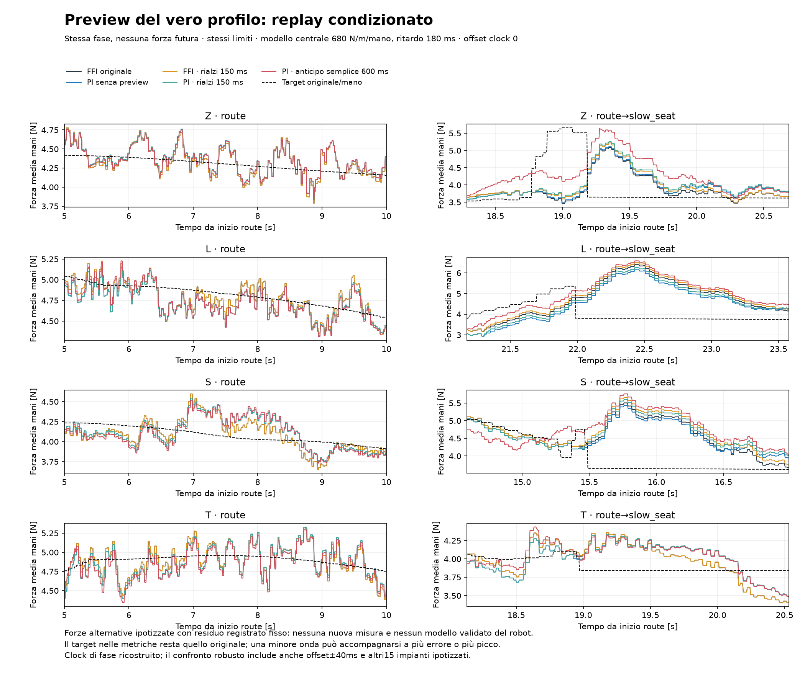
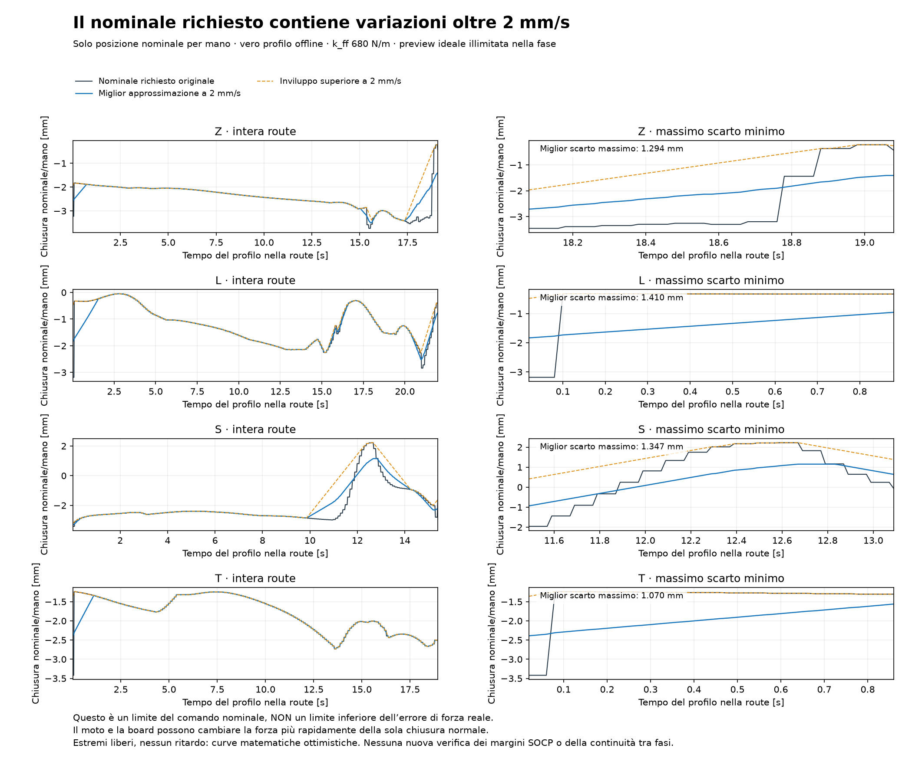

# Preview del profilo reale e fattibilità del nominale

**Esito: l’anticipo semplice nella fase corrente non migliora il compromesso robusto provato. Il nominale richiesto contiene tratti non realizzabili con i suoi limiti di velocità.**

## Provenienza e informazione disponibile

Letti esclusivamente i profili offline delle otto run di sviluppo. Tutti e otto corrispondono esattamente al SHA-256 registrato nei metadati, senza normalizzare le righe. Contenuti distinti: 4; le due run per pezzo usano lo stesso piano.

Il sorgente `insert_open.Profile.sample` interpola nella fase corrente e mantiene il primo/ultimo valore agli estremi. `controller.follow` e `move` hanno un tempo di fase ma possono terminare per eventi. La preview qui usa soltanto il profilo della fase già iniziata. Non consulta gli orari futuri delle fasi osservate né la forza futura. Un salto route→slow_seat non è anticipato con l’orario registrato della transizione.

La fase viene riconosciuta quando compare nel log; il tempo trascorso è calcolato causalmente dalla prima riga di quella fase. Il vero `phase_t0` non è salvato. Tre scenari di offset −40/0/+40ms valutano la sensibilità; non sono limiti di errore identificati. Non è stato scelto l’offset che fa apparire il risultato migliore.

| Run sviluppo | RMSE target ricostruito dal clock | Massimo scarto target |
|---|---:|---:|
| `F75_Zt1_s9012_c100_five_cut800_ffi_20261023_174143` | 0.0099 N | 0.2206 N |
| `F75_Zt1_s9012_c100_five_cut800_ffi_20261023_175102` | 0.0266 N | 0.5132 N |
| `F75_Lt1_s9014_c100_five_cut800_ffi_20261023_182743` | 0.0104 N | 0.2421 N |
| `F75_Lt1_s9014_c100_five_cut800_ffi_20261023_183741` | 0.0217 N | 0.6387 N |
| `S_s7073m3_c100_narrow75_ffi_20261023_190407` | 0.0253 N | 0.4718 N |
| `S_s7073m3_c100_narrow75_ffi_20261023_191302` | 0.0170 N | 0.3480 N |
| `F75_Tt1_s9007_c100_five_cut800_ffi_20261023_192128` | 0.0219 N | 0.6464 N |
| `F75_Tt1_s9007_c100_five_cut800_ffi_20261023_192700` | 0.0110 N | 0.2891 N |

Per conservare l’identità della baseline si applica un **delta di preview**: nominale originale esatto più la differenza tra profilo futuro e presente campionati con lo stesso clock. Quindi l’offset di ricostruzione non altera il caso senza preview. Questa scelta è dichiaratamente uno studio condizionato; non ricostruisce esattamente una nuova esecuzione che usi direttamente il profilo assoluto.

## Confronto: stessi limiti e target originale nelle metriche

Cinquanta candidati ×16 modelli ×8 run = **6.400 replay condizionati**. Leggi fissate: FFI originale e PI P0,1/I0,8 con filtro P100ms. Preview 150/300/600/1200ms; tre offset di clock. Il feedback continua a inseguire il target originale. Priorità FF e tutti i limiti di corsa/velocità restano uguali.

Due modalità: `shift` campiona il target pianificato a t+h e può anticipare anche una riduzione; `rise_envelope` considera max[r(t+s)−1,36s], 0≤s≤h, e aumenta solo il nominale rispetto alla baseline. Il cono usa la calibrazione nominale680N/m e2mm/s. Una preview finita di questo tipo non è una pianificazione globale con vincolo di velocità.

Il residuo della forza registrata rimane imposto come nei confronti precedenti. Il modello comando→forza non è validato: nessuna previsione causale delle nuove forze del robot o del contatto bilaterale.

| Legge fissata | Preview | Anticipo | Score robusto su modello e clock ↓ | Δ rispetto alla stessa legge senza preview | Minimo medio mani |
|---|---|---:|---:|---:|---:|
| `PI_P0.1_I0.8_D0_R0.1` | rise_envelope | 150ms | 12.564 | +6.08% | 2.427 N |
| `PI_P0.1_I0.8_D0_R0.1` | shift | 150ms | 12.764 | +7.76% | 2.427 N |
| `I_P0_I1.6_D0` | rise_envelope | 150ms | 12.937 | +8.83% | 2.425 N |
| `PI_P0.1_I0.8_D0_R0.1` | rise_envelope | 300ms | 12.944 | +9.28% | 2.427 N |
| `PI_P0.1_I0.8_D0_R0.1` | rise_envelope | 600ms | 13.173 | +11.22% | 2.427 N |
| `I_P0_I1.6_D0` | rise_envelope | 300ms | 13.299 | +11.87% | 2.425 N |
| `I_P0_I1.6_D0` | shift | 150ms | 13.315 | +12.01% | 2.425 N |
| `I_P0_I1.6_D0` | rise_envelope | 600ms | 13.594 | +14.35% | 2.425 N |
| `PI_P0.1_I0.8_D0_R0.1` | rise_envelope | 1200ms | 13.930 | +17.61% | 2.427 N |
| `PI_P0.1_I0.8_D0_R0.1` | shift | 300ms | 13.999 | +18.19% | 2.427 N |
| `I_P0_I1.6_D0` | rise_envelope | 1200ms | 14.354 | +20.75% | 2.425 N |
| `PI_P0.1_I0.8_D0_R0.1` | shift | 600ms | 14.417 | +21.71% | 2.427 N |
| `I_P0_I1.6_D0` | shift | 300ms | 14.785 | +24.38% | 2.425 N |
| `I_P0_I1.6_D0` | shift | 1200ms | 15.162 | +27.55% | 2.366 N |
| `I_P0_I1.6_D0` | shift | 600ms | 15.207 | +27.92% | 2.425 N |
| `PI_P0.1_I0.8_D0_R0.1` | shift | 1200ms | 15.411 | +30.11% | 2.425 N |

La migliore preview della griglia peggiora il punteggio della legge corrispondente del **6.08%**: PI + rialzi anticipati150ms. Il confronto include sempre il caso senza preview. Nessun candidato supera tutte le soglie provvisorie. Questo non esclude una pianificazione diversa o anticipi minori; non sostiene l’idea che basti traslare avanti il profilo.

Verifiche: baseline I e PI riprodotte esattamente su quattro metriche in tutti i modelli; prefissi invariati cambiando futuri orari/fasi/nominali dei log e tutta la forza misurata. Raffinamento su 240 casi5→2,5ms: ΔRMSE massimo0.0015N, Δbanda0.0011N, Δpicco0.0137N; tolleranze originali rispettate.

## Minimi individuali effettivamente osservati

Normali compensate proiettate sull’asse di ciascuna mano, con clip a zero come nel controllo; minimo nelle fasi route e slow_seat. Sono misure delle run originali. Le alternative simulate producono solo una media fra mani e non possono garantire questi minimi individuali.

| Run sviluppo | Minimo sinistra | Minimo destra |
|---|---:|---:|
| `F75_Zt1_s9012_c100_five_cut800_ffi_20261023_174143` | 2.950 N | 2.959 N |
| `F75_Zt1_s9012_c100_five_cut800_ffi_20261023_175102` | 2.944 N | 2.910 N |
| `F75_Lt1_s9014_c100_five_cut800_ffi_20261023_182743` | 3.141 N | 3.180 N |
| `F75_Lt1_s9014_c100_five_cut800_ffi_20261023_183741` | 3.120 N | 3.096 N |
| `S_s7073m3_c100_narrow75_ffi_20261023_190407` | 3.414 N | 3.365 N |
| `S_s7073m3_c100_narrow75_ffi_20261023_191302` | 2.550 N | 3.578 N |
| `F75_Tt1_s9007_c100_five_cut800_ffi_20261023_192128` | 2.947 N | 3.394 N |
| `F75_Tt1_s9007_c100_five_cut800_ffi_20261023_192700` | 2.407 N | 3.169 N |

## Il vincolo del nominale, misurato sul vero piano

Il controller vuole `ff=(target−pickup)/680`. Per seguire esattamente questo nominale a2mm/s, il profilo deve avere |dtarget/dt|≤1,36N/s. Nei profili archiviati alcuni cambiamenti sono molto più rapidi. Questo confronto usa solo sorgente, piano e limiti configurati; non richiede un modello del servo.

| Pezzo | Picco velocità nominale richiesta | Tempo route con richiesta >2mm/s | Minimo possibile del massimo errore nominale con preview illimitata |
|---|---:|---:|---:|
| Z | 87.8 mm/s | 3.04% | 1.294 mm/mano |
| L | 143.0 mm/s | 6.47% | 1.410 mm/mano |
| S | 58.8 mm/s | 5.59% | 1.347 mm/mano |
| T | 109.0 mm/s | 3.59% | 1.070 mm/mano |

**Sono scarti di posizione del nominale, non limiti inferiori sull’errore della forza reale.** Il moto della geometria, la board e il contatto possono cambiare la forza molto più rapidamente della sola chiusura normale. L’I può modificare il comando totale e il residuo può aiutare o peggiorare: non si deduce da questa tabella che il robot debba avere quell’errore di forza.

La migliore approssimazione matematica usa tutta la fase già pianificata, estremi liberi e nessun ritardo: è un limite ottimistico sul solo comando. Per valori r_i con velocità equivalente v, ogni soluzione deve avere errore massimo almeno ½max(|r_i−r_j|−v|t_i−t_j|)₊. Il punto medio dell’inviluppo superiore e inferiore a pendenza v raggiunge questo limite. Verificati il caso analitico di due punti e50 casi casuali contro tutti i vincoli a coppie.

Il punto medio può richiedere meno normale del SOCP originario e **non è una proposta di target accettabile per i margini**. È salvato anche l’inviluppo superiore: non abbassa il target scalare e rispetta la pendenza nella singola fase, ma aumenta il precarico. Non verifica da solo equilibrio, attrito, momenti, continuità tra fasi o possibilità di raggiungere la condizione iniziale.

## Campionamento del piano e transizioni

Il sorgente del planner conserva la cadenza SOCP di100ms, mentre la traccia salvata contiene il target corrente a ogni controllo20ms. La lettura del CSV interpola poi fra queste righe: un nuovo risultato SOCP può quindi diventare una rampa di soli20ms dopo un tratto costante. Inoltre il primo punto di una fase può ancora contenere il target della soluzione precedente. Il solo salto fra ultima/prima riga non descrive tutto il cambiamento attorno alla transizione.

| Pezzo | Ultima→prima riga route/slow_seat | Ultima route→minimo primi150ms slow_seat | Tempo minimo del nominale per questa riduzione |
|---|---:|---:|---:|
| Z | +0.000 N/mano | -1.864 N/mano | 1.371s |
| L | -1.566 N/mano | -1.567 N/mano | 1.153s |
| S | +0.000 N/mano | -1.108 N/mano | 0.815s |
| T | +0.000 N/mano | -0.262 N/mano | 0.193s |

Questi tempi riguardano la riduzione del nominale richiesta nei primi150ms della fase successiva, assumendo partenza esatta dall’ultimo target route e senza ritardo. Non sono il tempo di assestamento della forza reale. Il salto L richiede già oltre un secondo di variazione del nominale: aumentare D non cambia il limite software di2mm/s. Può comunque cambiare lo smorzamento della risposta reale e resta un esperimento distinto. Il campionamento del piano è verificato nel sorgente; non dimostra che sia la causa delle oscillazioni misurate.

## Prossimo confronto sostenibile

Separare una pianificazione scalare con velocità esplicita dal tuning del feedback: inviluppo superiore o piano ottimizzato, distinguendo riferimento nominale e riferimento del feedback. Valutare sempre anche l’errore rispetto al target originale e gli undershoot; non conservare per dichiarazione i margini del vecchio SOCP. Le transizioni richiedono un orologio del piano realmente disponibile e la gestione delle interruzioni, senza usare il futuro dei log.

Il damping interno rimane prioritario come prova D-only: tutti i dati FFI sono D60/7, le due D80 appartengono a un controllo diverso e il sorgente del servo interno manca. Nessun nuovo D è stato impostato. Le quattro run riservate restano escluse; nessun candidato è pronto al robot.

## Figure e sorgenti

Sorgenti: profile_preview.py, profile_preview_refinement.py, profile_feasibility.py, profile_preview_report.py. Disegno congelato: profile_preview_design.json. Metriche complete CSV/JSON e tracce NPZ nella campagna. Kernel conditional_controllers.py esteso con nominal_wants opzionale; default conservato e verificato contro i risultati precedenti. Sorgente precedente nel checkpoint2344. NVIDIA_RUNS e baseline restano in sola lettura.
