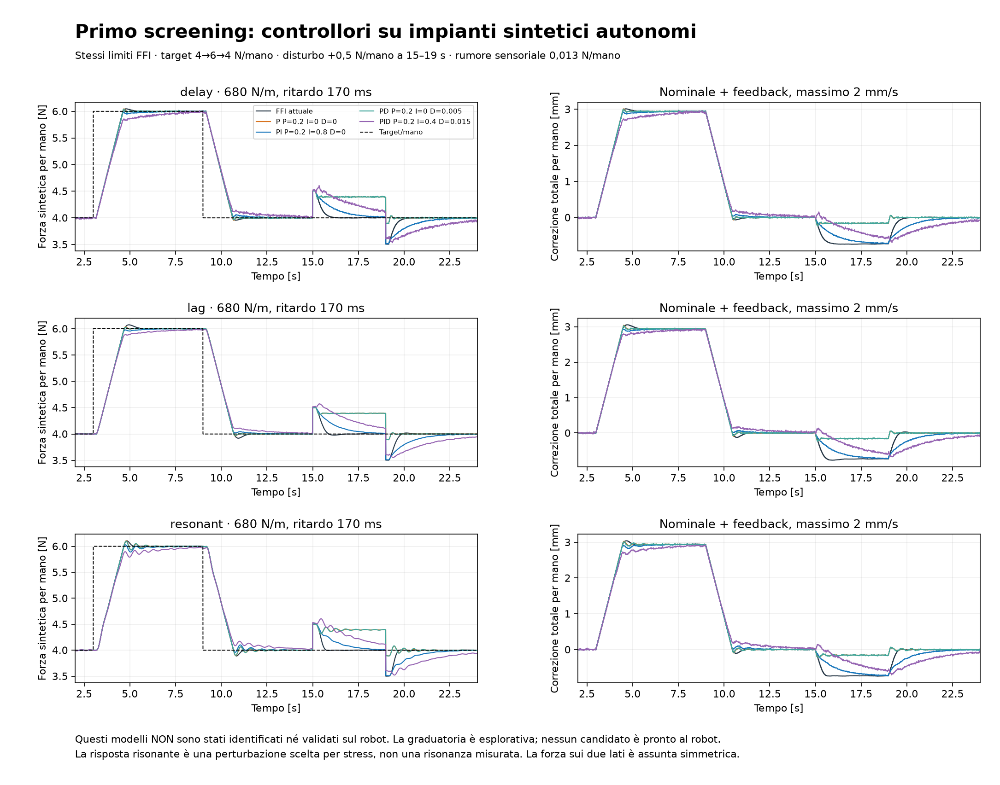

# Ricerca controllore normale — risultati provvisori

**Campagna notturna attiva, nessun nuovo controllore validato sul robot.**

## Codice e tracce numeriche conservati insieme

[Pacchetto scientifico locale e manifest](PAYLOAD_STATUS.md): ZIP verificato di
267,5MB con tutte61tracceNPZ della campagna, tabelle, sorgenti, disegni congelati,
grafici, log dei fallimenti, riferimenti citati e copia byte-identica dello
snapshot baseline.383file,316.904.324byte non compressi; ogni elemento riletto
e verificatoSHA/CRC. I checkpoint del solo codice restano conservati separatamente.

Nessun contenuto NVIDIA_RUNS spostato o riscritto; originali verificati a parte.
Il pacchetto non sostituisce CSV/bag e dipendenze per una riesecuzione, e non
è una release robot. Stato/registro/report operativi sono istantanee al momento
della confezione, mentre i risultati congelati restano confrontabili byte-per-byte.
Conclusioni scientifiche e prioritàD-only invariate, nessun nuovo tuning.

## Verifica di coerenza e precisazione sul clock del limite software

[Guida alla lettura](READING_GUIDE.md) e [audit degli output](SAVED_EVIDENCE_AUDIT.md).
I448 casi salvati, CSV/JSON, score e4.032 riduzioni metriche dalle tracce sono
coerenti; nessun replay o tuning rilanciato. Verificati manifest precedenti,
otto checkpoint e link locali. I tre fallimenti di raffinamento restano tali.

Il primo audit usava erroneamente gli intervalli del log come dt della FFI.
Conservati codice/log falliti, verificati solo i campi temporali dei quattro CSV
e salvati clock ausiliari separati. Il limite **2mm/s della correzione normale
software** è rispettato usando ffi_dt_ms, come nel kernel congelato. La divisione
per intervalli t_wall del log produce massimi circa2,05–2,14mm/s: è un'altra
quantità, non la velocità misurata dei tool o l'istante di consumo del servo.
Lo scheduling usa tempi di log e il limitatore usa dt FFI/clamped; l'incertezza
temporale del replay rimane dichiarata e non è stata ottimizzata dopo l'holdout.

Corretto anche un valore trascritto nella bozza dell'audit: i sorgenti delle
verifiche dichiarano0,03N per RMSE,0,01N per banda,0,05N per picco. Gli esiti
falliti non cambiano e nessuna tolleranza originaria è stata modificata.
Originali e tutti14sorgenti congelati invariati, nuovamente verificati SHA-256.

## Sintesi disponibile per la tesi

[Sintesi ragionata con testo da adattare](THESIS_SYNTHESIS.md), tabella delle
12 run, figura19 e registro di dieci affermazioni con evidenza e limiti.
Il risultato sostenuto è una dimostrazione sperimentale nelle condizioni
archiviate, con oscillazioni e transitori quantificati. Non si dispone di una
soglia universale di accettabilità per la tesi, di un nuovo controllore validato
o di una misura indipendente dell'accuratezza finale del pezzo.

Il confronto descrittivo con la Z delle20:20 chiarisce il compromesso: banda
0,156N storica contro0,111–0,123N nelle tre FFI; RMSE route0,256N storico contro
0,304–0,339N FFI. L/S/T hanno altri riferimenti storici espliciti nel report;
nessuno di questi confronti isola causalmente l'effetto del solo SOCP offline.
Anche architettura normale, profilo e condizioni differiscono.

Le12 run selezionate sono archiviate come riuscite con seat_found/noJAM;
non sono12/12 tentativi.24 metadata FFI includono13 flag seat_found e altre
condizioni/stop: nemmeno13/24 è una stima pulita della configurazione finale.
La sintesi conserva transitoriL, difficoltàS e minimi/asimmetrie, senza confondere
believed_mm con metrologia esterna o forza media positiva con margine di presa.

Damping prioritario: ipotesi ancora aperta, protocollo D-only a FFI fissa già
preparato. Compensazione del ritardo e nuovo PD/PID non promossi da modelli che
non superano le verifiche predittive. Tutto il tuning è concluso e congelato;
questa tranche ha soltanto aggregato risultati salvati e verificato le fonti.

## Aggiornamento: la misura ATI della FFI è già mediata

Nuovo [audit della pipeline](SIGNAL_PIPELINE_REPORT.md) con figura dei filtri.
I 12 metadata originali dichiarano `ft_data_avg` a 200 Hz e stream a 100 Hz;
il backend usa già la **media degli ultimi due messaggi**, indipendentemente
dal dt reale della FFI. Il nodo/launch prevede anche blocchi da cinque campioni,
ma il default non dimostra il valore runtime né il rate hardware. Verificate
22 definizioni contro tutte le 12 revisioni registrate: 72 confronti file,
264 definizioni semanticamente coincidenti. Nessun CSV forza rianalizzato.

Se la catena nominale è raw 1 kHz→blocchi da 5→ultimi 2, equivale a 10 campioni:
riduzione d'ampiezza circa **0,016% a 1 Hz**, 0,102% a 2,5 Hz. Non è abbastanza
per attenuare sensibilmente le onde lente. Una media aggiuntiva più lunga
modifica anche la fase; il grafico calcola solo filtri ideali, senza simulare
o promuovere un nuovo controller. Nei report «raw/grezzo» indica i valori
originali senza ulteriore filtro di analisi, non il singolo campione hardware.

Documentato l'ordine pubblicazione→wait→lettura→update FFI→log: il nuovo ds può
appartenere ai comandi successivi, mentre i target della riga sono già inviati.
Stamp e age esistono, ma identificano messaggi recenti/ricezione locale, non
l'intera cronologia dei campioni mediati e del consumo del servo. La legge
cartesiana interna rimane mancante: sul damping serve ancora il D-only.
Gli artifact precedenti e gli originali restano integri, verificati con SHA-256.

## Aggiornamento: stabilità locale, onde e dati minimi necessari

Nuovo [report analitico](LINEAR_ROBUSTNESS_REPORT.md) con una figura.
Le sette leggi restano fisse: **336 anelli discreti locali**, 16 modelli e tick
20/25/30 ms, senza leggere i CSV o rifare l'holdout. Tutti gli anelli ipotizzati
sono localmente stabili a limiti inattivi, ma alcune frequenze del disturbo
possono essere amplificate: stabilità e assenza di onde non sono equivalenti.
Ritardo e integrale possono produrre questa amplificazione anche senza rumore.
È un risultato dei modelli, non l'identificazione della causa reale delle onde.

Il massimo di sensibilità in banda 0,8–2,5 Hz della FFI ipotizzata arriva a4,20
nel caso peggiore della griglia; non è una previsione di moltiplicazione della
RMS reale. P/PD moderati lasciano invece circa il94% di un disturbo DC nel caso
centrale, mentre I lo annulla solo nell'ideale stabile e non limitato.
Poli verificati anche da una matrice di stato indipendente su tutti336 casi:
scarto massimo5,5e-13. Nessuna nuova selezione, compensazione del ritardo o
equivalenza fra cart_d e i parametri dei modelli.

Il [pacchetto dati e protocollo minimo](MINIMUM_IDENTIFICATION_PROTOCOL.md)
specifica timestamp di acquisizione/ricezione/consumo, comando realmente
applicato, pose/twist e wrench per mano. Priorità al D-only con FFI invariata;
prima servono semantica/versione del servo. L'effetto reale di aumentare D
resta non discriminato. Controlli SHA-256 degli originali e della consegna
holdout precedente passati; nessun dato/controller di produzione modificato.

## Aggiornamento: confronto bloccato sulle quattro run riservate completato

Nuovo [report con tre grafici](HOLDOUT_REPORT.md). Eseguito **un solo batch di
448 casi** a 2,5 ms, con sette configurazioni congelate prima dell'analisi e
nessun tuning successivo. La PI filtrata cambia lo score robusto di **−1,61%**
rispetto alla FFI; PI semplice −1,32%, PID −0,98%. Nessuno dei 448 casi raggiunge
insieme gli obiettivi esplorativi. Nei modelli centrali si attenua parte della
banda ma restano tracking e picco L importanti: FFI 6,61 N/mano, PI filtrata
ipotizzata 6,33 N/mano, contro richiesta finale circa 3,79 N/mano.

Questi replay impongono il residuo delle run originali; i modelli non hanno
superato le verifiche predittive. Lo scarto di score non valida un controllore.
L'holdout è retrospettivo per il tuning di questa notte, già visto in precedenti
analisi descrittive. Grafici osservati SX/DX, alternative scalari separate,
bande dell'errore, minimi, limitazioni e transiente medio su 200 ms salvati.
Nella run S le mani si separano durante slow_seat: il modello scalare non
ricostruisce questo fenomeno e non dimostra conservazione dei margini di presa.

Il damping interno resta invariato e non identificato dai confronti disponibili:
la verifica prioritaria resta il [protocollo D-only](DAMPING_AB_PROTOCOL.md).
Conservati anche i fallimenti: FF solo nello sviluppo ha due scenari con
media simulata ≤0, esclusi con penalità 10⁹; il report non li nasconde né
interpreta la forza negativa lineare come misura reale. Tutti i limiti e le
baseline software sono verificati. Verifica SHA-256 completa degli originali
e dei sorgenti protetti passata dopo questa tranche.

## Aggiornamento: piani limitati, tempi esatti e confronto finale congelato

Nuovo [report con grafici](PLANNED_REFERENCE_REPORT.md). Eseguiti **4.864 replay**
con piani scalari a velocità limitata e riferimenti del feedback separati, più
**1.792 scenari autonomi e altrettanti raffinamenti** su quattro forme di profilo.
Il riferimento pianificato può evitare che l’I annulli il precarico anticipato,
ma può aumentare la forza rispetto al target originale. Nessun piano modificato
migliora lo score robusto provato della stessa legge con il controllo del clock;
i margini full wrench non sono rivalidati e il minimax può abbassare la normale.

Il raffinamento del replay su 608 casi **fallisce sul picco** (massima differenza
0,184 N), mentre RMSE e bande cambiano poco. Verifica aggiuntiva su **456 casi a
eventi esatti** per i modelli a ritardo puro: nel caso critico Z, picco ipotizzato
6,804 N a 5 ms, 6,988 N a 2,5 ms e 6,981 N a eventi esatti. Il test fallito resta
conservato. La forma del residuo fra misure è ancora ipotizzata: questi picchi
non sono nuove misure del robot. Gli stress autonomi passano il raffinamento.

Congelato [il confronto finale](FINAL_COMPARISON_FREEZE.json), con manifest e
supplemento degli hash sorgenti/runtime, **prima di usare le quattro run riservate**:
sette configurazioni FF/I/P/PI/PD/PID a parametri fissi, 16 modelli, 448 casi
previsti. Nessuna variante è proposta per il robot; l’holdout resta retrospettivo,
già visto nelle vecchie analisi descrittive, e non dimostra la causalità dei replay.
Il batch bloccato è stato poi completato: vedere l’aggiornamento in apertura.

## Aggiornamento: preview reale e fattibilità del comando nominale

Nuovo [report con grafici](PROFILE_PREVIEW_REPORT.md). I profili originali delle
otto development corrispondono tutti al SHA-256 dei metadati. Eseguiti **6.400
replay condizionati**: FFI/PI, due modalità di preview nella fase corrente,
quattro anticipi e tre ipotesi di clock. Nessuna preview della griglia migliora
il punteggio robusto della stessa legge senza anticipo; la migliore peggiora
del 6,08%. Non sono usati forza futura né tempi futuri osservati delle fasi.

Riscontro indipendente dal modello del servo: alcuni tratti del profilo chiedono
al **nominale** picchi di 59–143 mm/s, contro i 2 mm/s consentiti. Anche con tutta
la preview di una fase e senza ritardo, il minimo possibile del massimo scarto
del nominale è 1,07–1,41 mm/mano. **È un limite di posizione del comando, non un
limite inferiore sull’errore della forza reale**: moto e contatto possono cambiare
la forza più rapidamente. Aumentare D non modifica il limite software di velocità.

Il sorgente conferma pianificazione SOCP ogni 100 ms e traccia ogni 20 ms;
alcune variazioni si traducono quindi in rampe del profilo di soli 20 ms. Il
primo punto di slow_seat può ancora avere il vecchio target: analizzati anche
i primi 150 ms, senza confondere un salto iniziale nullo con assenza di riduzione.
Questo non identifica la causa delle oscillazioni reali.

Raffinamento su 240 casi passato; baseline senza preview riprodotte esattamente,
causalità dei prefissi verificata. Salvati gli inviluppi matematici con pendenza
limitata: sono materiale per il prossimo studio di pianificazione, con margini
SOCP ancora da verificare. Le quattro run riservate restano escluse.

## Aggiornamento: PD più forte, priorità di velocità e stress autonomi

Nuovo [report completo](ADVANCED_CONTROL_REPORT.md), con due figure.
Esteso il confronto a **112 candidati e 14.336 replay condizionati**: P fino
a 0,8 mm/N, D fino a 0,1 mm s/N, roll-off aggiuntivo e tre allocazioni della
stessa velocità disponibile. La migliore PI filtrata migliora il punteggio
robusto solo dello **0,36%** rispetto alla FFI. Non sostiene un vantaggio reale
con l'incertezza attuale. Nessun candidato supera tutte le soglie provvisorie.

La priorità al feedback riduce alcuni picchi ma può peggiorare molto i minimi
e il tracking. Le alternative rispettano tutte gli stessi limiti; non è stato
assegnato loro più spazio o velocità. Baseline precedente riprodotta esattamente.

Eseguiti anche **384 stress autonomi e 384 raffinamenti**, senza forza registrata
imposta, con rumore, jitter e disturbo periodico. Alcuni impianti ipotizzati
oscillano con PD forte anche senza rumore. Questo documenta un rischio del
guadagno nei modelli, non identifica l'origine delle onde reali. La vera classe
FFI coincide con la baseline autonoma su 61.648 aggiornamenti.

Conservato un fallimento del raffinamento del replay: il PD forte è sensibile
al passo/arrotondamento dei timestamp, fino a 0,019 N RMS nella banda. Le ipotesi
moderate hanno differenze molto inferiori. Negli stress autonomi con identici
tick e rumore, ΔRMSE massimo è 0,000193 N. Tutti i limiti sono nel report.

Il damping cartesiano interno resta un esperimento distinto: sorgente interno
e confronto D-only mancano ancora. Il prossimo studio riguarda la preview del
profilo realmente disponibile, prima di congelare il confronto sul holdout.
Le quattro run riservate restano escluse anche da questa tranche.

## Aggiornamento: verifica empirica e 5.888 confronti tra controllori

Nuovo [report empirico e dei controllori](EMPIRICAL_CONTROL_REPORT.md).
Cross-validation 7 run→ottava sulle 8 run di sviluppo: i modelli a ritardo,
primo/secondo ordine e ARX ricostruiscono solo parte della componente dinamica
della forza dai comandi (R² mediano circa 0,36–0,40). Con moto già misurato come
ingresso, R² della forza circa 0,93: il limite principale del modello è quindi
prima della relazione locale moto–forza. Non è una nuova identificazione causale.

Nel replay condizionato sotto 16 dinamiche ipotizzate e con stessi limiti,
FFI attuale e PI (P=0,05 mm/N, I=0,8 mm/(N s)) sono praticamente alla pari nel
punteggio robusto, differenza circa 0,03%. P/PD senza I riducono parte della
banda ma peggiorano tracking/offset. Nessun candidato soddisfa tutte le soglie
provvisorie in tutti gli scenari. La griglia iniziale non esclude compensatori
con anticipo più forte e roll-off: la ricerca continua su quelli e sul piano.

Verificati recupero di un sistema sintetico noto, causalità dei prefissi,
baseline esatta in tutti i replay, velocità≤2 mm/s e raffinamento numerico su
80 casi. La shortlist è solo di sviluppo; le 4 run riservate restano escluse.

## Aggiornamento: prima verifica fisica del damping completata

Nuovo [report sul damping](DAMPING_REPORT.md), con tre figure e un
[protocollo futuro A/B](DAMPING_AB_PROTOCOL.md) preparato senza esecuzione robot.
Calcolate inerzie/Jacobiani URDF e verificate pose su 48 campioni delle sole
8 run di sviluppo. Eseguiti 384 confronti in frequenza, 192 scenari FFI
autonomi e 192 raffinamenti a passo dimezzato. Il damping è variato come
matrice fisica nella dinamica, senza convertirlo arbitrariamente in ritardo.

Risultato principale: il modello meccanico ideale **non predice bene il moto
registrato**. Sul medesimo segnale produce circa 15–25 ms di allineamento,
contro circa 140–215 ms osservazionali nelle FFI di sviluppo. I confronti diretti
modello→moto hanno R² scarso anche includendo tutti i 6 comandi cartesiani.
Quindi lo sweep non autorizza a dichiarare D80/100/120 ottimali sul robot.

Nel solo modello ideale D60→80 attenua la risposta sinusoidale normale a 1 Hz
di circa 0,3–0,8%; non è una previsione della riduzione dell'onda reale o di un
ciclo limite. Più D può smorzare il solo impianto e peggiorare leggermente
l'overshoot dell'anello integrale ritardato: tutti i compromessi sono riportati.
Il confronto futuro include l'aumento sul solo y di base, quasi parallelo alla
chiusura nelle posture registrate. Le 4 run riservate restano inutilizzate da
questa tranche. Verifiche di conservazione in preservation_verification.json.

## Codice conservato

`baseline_20261023/source_and_simulations.zip`: 431 file, 18.835.869 byte,
verificati tramite hash SHA-256 per file e ZIP. Comprende sorgenti/configurazioni,
profili offline e metadati delle 12 run, versioni dei tre moduli principali alle
revisioni registrate e codice delle simulazioni precedenti. Tutte le 12 revisioni
coincidono con il codice corrente per FFI, controller e backend. La baseline
resta separata dalla nuova ricerca. I CSV/bag originali restano in NVIDIA_RUNS.

## Primo screening autonomo

Eseguiti **1.242 scenari**: 46 candidati × 27 modelli ipotizzati. Questi modelli
**non ricostruiscono ancora il robot**: sono stress test con guadagno statico
480/680/964 N/m per mano, ritardo 120/170/230 ms, ritardo puro oppure polo 60 ms
oppure secondo ordine 2 Hz, smorzamento 0,3. Non attribuire al robot quel polo
o quella risonanza. Nessun campione futuro della forza è usato dal controllo.

Step 4→6→4 N/mano, disturbo additivo +0,5 N/mano tra 15 e 19 s, rumore sensoriale
gaussiano 0,013 N/mano scelto come ordine di grandezza dalla bag ferma; rumore
identico per tutti i candidati. Limiti 2 mm/s, trim ±3 mm, totale ±12 mm e priorità
al nominale come nel controller corrente. Derivata filtrata sulla misura a 50 ms.
La simulazione assume due mani simmetriche e non rappresenta slip/contatti.

Le alternative selezionate per famiglia dal punteggio dichiarato prima dello
screening sono **soltanto una shortlist esplorativa**. Alcuni migliori P sono al
bordo della griglia, quindi non si è ancora cercato un ottimo interno.

| Legge | P [mm/N] | I [mm/(N s)] | D [mm s/N] | Peggior overshoot salita | Peggior undershoot discesa | Peggior errore assoluto medio a regime |
|---|---:|---:|---:|---:|---:|---:|
| FFI attuale | 0 | 1,6 | 0 | 0,796 N | 0,795 N | 0,006 N |
| FF+P | 0,2 | 0 | 0 | 0,754 N | 0,165 N | 0,204 N |
| FF+PI | 0,2 | 0,8 | 0 | 0,594 N | 0,588 N | 0,041 N |
| FF+PD filtrato | 0,2 | 0 | 0,005 | 0,723 N | 0,141 N | 0,207 N |
| FF+PID filtrato | 0,2 | 0,4 | 0,015 | 0,520 N | 0,513 N | 0,151 N |

Queste cifre sono su errore somma nel controllo, forze medie per mano nelle
metriche. Ogni estremo può provenire da un modello diverso: non si deve sommare
la colonna peggiore per ricostruire uno scenario reale. Il criterio di selezione
è il massimo del punteggio aggregato **per scenario**, non una scelta sul grafico
centrale. Dettagli in frozen_design.json e standalone_metrics.csv.

Si vede il compromesso che motivava l'I: il PD lascia più errore persistente;
l'I riduce l'offset ma può produrre più sovraelongazione con mismatch.
PI/PID possono migliorare alcuni compromessi. Nessuno di questi numeri prova
ancora un vantaggio sulle run reali né soddisfa tutti gli obiettivi provvisori.

## Rapidità e vincoli

Nel modello quasi statico nominale **680 N/m × 0,002 m/s = 1,36 N/s per mano**.
Per cambiare di 2 N tramite quella sola chiusura servono almeno 1,47 s per il
cambio completo; dal 10% al 90% servono almeno 1,18 s di moto. Il ritardo sposta
l'inizio della risposta. Un controllore diverso non rende infinitamente rapido
un attuatore vincolato. Questo conto non è un limite assoluto sulla forza di
contatto con la board: moto esterno, orientamento e rigidezza reale possono
produrre variazioni di forza differenti, anche brusche.

## Verifiche e limiti

- Formula di aggiornamento della baseline confrontata col codice FFI effettivo
  per 1.000 tick variabili in target/misura: errore massimo 9,98e-18 m.
- Velocità totale ≤2 mm/s rispettata in tutti i 1.242 scenari.
- Le run reali non sono state usate per selezionare questa shortlist sintetica.
- Congelata la suddivisione: prime due run cronologiche per pezzo per sviluppo,
  terza per verifica del nuovo tuning. Le terze erano già state viste nelle
  analisi precedenti: non costituiscono una verifica prospettica indipendente.
- Restano da verificare convergenza numerica, jitter e scenari di stress nuovi;
  graduatoria e punteggi non sono una dimostrazione di stabilità.
- La banda usata offline per il punteggio è separata dalla misura usata in
  controllo; qui la metrica di banda dell'errore comprende parte dei transitori,
  quindi non equivale all'oscillazione stazionaria delle run reali.

## Prossimi passi della notte

**Steering di Lorenzo: verificare prima il damping interno.** Le 12 FFI usavano
D=60/7. Nei metadata esistono due Z online a 80/7; quella delle 12:18 mostra ancora
0,1583 N RMS nella banda 0,8–2,5 Hz, ma con un anello diverso. Non dimostra né
esclude un beneficio di D80 con FFI. Il confronto D-only è ora prioritario:
vedere DAMPING_STEERING.md e damping_metadata_audit.json. La graduatoria sintetica
sopra non ha variato il parametro fisico cart_d e quindi non risponde ancora
a questa ipotesi. Un damping ratio scelto nel toy model non equivale a cart_d.

1. Verificare quali modelli hanno capacità predittiva su comportamenti diversi,
   distinguendo comando→moto e moto→forza; controllare le Z con I quasi spenta.
2. Confrontare la shortlist e varianti nel replay condizionato delle sole run di
   sviluppo, senza chiamare il residuo imposto una validazione del modello.
3. Studiare gestione del limite condiviso e preview causale del target offline;
   controllare i minimi rispetto al target SOCP originale.
4. Congelare i candidati, verificare run riservate e stress, poi riportare il
   compromesso migliore oppure l'assenza di una soluzione convincente.

Il riferimento metodologico per modelli a ritardo e tuning PI/PID è
[Skogestad, 2003](https://www.sciencedirect.com/science/article/pii/S0959152402000628).
Non sono ancora applicate automaticamente quelle regole a un impianto identificato.

## Prosecuzione

Automazione di questa chat: `forze-kinova-ricerca-controllore-stanotte`, attiva
ogni 30 minuti fino al 24/10 ore 09:00 Singapore. Lavora sui file locali:
[la macchina deve restare accesa con l'app in esecuzione](https://learn.chatgpt.com/docs/automations?surface=app).
Non equivale a una promessa di calcolo continuo tra i risvegli.
