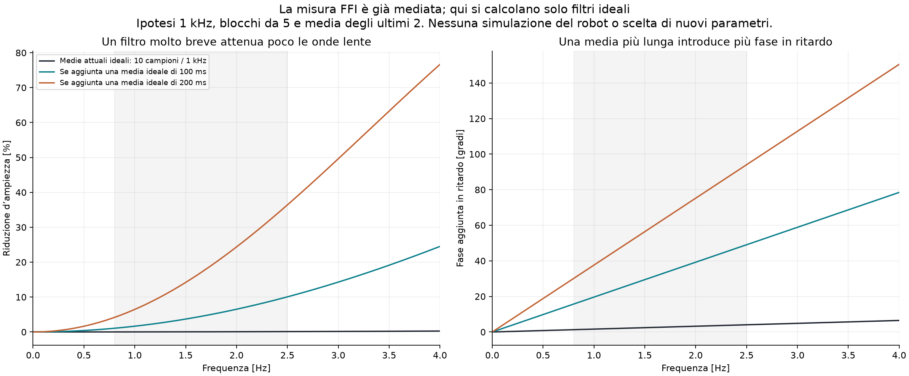

# Catena della misura e del comando: audit dei sorgenti

**La FFI non riceve il singolo campione ATI raw.** Tutti i 12 metadata originali
delle run FFI riuscite dichiarano, per entrambe le mani, `wrench_source=ft`,
topic `ft_data_avg` e rate configurato 200 Hz, stream 100 Hz. Il backend calcola
`n_avg=round((1/100)*200)=2` e passa al controller la media degli ultimi due
messaggi del buffer. «raw ft» nel CSV significa prima di bias/gravità/frame,
non senza media temporale. Nessun nuovo filtro o parametro è stato applicato.

Questa tranche legge sorgenti e metadata, **nessun CSV numerico né replay**.
I parametri dei controllori, split e risultati riservati restano congelati.

## Provenienza

Audit originale per run, SHA dei metadata e dei sorgenti, riferimenti alle
funzioni e confronto con `git show` delle revisioni registrate sono in
[SIGNAL_PIPELINE_AUDIT.json](SIGNAL_PIPELINE_AUDIT.json).
Confronti file/revisione: 72; disponibili: 72;
tutti gli anchor selezionati semanticamente uguali al sorgente corrente:
72. Sono 22 definizioni per revisione,
confrontate come AST senza commenti/numero di riga, non solo i nomi dei file.
Questo conferma la congruenza con la revisione registrata; un metadata git_dirty
non conserva il diff del file dispiegato. Il sorgente locale immutato rispetto
allo snapshot non è da solo una prova bit-per-bit del processo sul robot.

## Percorso documentato

1. [AtiNode._rx](C:/Users/Lorenzo/Desktop/kinova_dual_arm_dmp_insertion_fullwrench/kinova_dual_arm_dmp_insertion/ati_node.py:48): accumula `every` pacchetti e pubblica la media su
   `ft_data_avg`. Il default del nodo e del launch è 5. Il raw separato viene
   pubblicato solo se abilitato. `configure_sensor=false`: il rate hardware
   non viene dimostrato dal solo default del launch.
2. [AtiNode._msg](C:/Users/Lorenzo/Desktop/kinova_dual_arm_dmp_insertion_fullwrench/kinova_dual_arm_dmp_insertion/ati_node.py:40): il timestamp ROS è l'istante in cui si crea il
   messaggio medio, non il centro temporale dei campioni hardware. I primi
   due campi del pacchetto RDT sono scartati dalla routine di ricezione.
3. [_Arm._ft](C:/Users/Lorenzo/Desktop/kinova_dual_arm_dmp_insertion_fullwrench/kinova_dual_arm_dmp_insertion/ros_backend.py:181) e [_Arm.ft_last](C:/Users/Lorenzo/Desktop/kinova_dual_arm_dmp_insertion_fullwrench/kinova_dual_arm_dmp_insertion/ros_backend.py:189): nel buffer entrano vettori
   scalati in N/Nm; il timestamp è tenuto separatamente per l'ultimo messaggio,
   senza cronologia per ogni vettore. L'età usa il clock monotono alla callback.
4. [RosBackend.read](C:/Users/Lorenzo/Desktop/kinova_dual_arm_dmp_insertion_fullwrench/kinova_dual_arm_dmp_insertion/ros_backend.py:393): media gli ultimi n_avg vettori; n_avg dipende
   dal periodo configurato dello stream, **non dal dt reale FFI**. Se il loop
   rallenta non diventa automaticamente una media più lunga. Poi rimuove
   bias/peso, trasforma il wrench e usa la stessa FK snapshot per posa e frame
   del wrench di ciascun braccio ([RosBackend.ft_on_tool](C:/Users/Lorenzo/Desktop/kinova_dual_arm_dmp_insertion_fullwrench/kinova_dual_arm_dmp_insertion/ros_backend.py:383)).
5. [Insertion.normal_force](C:/Users/Lorenzo/Desktop/kinova_dual_arm_dmp_insertion_fullwrench/kinova_dual_arm_dmp_insertion/controller.py:174): proietta la forza lungo l'asse x misurato
   di ogni mano, taglia le componenti negative a 0 e somma le due normali.
6. [FFIMixin._squeeze_update](C:/Users/Lorenzo/Desktop/kinova_dual_arm_dmp_insertion_fullwrench/kinova_dual_arm_dmp_insertion/insert_ffi.py:143): il trim I usa quella somma.
   [NominalIntegral](C:/Users/Lorenzo/Desktop/kinova_dual_arm_dmp_insertion_fullwrench/kinova_dual_arm_dmp_insertion/insert_ffi.py:45) non aggiunge un filtro della forza; limita dt,
   velocità, corsa e trim. CONTROL_PERIOD 20 ms è una soglia di scheduling,
   non prova di tick realmente equispaziati.

Il controller interno `kinova_control/kinova_controller.py` non è implementato
qui: il launch passa cart_k/cart_d/kalman/friction, ma non dimostra la legge
o il filtro velocità effettivi. I commenti del launch sul Kalman non sostituiscono
quel sorgente. Non si può derivare un effetto quantitativo del damping da questa
catena esterna.

## Quanto filtrano queste medie, sotto ipotesi dichiarate

Se arrivano uniformemente 1000 campioni/s e ogni messaggio 200 Hz è davvero la
media di 5 consecutivi non sovrapposti, gli ultimi due messaggi equivalgono a
10 campioni raw consecutivi. Guadagno ideale:

`|H(f)| = |sin(pi*10*f/1000) / (10*sin(pi*f/1000))|`.

| Frequenza [Hz] | Guadagno | Riduzione d'ampiezza |
| --- | --- | --- |
| 0.8 | 0.999896 | 0.0104% |
| 1 | 0.999837 | 0.0163% |
| 1.5 | 0.999634 | 0.0366% |
| 2.5 | 0.998983 | 0.1017% |
| 5 | 0.995934 | 0.4066% |
| 10 | 0.983793 | 1.6207% |

Il ritardo di gruppo del solo filtro ideale è 4,5 ms rispetto al campione raw
più recente incluso nella media. La finestra dei blocchi è già in quei 4,5 ms;
non si somma una seconda volta. Sono esclusi coda ROS, età del messaggio alla
lettura, firmware, scheduling e servo. Per ogni ramo servono i campioni consumati.
I metadata confermano il topic e il rate **dichiarato**, non il valore runtime
di `every`, il rate hardware effettivo o l'antialiasing del sensore.
L'identità della cascata è verificata numericamente, non sui campioni delle run.

Queste medie brevi, nell'ipotesi nominale, attenuano pochissimo 0,8–2,5 Hz:
non c'è motivo matematico per aspettarsi che da sole eliminino onde di 1 Hz.
Una media aggiuntiva più lunga può attenuarle, ma cambia la fase dell'anello.
La figura illustra finestre ideali 100/200 ms, senza scegliere un controller,
senza prova di stabilità/overshoot e senza fingere una simulazione delle run.

## Il tempo del CSV non è il tempo di applicazione del nuovo ds

[Insertion.drive](C:/Users/Lorenzo/Desktop/kinova_dual_arm_dmp_insertion_fullwrench/kinova_dual_arm_dmp_insertion/controller.py:364) usa ds per generare i target. In
[Insertion.tick](C:/Users/Lorenzo/Desktop/kinova_dual_arm_dmp_insertion_fullwrench/kinova_dual_arm_dmp_insertion/controller.py:146) l'ordine è: pubblicazione dei target → wait → lettura
dei messaggi → eventuale update FFI → scrittura della riga. Quindi i target
cartesiani della riga sono già stati inviati; ds/target/diagnostica FFI possono
essere nuovi valori per i comandi successivi. Non assegnare al nuovo ds il
timestamp della pubblicazione precedente. I cicli senza update ripetono la
stessa ffi_seq. Il rate 100 Hz configurato e la soglia 20 ms non vanno confusi.

[RosBackend.command](C:/Users/Lorenzo/Desktop/kinova_dual_arm_dmp_insertion_fullwrench/kinova_dual_arm_dmp_insertion/ros_backend.py:315) mette nel messaggio il tempo ROS di pubblicazione,
ma non legge un acknowledgment del servo o il tempo effettivo di consumo.
[Log](C:/Users/Lorenzo/Desktop/kinova_dual_arm_dmp_insertion_fullwrench/kinova_dual_arm_dmp_insertion/main.py:76) salva `t` monotono all'atto del log (arrotondato a1ms), `t_wall`
wall clock a 0,1 ms, gli ultimi joint_stamp/ft_stamp e le età dalla ricezione
locale. La misura FFI e gli stati non hanno un unico timestamp hardware comune.
ft_stamp identifica l'ultimo messaggio visto dalla callback, non tutti i
campioni della media; una callback può intervenire durante una lettura.
Il metadata descrive già esplicitamente questa sequenza in `log_timing`.

Nei log dunque esistono stamp e indicatori di freschezza utili, ma non l'intera
cronologia acquisizione→media→consumo→applicazione. Un valore basso di ft_age
non certifica bassa latenza hardware-end-to-end: misura il tempo dall'ultima
callback locale. Il joint_age usa la ricezione, non il timestamp di acquisizione.
Non si convertono automaticamente questi campi in ritardo del servo.

## Conseguenza pratica

Alla proposta «mettiamo una moving average sul raw ATI» va aggiunta questa
precisazione: due medie sono già previste nella pipeline; per una nuova prova
occorre fissare **su quale segnale, con quale finestra e con quale timestamp**.
Non è stata modificata l'interpretazione dei risultati congelati né rilanciato
il tuning con uno shift temporale favorevole.

Per il damping la conclusione resta aperta: il confronto prioritario è
[D-only con FFI invariata](DAMPING_AB_PROTOCOL.md). Per distinguere il contributo
di misura e servo, il [protocollo dati](MINIMUM_IDENTIFICATION_PROTOCOL.md)
richiede i timestamp per campione/consumo e il comando realmente applicato.
Nessuna deduzione causale certa dell'origine delle onde dai soli sorgenti.
