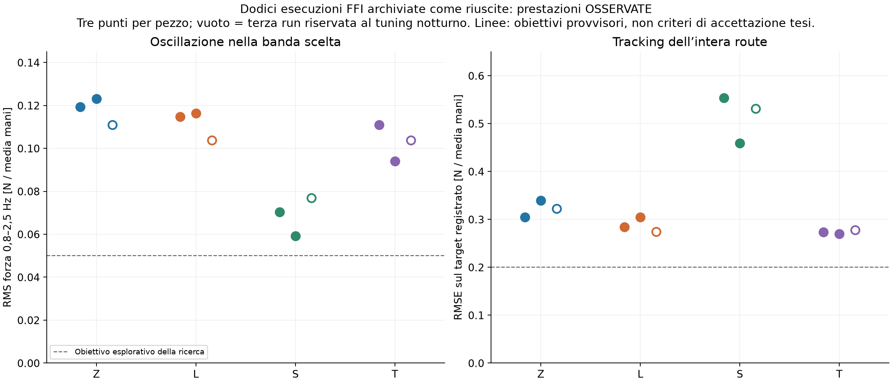

# Interpretazione dei risultati per la tesi

**La documentazione sostiene una dimostrazione sperimentale con limiti
quantificati. Non sostiene tracking preciso in ogni fase o oscillazioni eliminate.**
Non esiste nei requisiti forniti una soglia universale che renda un'oscillazione
«accettabile per una tesi». Serve dichiarare il contributo, le metriche e i limiti.
Questa sintesi non cambia i dati o i parametri per far raggiungere le soglie.

## Sul damping, prima di scegliere un controllo più complesso

L'ipotesi «magari bastava alzare il damping» è ancora **aperta**. Tutte le 12 FFI
hanno runtime D60/7. Due online D80/7 non sono confronti a FFI invariata. Il
modello URDF è fisicamente dichiarato ma non prevede bene il moto registrato;
lo sweep D60/80/100/120 è diagnostico e non sceglie un valore robot. Il parametro
ζ del replay non equivale a cart_d. Non si conclude né «D80 risolve» né «D80
non può aiutare» dai risultati attuali. Il [D-only ripetuto](DAMPING_AB_PROTOCOL.md)
rimane il prossimo confronto prioritario, previo controllo della legge interna.

## Che cosa è stato osservato

Il gruppo selezionato contiene 12 esecuzioni, tre per Z/L/S/T, archiviate come
riuscite con flag `seat_found` e senza flag JAM. **Non sono 12 tentativi totali.**
Il catalogo contiene 24 record metadata FFI e
13 flag seat_found; configurazioni, fasi e ragioni
di stop differiscono. Né 12/12 né 13/24 rappresentano una stima pulita della
probabilità di successo della configurazione finale. La classificazione
dell'archivio/operatore e l'esito algoritmico vanno tenuti distinti.

| Pezzo | RMS banda [N] | RMS banda / media [%] | RMSE route [N] | RMSE slow_seat [N] | Rate limited route [%] |
| --- | --- | --- | --- | --- | --- |
| Z | 0.111–0.123 | 2.70–2.97 | 0.304–0.339 | 0.493–0.628 | 6.8–8.8 |
| L | 0.104–0.116 | 2.18–2.45 | 0.274–0.305 | 1.396–1.521 | 11.6–12.8 |
| S | 0.059–0.077 | 1.35–1.77 | 0.459–0.554 | 0.712–1.136 | 18.4–19.2 |
| T | 0.094–0.111 | 2.06–2.43 | 0.270–0.278 | 0.301–0.449 | 5.6–7.0 |

Tutti i valori in N riguardano la **media delle mani**, non la somma o la singola
mano. Le statistiche sono quelle già salvate dall'analisi uniforme dell'archivio:
forza `fn_N/2`, target arrotondato del CSV, RMS sui campioni delle rispettive
fasi; bande con detrend/ricampionamento/filtro offline e bordi come nel sorgente
`archive_review/analyze.py` e nel suo helper. La banda è una metrica della
forza, non dell'errore; comprende anche eventuali variazioni volute del target.
Non confrontarla come identica alla banda dell'errore o alle metriche del nuovo
holdout, che usano anche target preciso e altri campionamenti dichiarati.
Nessuna nuova simulazione o lettura numerica dei CSV è fatta da questa sintesi.

Le linee 0,05 N di banda e 0,20 N di RMSE sono obiettivi esplorativi dichiarati
dalla ricerca notturna, **non criteri di sicurezza o accettazione tesi**.
Una RMS di 0,1 N non vuol dire oscillazione sempre ±0,1 N o 0,2 N picco-picco.
Solo per una sinusoide pura A=√2·RMS; queste tracce hanno transitori e più bande,
quindi non si converte automaticamente la RMS in ampiezza di ogni ciclo.

Le onde sono presenti anche nelle bag ATI 200 Hz. La registrazione a posa quasi
ferma dà circa 0,013 N di deviazione standard e 0,0011 N RMS in 0,8–2,5 Hz sulla media
mani, con condizioni diverse dalle run. Questo contrasta con l'idea che tutto
sia inevitabile rumore costante del sensore; non identifica il contributo di
rumore, servo, elasticità e contatto durante il moto. Due Z con I quasi spenta
mantengono onde ma differiscono per precarico/condizioni: non isolano solo I.
Riferimento: [analisi delle bag](../archive_review/REPORT.md).

## È meglio del feedback e SOCP online?

Per questi riferimenti storici specifici, la FFI mostra meno RMS nella banda;
il tracking completo non migliora uniformemente. È un confronto descrittivo:

| Pezzo e riferimenti | Banda storica [N] | Banda FFI [N] | RMSE storico [N] | RMSE FFI [N] |
| --- | --- | --- | --- | --- |
| Z (Z 22/10 20:20) | 0.156 | 0.111–0.123 | 0.256 | 0.304–0.339 |
| L (3 run) | 0.310–0.337 | 0.104–0.116 | 0.352–0.403 | 0.274–0.305 |
| S (2 run) | 0.326–0.425 | 0.059–0.077 | 0.726–0.749 | 0.459–0.554 |
| T (3 run) | 0.172–0.207 | 0.094–0.111 | 0.267–0.320 | 0.270–0.278 |

Le identità esatte dei nove riferimenti sono in [THESIS_EVIDENCE.json](THESIS_EVIDENCE.json).
La Z delle 20:20 ha banda 0,156 N contro circa 0,11–0,12 N della FFI, ma RMSE
route 0,256 N contro circa 0,30–0,34 N: **meno onda non significa migliore in tutto**.
Le altre righe non sono un esperimento randomizzato o abbinato; target, precarico,
guadagni, esecuzione e condizioni possono differire. Niente percentuali causali
di miglioramento del nuovo controllore o del solo SOCP offline.

Non cambia soltanto «SOCP online/offline». La Z delle 20:20 è registrata come
`insert_open.py --online --squeeze-gain 0.5`; la famiglia corrispondente integra
l'errore ATI con la precedente legge. FFI usa nominale riferito al pickup più
trim I con dt/velocità/corsa espliciti. La posizione del calcolo SOCP è un
fattore distinto dall'architettura normale e dall'eventuale feedback wrench.
Per isolare l'offline occorrono stessa legge e condizioni, variando solo quello.
Il runtime D della 20:20 non è confermato da un metadata del servo: non usarla
come confronto D60/80.

## La L è un limite ripetibile da discutere, non da nascondere

Nelle tre L il target scende 5,36→3,79 N/mano; la forza raggiunge 6,23–6,61 N dopo
circa 0,34–0,45 s. I target pubblicati aprono mentre i tool misurati continuano
temporaneamente ad avvicinarsi. Il trim I rimane fisso; il nominale occupa il
budget di apertura 2 mm/s e il trim è lontano dal finecorsa ±3 mm. Non è evidenza
sufficiente per dichiarare windup o un urto con la board come causa unica.
[Cronologia completa](../archive_review/L_TRANSIENT.md).

La variazione nominale 1,57/680≈2,31 mm per mano richiede circa 1,15 s a 2 mm/s,
senza ritardo. È il tempo del **nominale nel modello dichiarato**, non il tempo
di assestamento reale o un limite assoluto alla velocità di variazione della
forza. D maggiore non cambia il limite software, ma può cambiare la dinamica.

La S ha la banda minore ma fatica a seguire i picchi del target; ciò appare
nel maggiore RMSE e nella limitazione di velocità. Nella posa, S/T mostrano
anche asimmetria delle normali: il replay scalare non garantisce i contatti
individuali. Positività della media o `seat_found` non dimostrano margine della
presa. La verifica full wrench e la metrologia finale restano separate.

| Pezzo | believed_mm finale, range fra tre run |
| --- | --- |
| Z | -0.45–0.20 |
| L | 1.99–2.96 |
| S | 2.45–2.90 |
| T | 0.32–0.49 |

`believed_mm` è una stima cinematica interna, non una misura esterna della
quota finale del pezzo. Questi dati non sostengono accuratezza uniforme entro
0,5 mm. Per dichiarare precisione di posa servono criterio e misura indipendenti.

## Che valore hanno le simulazioni della notte

I confronti FF/P/PI/PD/PID sono stati completati con stessi limiti principali,
più stress di rumore/jitter, rigidezza e ritardo. Verifiche software, causalità
e raffinamenti sono salvati, inclusi i fallimenti dei picchi sensibili alla
griglia. Non si è continuato il tuning dopo le quattro run riservate.

Nell'unico batch congelato di 448 casi, la PI filtrata cambia lo score robusto
di -1.61%
rispetto alla FFI; nessun caso raggiunge tutti gli obiettivi esplorativi.
Il piccolo scarto non supera l'incertezza del modello. Non è stata validata
una nuova legge sul robot né una compensazione del ritardo. Le run riservate
sono holdout **retrospettivo per questo tuning**, già viste in analisi precedenti.

Tre livelli da mantenere distinti:

| Livello | Cosa fornisce | Cosa non dimostra |
| --- | --- | --- |
| Dati osservati | Prestazioni e transitori del sistema eseguito | Causa unica delle onde o risposta di un controllore mai eseguito |
| Replay condizionato | Sensibilità a leggi/impianti ipotizzati con residuo e fasi registrati fissi | Evoluzione autonoma del contatto o successo dell'inserzione alternativa |
| Simulazione autonoma e poli locali | Comportamento della matematica dichiarata e verifica implementativa | Validazione del Kinova o stabilità della presa reale |

I modelli liberi della forza dai comandi non superano il gate predittivo
esplorativo (R² mediano circa 0,36–0,40); usare moto già misurato dà un'associazione
più forte, non una previsione del nuovo moto. Fonte: [verifica empirica](EMPIRICAL_CONTROL_REPORT.md).
La I ha una ragione per compensare offset nel modello, ma non è dimostrata
causa unica delle oscillazioni; PD non è automaticamente risolutivo.

## Formulazione pronta da adattare alla tesi

> Sono state analizzate dodici esecuzioni archiviate come riuscite, distribuite
> su quattro traiettorie con tre ripetizioni per traiettoria. La configurazione
> comprende un nominale di forza derivato dal piano SOCP offline e una correzione
> integrale della normale misurata. Nella route l'RMS della forza media delle
> mani nella banda 0,8–2,5 Hz è compresa fra circa 0,06 e 0,12 N, pari a circa 1,35–2,97%
> della forza media. L'errore RMS sul riferimento registrato varia circa 0,27–0,55 N
> ed evidenzia un compromesso distinto dall'oscillazione in banda. Persistono
> transitori dipendenti dal pezzo, in particolare un eccesso di forza ripetuto
> sulla L durante la posa e difficoltà di inseguimento dei picchi sulla S.
> I confronti storici sono descrittivi e non isolano l'effetto del solo SOCP
> offline. Gli studi di controllori alternativi, pur verificati numericamente,
> non hanno fornito un modello sufficientemente predittivo o una nuova legge
> validata sul robot. I risultati documentano il funzionamento nelle condizioni
> archiviate e ne quantificano i limiti; non stabiliscono un tasso di successo
> generale, accuratezza di posa indipendentemente misurata o assenza di onde.

Questa formulazione va adattata agli obiettivi effettivi concordati per la tesi.
Non basta cambiare il nome «rumore» in «oscillazione»: occorre mostrare metriche,
finestre, condizioni e transitori, mantenendo le forze originali nei grafici.

## Prossimo esperimento minimo e materiale disponibile

Prima: confermare sorgente/versione/semantica di cart_d; poi confrontare D-only
con FFI fissa, ripetizioni bilanciate e log acquisizione–consumo–applicazione.
Se l'effetto non discrimina, identificazione separata comando→moto→forza con
ingresso noto e verifica libera su nuove run. Il [protocollo dati](MINIMUM_IDENTIFICATION_PROTOCOL.md)
è preparato; nessun robot è stato eseguito dalla campagna.

La misura ATI è già mediata: il [source audit](SIGNAL_PIPELINE_REPORT.md) spiega
le due medie e i timestamp. Filtri più lunghi o target raccordati richiedono
verificare fase, rapidità, minimi e margini originali, non solo una curva liscia.

Per riprodurre questa sintesi: `thesis_synthesis.py`, tabella delle 12 run
[thesis_observed_runs.csv](thesis_observed_runs.csv), provenance/ledger delle
affermazioni [THESIS_EVIDENCE.json](THESIS_EVIDENCE.json). Le immagini originali,
metriche e sorgenti dei singoli studi restano conservati. Nessun dato NVIDIA_RUNS,
snapshot, sorgente di produzione o vecchia analisi è stato modificato.
