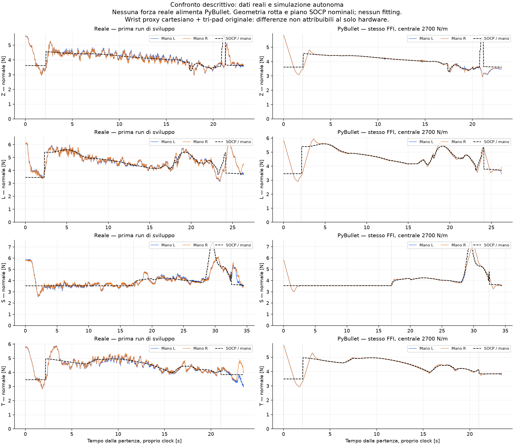

# FFI in PyBullet — centrale 2700 N/m

**Primo backend flottante. La successiva prova con Gen3 articolati e legge originale del laboratorio è in [gen3/LAB_IMPEDANCE_RESULTS.md](gen3/LAB_IMPEDANCE_RESULTS.md).**

**Prova fisica autonoma eseguita; nessun nuovo controller o parametro hardware validato.**

La configurazione richiesta è centrale assiale **2700 N/m**, tre molle pad **500 N/m ciascuna**: totale assiale del tri-pad **4200 N/m**. Le precedenti prove con totale2700/centrale1200 sono conservate e superate; non vengono rietichettate.

Si importa il controller delle run senza modificarlo: FFI Ki0.0016 sul totale delle forze, k_eff680, trim±3mm, totale±12mm, 2mm/s; pickup I e sequenza completa originali. K cartesiano1500/20, D60/7, scala/masse/rotte/config dai metadata di sviluppo. Nessuna forza reale viene fornita al motore.

## Risultati della configurazione richiesta

Normale e bande si riferiscono alla **media delle due mani**, non al picco-picco. RMSE e bande sono calcolate sulla fase route; i transitori di cambio fase sono riportati nelle figure. La banda della forza comprende anche le variazioni del target: si conserva separatamente la banda dell’errore.

| Caso | dt ms | RMSE route N | RMS forza .8–2.5Hz N | RMS errore .8–2.5Hz N | Errore finale cella peggiore mm | seat_found |
|---|---:|---:|---:|---:|---:|---|
| L_central2700_D60_dt025 | 0.25 | 0.275 | 0.042 | 0.090 | 6.18 | True |
| L_central2700_D60_dt05 | 0.5 | 0.275 | 0.042 | 0.090 | 5.25 | True |
| S_central2700_D60_dt05 | 0.5 | 0.292 | 0.028 | 0.052 | 8.85 | True |
| T_central2700_D60_dt05 | 0.5 | 0.199 | 0.022 | 0.078 | 4.95 | True |
| Z_central2700_D60_dt025 | 0.25 | 0.288 | 0.040 | 0.091 | 77.33 | True |
| Z_central2700_D60_dt05 | 0.5 | 0.295 | 0.040 | 0.092 | 78.13 | True |

La posa vera è letta esclusivamente per la valutazione: massima distanza dei quattro centri cella dal target dopo rilascio e ritirata. Il flag seat_found proviene invece dalla sentinella basata sul wrench: può dichiarare appoggio senza garantire precisione geometrica. Un singolo replay nominale non misura una probabilità di successo.

## Verifica del passo numerico

I coefficienti di smorzamento delle molle sono congelati al riferimento0.25ms: si è verificata identità di K e C tra i raffinamenti della serie centrale2700. Non si cambia damping fisico per far migliorare il risultato.

- Z_central2700_D60_dt05 → Z_central2700_D60_dt025: ΔRMSE=0.00769N, ΔRMSbanda=0.00010N; Δerrore geometrico finale=0.80mm.
- L_central2700_D60_dt05 → L_central2700_D60_dt025: ΔRMSE=0.00001N, ΔRMSbanda=0.00002N; Δerrore geometrico finale=0.93mm.

La prova iniziale a1ms con meccanica originale è abortita in aria e rimane conservata. Le prime prove originale21500 utilizzavano il cap di C legato a dt; non costituiscono un raffinamento a identica fisica. Il loro cambiamento della posa Z non viene usato per attribuire una causa hardware.

## SOCP e wrench ai polsi

Il SOCP completo è ricalcolato offline come nelle run: input, forze per pad, margini e residui sono in socp_allocations.json; profilo di entrambi i wrench in profile.csv. Le statistiche SOCP durante il moto sono zero perché il piano è già risolto. Il confronto con i profili originali conserva uguali righe e fasi; differenze numeriche massime di tutti i componenti inferiori a0.001 nelle unità rispettive.

La misura FT è la reazione delle molle sulla flangia, con gravità del tool rimossa e inerzia conservata. Sono registrati sei componenti per mano, forze di contatto, normali dei tre pad, deformazioni, pose e diagnostiche FFI. La misura non è il wrench richiesto dal SOCP. Il controller originale regola solo la normale: nessun anello di momento/tangenziale è stato aggiunto.

## Cosa conclude questo confronto

La simulazione permette di verificare il codice, la fattibilità del piano e i transitori nel modello dichiarato. Non dimostra che ogni differenza dal reale sia dovuta a cambiamenti hardware: il modello non è stato identificato/validato sui dati reali in questa nuova prova e il servo interno Kinova non è disponibile. Eventuali oscillazioni o overshoot nominali sono compatibilità del modello, non ricostruzioni causali certe delle run.

Restano dichiarati: impedenza cartesiana flottante, non sette giunti Kinova; masse originali del tool (140g oltre il polso, flangia50g), inerzia di flangia0.05kgm²; rigidezze laterali e torsionali originali, contatto8000N/m–207Ns/m, pezzi/vicini50g, nessun rumore o latenza di rete. Centrale2700 non identifica da sola queste proprietà. Il k_eff del controller rimane680 anche se la serie elastica nominale 1500–4200 dà circa1105N/m prima del contatto.

## Grafici e riproducibilità

Per ogni run: force_tracking.png, wrist_wrench.png (sei componenti locali), socp_wrench.png (momenti della misura al centro attuale, target al centro nominale), trace.npz e CSV. La GIF Z è la registrazione del caso a0.5ms, non una previsione del robot. Tutti i source dei runner sono conservati per run.

Verifiche: backend_checks_central2700.json; central2700_verification.json; input_integrity_and_profile_parity.json; runtime_provenance.json. Originali verificati SHA-256: 765file NVIDIA, 4080005175byte, 332 sorgenti runtime invariati. Baseline ZIP intatto. Nessun ROS, robot, deploy, push o modifica di produzione.
