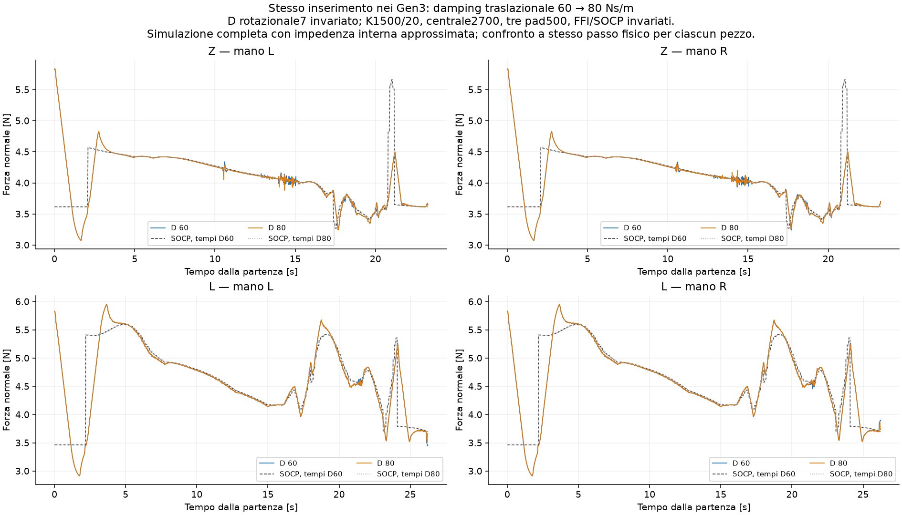
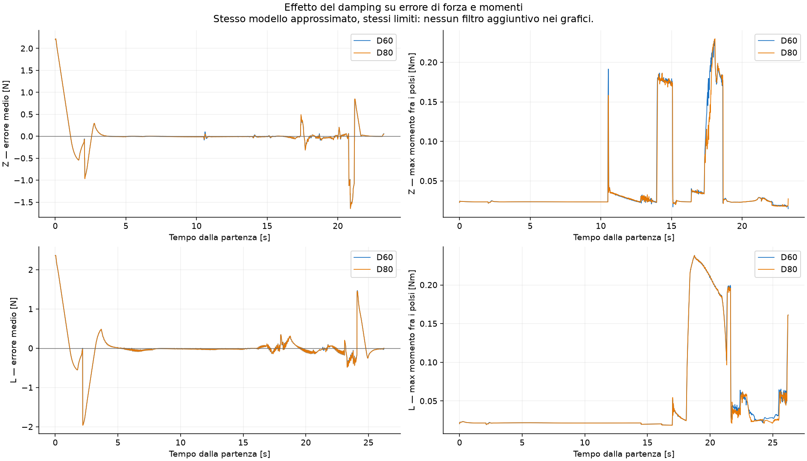
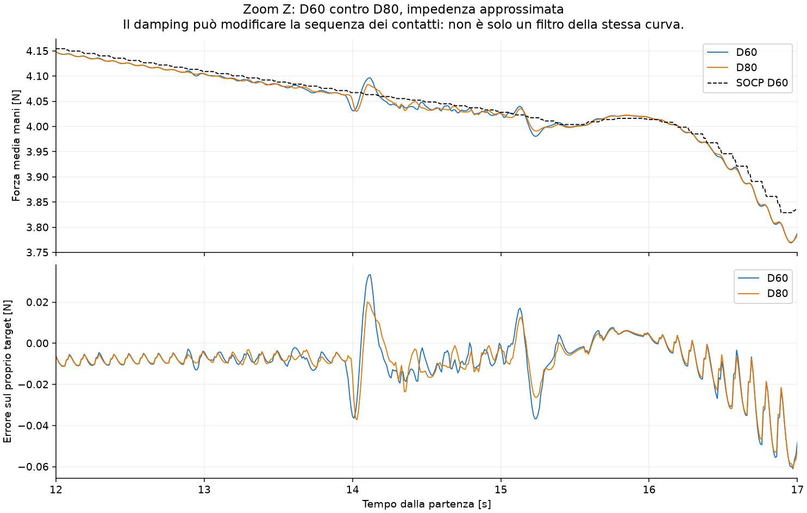
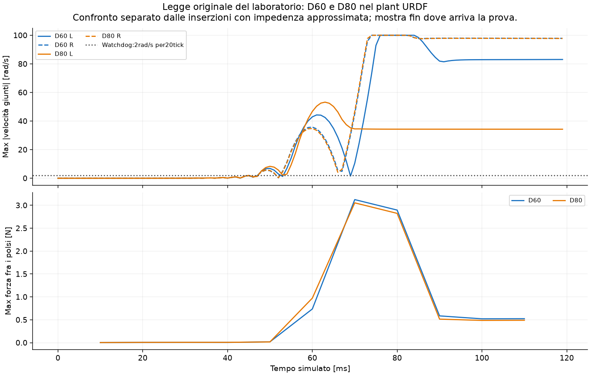

# Damping60 → 80 nei Gen3 simulati

Si cambia solo D traslazionale da60 a80Ns/m. D rotazionale7, K1500/20, centrale2700 + tre pad500, FFI, limiti2mm/s e±12mm, masse, rigidezze/smorzamenti meccanici e passo fisico rimangono identici nel confronto di ciascun pezzo. Verificati byte identici di URDF e profilo SOCP offline.

Le inserzioni complete usano lo stesso servo implicito approssimato già mostrato. Separatamente si cambia D anche nella legge originale del laboratorio, senza modificarne le classi.

**Esito: D80 non è risolutivo nel modello. RMSE, banda lenta e overshoot restano quasi uguali.** La banda della forza 2.5–10 Hz diminuisce del 15.7% sulla Z e del 9.3% sulla L. La legge originale continua a fermarsi a0.12s nel plant URDF; l’aumento traslazionale non elimina quello stop.

| Pezzo | D | RMSE route N | RMS forza0.8–2.5Hz N | RMS errore0.8–2.5Hz N | Overshoot route N | Overshoot seduta N | Errore finale mm |
|---|---:|---:|---:|---:|---:|---:|---:|
| Z | 60 | 0.209 | 0.042 | 0.086 | 0.489 | 0.850 | 4.41 |
| Z | 80 | 0.210 | 0.042 | 0.086 | 0.492 | 0.852 | 4.55 |
| L | 60 | 0.277 | 0.044 | 0.089 | 0.483 | 1.470 | 4.78 |
| L | 80 | 0.278 | 0.044 | 0.089 | 0.486 | 1.456 | 4.42 |

Le bande sono RMS della media delle mani, non picco-picco. La banda della forza contiene anche variazioni del riferimento: per questo si riporta la banda dell’errore. L’errore finale è la peggiore cella dopo rilascio/ritirata, non il flag seat_found. Il tempo della prima finestra200ms entro±0.1N dopo l’inizio rotta è in results.json: è un descrittore del transitorio su target variabile, non un tempo di assestamento da step ideale.

## Codice originale

- D60: stop a0.120s, Abort('right flange 43 mm from its target'); eventi[{"t": 0.07200000000000001, "side": "R", "event": "velocity_watchdog_gravity_only"}, {"t": 0.089, "side": "L", "event": "velocity_watchdog_gravity_only"}].
- D80: stop a0.120s, Abort('right flange 41 mm from its target'); eventi[{"t": 0.067, "side": "L", "event": "velocity_watchdog_gravity_only"}, {"t": 0.07200000000000001, "side": "R", "event": "velocity_watchdog_gravity_only"}].

Questo confronto non modifica il damping rotazionale e non identifica i limiti del plant URDF. Nessuna conclusione automatica sul robot reale.

