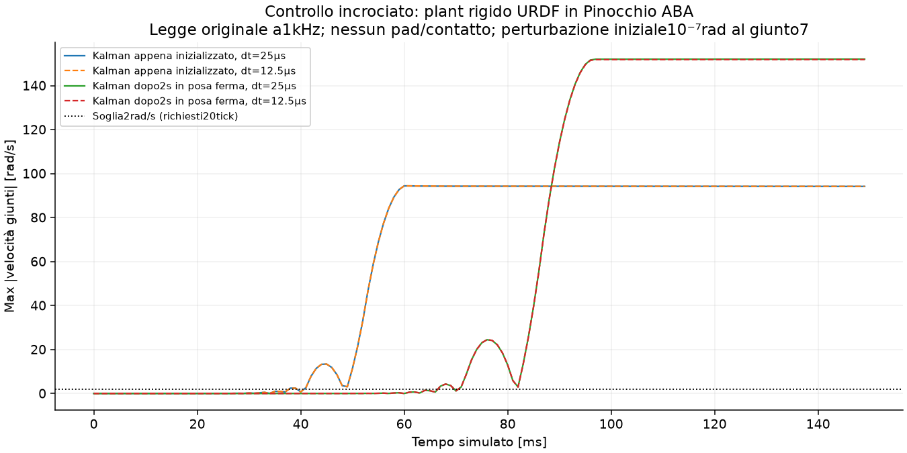

# Impedenza originale del laboratorio — prova autonoma

**Legge originale integrata ed eseguita. Il plant nominale non supera il mantenimento in aria: non è ancora un simulatore validato per giudicare l’inserimento reale.**

## Cosa è identico al riferimento fornito

La copia trovata nei Download ha2092 righe e SHA-256 `685c80b14b527d450d6d42a03f779d04f928a4e2d31d22b44c9733d7a98cbfba`. È conservata integralmente in lab_source/kinova_controller_original.py. ControlMode, angle_diff e le quattro classi matematiche vengono estratti testualmente, senza importare ROS/Kortex. Il corpo eseguibile di compute_torque e estimate_wrench coincide con il codice VERBATIM incollato da Lorenzo: confronto AST in user_reference_check.json. Questo conferma i metodi forniti, mentre l’hash dell’intero file effettivamente sulla NVIDIA resta non verificato.

Si usa Pinocchio reale4.1.0 per FK, Jacobiano e gravità del modello originale150g. Stessi K1500/20, D60/7, joint damping0.001, clip35Nm sui primi4 e12Nm sugli ultimi3, filtro RC100Hz, Kalman con r_q=1e-6,r_dq=2.5e-5,q_ddq=1, slew0.5Nm/tick e watchdog2rad/s per20tick. Null stiffness0. Friction abilitata ma scale0, come default non sovrascritto dal launch: contributo nullo. Non si inventano coefficienti per il file gen3_bare.urdf mancante.

Il wrapper riproduce feedback in gradi/radianti, torque_sensor=-tau_motor applicata nel tick precedente, sequenza Kalman→compute_torque→slew e pubblicazione250Hz di pose e wrench stimato. Le pose usate dall’outer loop sono mantenute fra le pubblicazioni. Il segnale ATI simulato resta separato dal wrench stimato dalle coppie. Entrambi sono salvati; nessuno viene sostituito con il target SOCP.

## Cosa è un modello

Due Gen3 articolati, nella geometria nominale dei metadata del lab; mesh ufficiali e URDF locale, gravità, pezzo/vicini dinamici e tri-pad. Centrale2700N/m, tre pad500N/m ciascuno: totale4200N/m. Tool150g, di cui40g mobili. FFI e SOCP originali, nessun tuning. Il piano offline è ricalcolato e salvato anche quando il robot simulato abortisce prima del pickup.

Il nodo ROS intero e il trasporto Kortex non vengono avviati: si eseguono le classi matematiche e il contratto del loop in tempo virtuale deterministico1kHz. Nessun jitter/rumore di rete inventato. L’homing di8s e lo spostamento fino alla presa non sono simulati: il setup inizializza la posa aperta della presa. Si distingue un Kalman appena inizializzato da una covarianza assestata con2s di feedback costante. Quest’ultimo controlla l’effetto dell’inizializzazione, senza modificare i gain.

## Verifiche prima di interpretare il fallimento

- 40 pose: massimo errore FK Pin/Bullet 3.58e-08 m; Jacobiano 3e-15; gravità 3.38e-06 Nm. La gravità confronta correttamente 110 g rigidi + 40 g nominali con il tool 150 g originale.
- Nessun contatto iniziale dei bracci con altri corpi nella posa di prova.
- Sensore meccanico verificato separatamente in aria e in compressione statica: articulated_sensor_checks.json.
- Nelle prove aggiornate si verifica il segno del feedback di coppia e il massimo incremento 0.5 Nm/tick direttamente dalle tracce.
- estimated_wrench_sign_check.json verifica wrench nullo con torque_sensor=-g e recupero delle sei componenti di un carico esterno noto (errore massimo inferiore a2e-15 nelle rispettive unità).

## Esito delle prove con la legge originale

| Caso | dt fisico ms | Fine s | Primo watchdog s | Ultima fase |
|---|---:|---:|---:|---|
| Gen3Lab_Z_central2700_dt025 | 0.25 | 0.240 | 0.060 | to_open_pose |
| Gen3Lab_Z_central2700_warm_dt025 | 0.25 | 0.120 | 0.072 | to_open_pose |
| Gen3Lab_Z_hold_dt0125 | 0.125 | 0.220 | 0.060 | start |
| Gen3Lab_Z_hold_dt025 | 0.25 | 0.240 | 0.060 | start |
| Gen3Lab_Z_hold_warm_dt0125 | 0.125 | 0.120 | 0.067 | start |

Le prove aggiornate con filtro assestato si fermano prima del pickup: il watchdog passa a sola gravità e la sentinella esterna interrompe per errore di posa. Le run più vecchie conservano inizializzazione del filtro fresca e meno telemetria; non vengono rietichettate come prove aggiornate. **Nessuna di queste prove misura RMSE di inserimento, overshoot di inserimento o probabilità di successo.**

Il confronto indipendente usa il plant rigido dello stesso URDF in Pinocchio ABA, senza Bullet, pad o contatti. Con perturbazione iniziale di10⁻⁷rad al giunto7, il watchdog scatta a60ms con Kalman fresco e90ms con covarianza assestata, sia con dt25µs sia con12.5µs. Questo esclude che basti attribuire il fenomeno ai contatti dei pad o al solo solver Bullet; non prova che il robot reale abbia tale instabilità.

## Conclusione utilizzabile

Il controller originale ora è nel simulatore, ma **stesso controller non rende automaticamente uguale il plant**. Il modello URDF rigido e la realizzazione ideale dell’attuatore non riproducono ancora il mantenimento che il robot reale sa fare. Occorre verificare configurazione effettiva e dinamica degli attuatori, inerzie riflesse/trasmissione, attrito/damping fisico e filtri interni Kortex. Dai dati di questa prova non si identifica quale contributo sia responsabile. Non si aggiunge damping o inerzia arbitraria per far riuscire il grafico.

Le precedenti inserzioni con impedenza implicita approssimata rimangono confronti preliminari: Z passa da77.2mm a4.4mm raffinando dt0.5→0.25ms; L ha4.8mm a0.5ms. Quindi né il primo fallimento Z né la successiva riuscita approssimata possono essere attribuiti al controller originale o a cambiamenti hardware.

Dati minimi per proseguire con una previsione affidabile: parametri e versione effettivi del nodo; breve tratto reale in aria di q,dq,coppia misurata/coppia comandata e timing; informazioni disponibili su attuatore/trasmissione e filtri. La prima verifica deve riprodurre il mantenimento e una piccola variazione libera; solo dopo ha senso valutare oscillazioni e overshoot dell’inserimento.

## File

- run_lab_impedance.py; lab_source/; user_reference_check.json; lab_model_checks.json; lab_verification.json.
- ../runs/Gen3Lab_*/: trace.npz/CSV, laboratory_loop_1kHz.npz, robot_used.urdf, sorgente per run, piano e allocazioni SOCP, diagnosi e GIF quando richiesta.
- Prove aggiornate: kortex_feedback_1kHz.npz e node_publish_250Hz.npz, quest’ultimo con wrench stimato in frame EE locale e posa tool pubblicata.
- rigid_pin_hold*.npz/json: diagnostica separata del plant rigido; pin_runtime_provenance.json per il runtime isolato.
- Originali verificati in ../input_integrity_and_profile_parity.json. Nessun ROS, robot, deploy, push o modifica di produzione.
