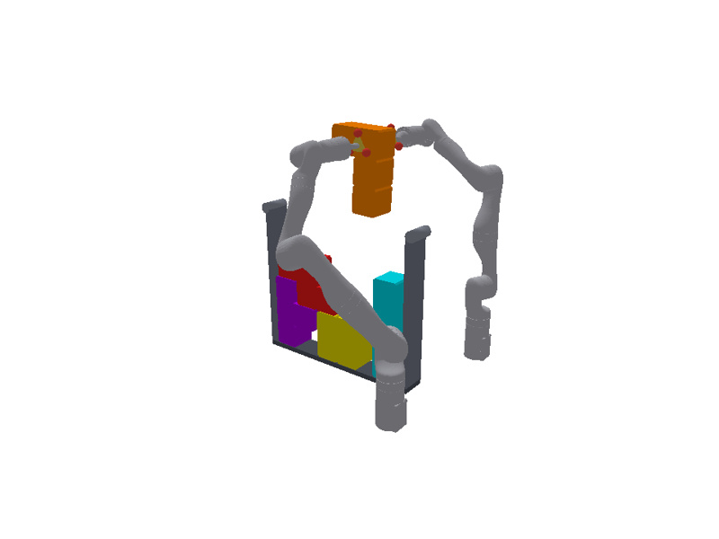
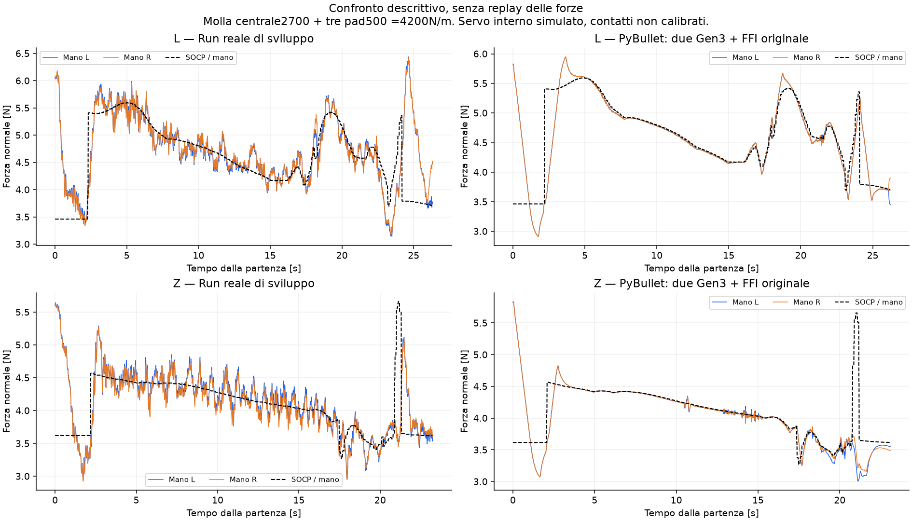

# Due Kinova Gen3 in PyBullet, molla centrale2700

**Archivio preliminare con impedenza approssimata. Per la legge originale fornita da Lorenzo leggere [LAB_IMPEDANCE_RESULTS.md](LAB_IMPEDANCE_RESULTS.md).**

Eseguito il controller esterno FFI originale, con piano SOCP offline ricalcolato, su due Gen3 articolati e contatti dinamici. Questa è una simulazione autonoma, non un replay delle forze.

## Geometria e parametri

Mesh ufficiali Kinova, revisione fissata in mesh_provenance.json; cinematica e inerzie da urdf/gen3_ati_tool.urdf, copia derivata locale. Le basi sono poste nel frame scaffale con le shelf_in_base delle run: L=(0.7525,-0.3025,0.030)m, R=(0.7525,0.2975,0.030)m; distanza0.600m e rotazione180° attorno a z. Scaffale, pezzo, vicini, grasp e rotta provengono dalla configurazione nominale. Non è stata eseguita una nuova calibrazione fisica del lab.

FK indipendente e posizione tool della prima riga reale sono controllate prima della simulazione; gli angoli reali iniziali servono come seed IK, non come traiettoria imposta. Dopo inizializzazione i giunti evolvono sotto coppie, gravità e collisioni.

Centrale assiale2700N/m, tre pad500N/m ciascuno: totale4200N/m. Massa tool150g (110g rigidi +40g piastra/pad), come metadata; inerzia del supporto ancora approssimata. Altre rigidezze e smorzamenti del modello originale, C fissato al riferimento0.25ms. Contatto nominale8000N/m,207Ns/m; attrito pad-pezzo1. Proprietà non identificate sul banco.

FFI Ki0.0016m/(Ns) sull’errore sommato, k_eff680N/m per mano, trim±3mm, totale±12mm, velocità2mm/s; pickup, sentinelle e sequenza originali. K cartesiano1500/20 e D60/7; nessun tuning o anello esterno PD aggiunto.

## Servo interno: limite importante

Queste prove sono state costruite prima di trovare il codice del servo nei Download. Si realizza un’impedenza cartesiana nominale in coppia, a1kHz, con gravità/Coriolis, limiti di coppia URDF e damping nullo proiettato0.2. La discretizzazione localmente implicita include la reazione FT corrente nel predittore di accelerazione; non usa forza futura. I gain continui restano invariati, ma questa realizzazione non è una replica verificata del firmware reale.

La prima realizzazione esplicita è abortita in aria: piccole inerzie dei polsi e D rotazionale7 hanno prodotto instabilità numerica e saturazione. Il fallimento, il probe e i sorgenti sono conservati; non è un risultato del robot. La variante implicita è stata prima verificata in posa ferma e poi sull’inserimento completo.

## Risultati

RMSE e bande sono della forza media delle due mani nella fase route. Il flag seat_found è la sentinella del controller; l’errore geometrico usa invece la posa vera dopo rilascio e ritirata, mai fornita al controller.

| Caso | dt ms | RMSE N | RMS forza0.8–2.5Hz N | RMS errore0.8–2.5Hz N | Errore cella peggiore mm |
|---|---:|---:|---:|---:|---:|
| Gen3_L_central2700_implicit_dt05 | 0.5 | 0.277 | 0.044 | 0.089 | 4.78 |
| Gen3_Z_central2700_implicit_dt025 | 0.25 | 0.209 | 0.042 | 0.086 | 4.41 |
| Gen3_Z_central2700_implicit_dt05 | 0.5 | 0.276 | 0.042 | 0.088 | 77.16 |

Raffinamento a identici K/C, masse, servo e frequenza di controllo:

- Gen3_Z_central2700_implicit_dt05 → Gen3_Z_central2700_implicit_dt025: ΔRMSE0.0674N, Δerrore geometrico72.74mm.

## Misure e interpretazione

Un giunto fisso FT misura la reazione trasmessa dalle molle al supporto al polso. Si rimuove la gravità dei40g mobili e si conserva la loro inerzia; il supporto rigido a monte del giunto sensore contribuisce alla dinamica del robot ma non alla misura FT. Questo non riproduce esattamente la collocazione e ogni inerzia dell’ATI fisico. Sono conservati sei componenti per mano a1kHz, blocchi mediati5ms e misura usata dal controller (ultimi due blocchi); contatti/pad sono registrati separatamente.

Il SOCP alloca il wrench completo; il controller FFI delle run controlla solo la normale. Le coppie e forze tangenziali rimangono misure, non target inseguiti da un nuovo regolatore. Zero solve durante il moto significa SOCP offline già eseguito.

La presenza di oscillazioni o di errori geometrici in questo modello dimostra che possono emergere anche senza rumore ATI o cambiamenti hardware. La loro assenza non dimostrerebbe che il reale deve essere regolare: servo, contatti, inerzie e latenza restano da validare. Il confronto reale/simulato è descrittivo e non attribuisce una causa certa all’hardware.

Per ogni caso: force_tracking.png, wrist_wrench.png, socp_wrench.png, joints.png, trace.npz/CSV, joint_telemetry.npz, profile.csv, socp_allocations.json, robot_used.urdf e runner_source.py. GIF nel caso Z a0.5ms. Verifiche del sensore in articulated_sensor_checks.json; integrità originali in ../input_integrity_and_profile_parity.json.
