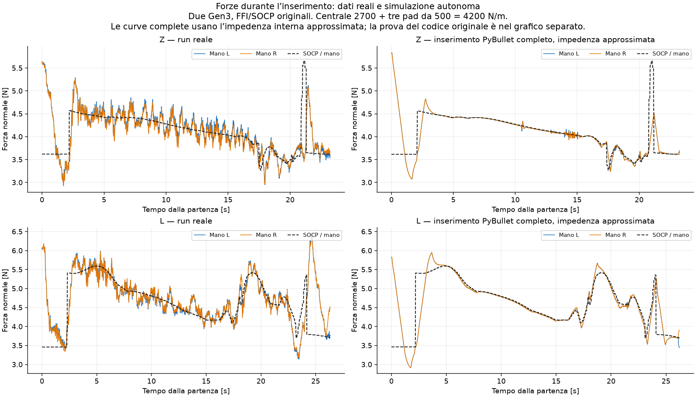
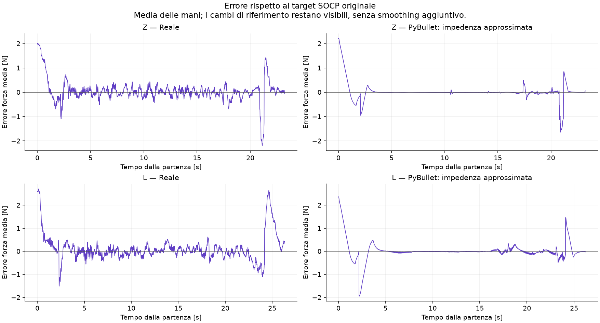
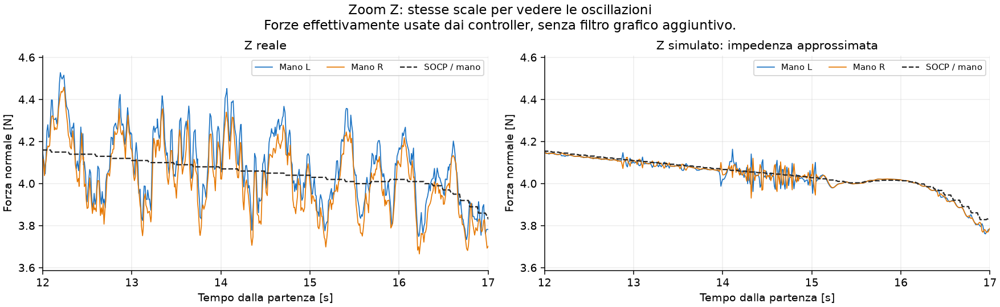
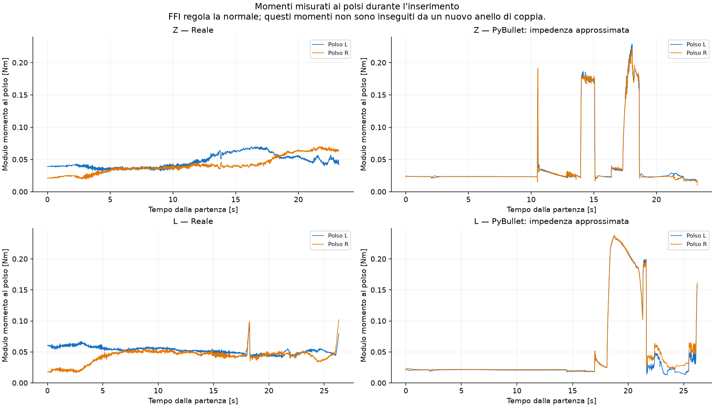
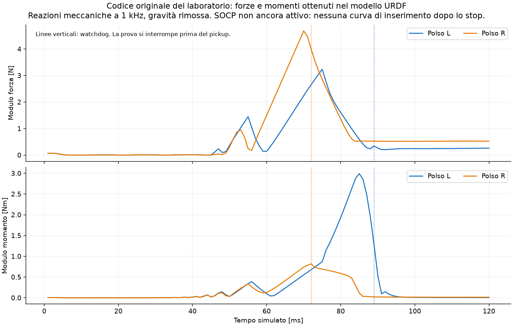

# Grafici pronti

Le curve complete Z/L usano FFI/SOCP originali e due Gen3 con impedenza interna approssimata. Z usa il passo più fine disponibile (0.25ms); L0.5ms. Centrale2700 + tre pad500N/m. La prova con il codice originale del laboratorio è mostrata separatamente fino allo stop reale nel simulatore.

## Numeri principali

| Pezzo | RMSE reale N | RMSE sim N | RMS banda0.8–2.5 reale N | sim N | Errore geometrico sim mm |
|---|---:|---:|---:|---:|---:|
| Z | 0.301 | 0.209 | 0.125 | 0.042 | 4.41 |
| L | 0.282 | 0.278 | 0.115 | 0.043 | 4.78 |

Banda e RMSE della media delle mani. RMS di banda non significa picco-picco. Metriche per mano e transitori in metriche.json. Nessuna nuova simulazione, modifica di modello o tuning per produrre questi grafici.

Sei componenti e SOCP completo: ../runs/Gen3_Z_central2700_implicit_dt025/wrist_wrench.png e socp_wrench.png; analoghi file per L. Prove floating-plate su quattro pezzi conservate in ../real_vs_bullet_central2700.png.
