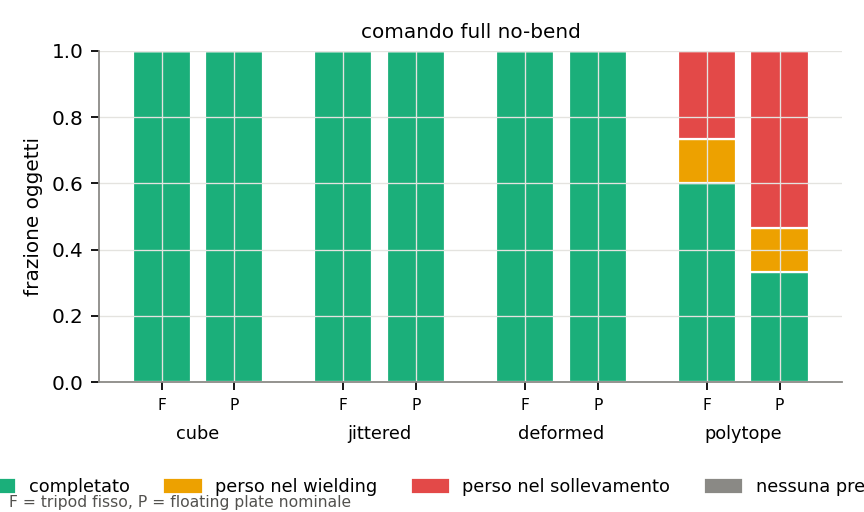
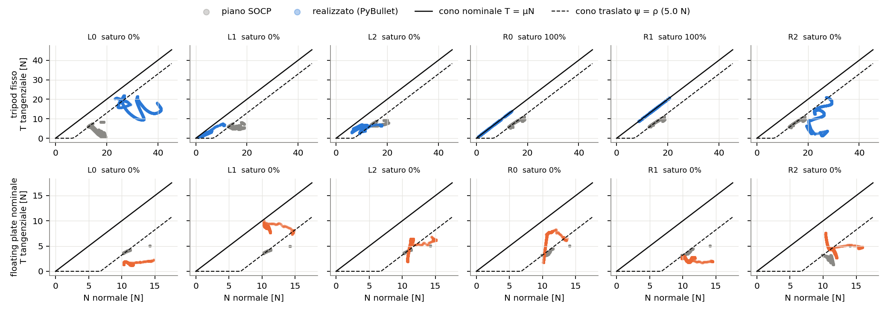
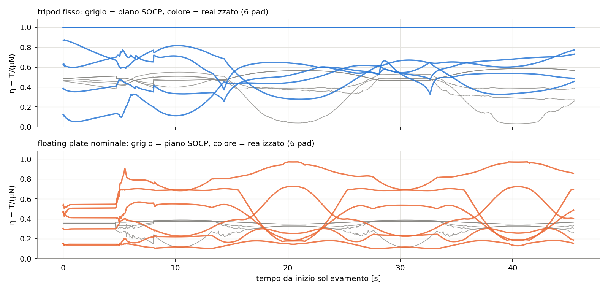
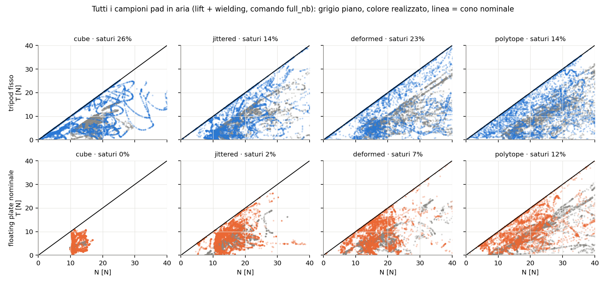
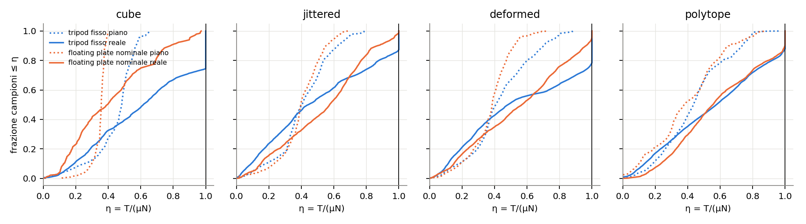
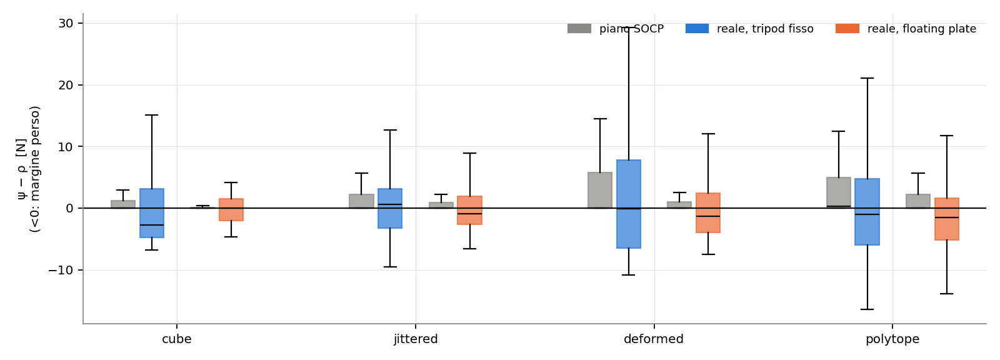
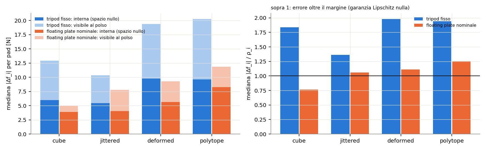
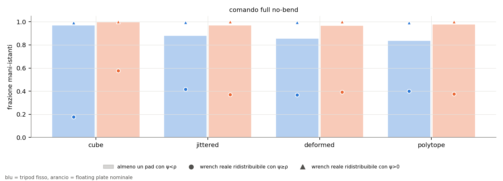
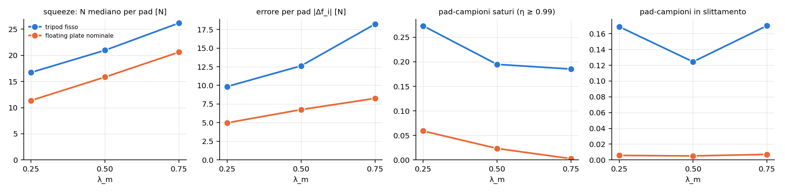

# Coni d'attrito: tripod fisso vs floating plate nominale

Studio PyBullet, 24 ottobre 2026, **μ_eff = 1**. 38 oggetti di TESI_antiG (3
cubi, 10 cubi jittered, 10 cubi deformati, 15 poliedri) × 2 tool. Per ogni tick
dell'allocatore si confrontano le sei forze per pad **pianificate** dalla SOCP
con le sei forze **realizzate** ai punti di contatto di PyBullet (normale e
tangenziale, dal manifold).

Configurazione di default:
- SOCP del robot con cono traslato, `no_bending` e **margine λ_m = 0.5**;
- esecuzione in **feedforward sul wrench completo alla Wong** (sezione "Legge
  di esecuzione").

Come riferimenti restano lo sweep del margine (λ_m = 0.25 e 0.75, sezione 5) e
la campagna con la legge proporzionale e lo squeeze scalare
(`sens_admittance_mu1/`).

## Legge di esecuzione

A ogni tick di controllo (50 Hz), per ciascuna mano k:

1. La **SOCP** (`kinova_dual_arm_dmp_insertion/socp.py`) usa le posizioni e le
   normali misurate. Il cono è ψ_i = (μN − ‖T‖)/√(1+μ²) ≥ ρ_i, con
   ρ = λ_m ‖F_task‖ + λ_CoM, **λ_m = 0.5**, λ_CoM = 1 N, distribuito con
   ‖(G⁺G)_i‖; prior TP-GMM, `w_force = 0`, **`no_bending = true`**. Dalle forze
   per pad si ottiene il wrench desiderato sul pezzo al polso:
   W\*_k = [Σ f_i ; Σ (p_i − x_k) × f_i].
2. **Zero alla presa.** Alla prima lettura con entrambe le mani a contatto si
   registra il wrench misurato W_pick,k, salvato nel frame della mano e
   trasportato con la presa.
3. **Feedforward**: bias di posa a 6 DoF del flange
   u_k = K_eff,k⁻¹ (W\*_k − W_pick,k)
   - fisso: K_eff = impedenza del polso, diag(1500, 1500, 1500 N/m;
     40, 8, 8 Nm/rad), nel frame della mano;
   - plate: K_eff = (K_polso⁻¹ + C_plate)⁻¹, con C_plate la cedevolezza 6×6 di
     `floating_plate.stiffness_6x6`, trasportata dal centro del plate al polso.
4. **Limiti**: ‖u‖ ≤ 50 mm e 0.35 rad; velocità ≤ 10 mm/s e 0.1 rad/s.
5. **Posa ghost** = posa comandata della pipeline + u_k. L'**impedenza** sulla
   base del tool è F = K_p (x_ghost − x) − K_d v + m g, con K_p = 1500 N/m,
   K_d = 15 Ns/m, e τ = diag(40, 8, 8)·e_R − 1.15 ω.
6. **Nessun feedback** sul wrench misurato. Con allocazione rifiutata o una
   mano senza contatto, il bias resta fermo.

Implementazione: `ffi_wrench.py` (`--wrench-law ff`, default). Con
`--wrench-law ffi` si aggiunge un integratore su tutti e 6 i componenti, non
usato in questo studio.

### Quanto è diversa dai riferimenti

| | feedforward | zero di forza | rigidezza | feedback sul wrench | flettente | margine | contatto |
|---|---|---|---|---|---|---|---|
| **questo studio** | wrench a 6 componenti per mano | presa misurata | polso; col plate in serie al 6×6 | nessuno | nullo (vincolo SOCP) | ψ ≥ ρ, λ_m 0.5, 1 N | 3 sfere puntiformi |
| **Wong et al.** (eq. 48–50) | u = z_ref + K⁻¹ w_des, 6 componenti per mano | geometrico, z_ref dalla traiettoria della scatola | impedenza Kinova 1000 N/m, 10 Nm/rad | PID sull'errore, "primarily along the squeezing direction" | nullo (Π τ = 0) | limite ellittico, r_s = 0.10 | patch 7×10 cm |
| **Keeping Contact** | u = p̃_i(q) + K⁻¹ f̃_i, forza per contatto | geometrico, p̃_i dalla posa pianificata | 1000 N/m, 20 Nm/rad | nessuno | n.d. (contatti emisferici) | ψ ≥ ρ, λ_m 0.25, 0.5 N | 2 contatti + perno ambientale |
| **tuo `insert_ffi`** | solo normale: (N\* − N_pick)/k_eff, uguale per le due mani | presa misurata | k_eff assiale con la molla in serie (964 o 680 N/m) | I sulla somma delle normali (1.6 mm/(N s), ±3 mm) | opzionale | ψ ≥ ρ, λ_m 0.25, 1 N | 3 sfere |
| **Vitus** (sim) | x_ghost = x_attuale + (F_des + m g)/K, forza 3D | posizione attuale della mano, riancorata a ogni tick | 800 N/m, K_d 50, saturazione ±50 N | nessuno (solo un PD sull'inclinazione dell'oggetto, dentro la SOCP) | n.d. | floor 1 N | 1 sfera con spinning friction 100 |

Le differenze in breve:
- **Rispetto a Wong**: stessa legge e stessa restrizione sul flettente. Mancano
  il suo PID sullo squeeze e la sua patch estesa. Cambia l'origine dello zero
  di forza: qui viene dalla presa misurata. Se K_eff è giusto le due forme
  coincidono, perché z_0 = posa_pick − K_eff⁻¹ W_pick.
- **Rispetto a Keeping Contact**: lì il feedforward è per contatto (2 contatti
  comandati direttamente). Qui ogni mano ha 3 punti e si comanda solo la loro
  somma, quindi resta lo spazio nullo. Il margine qui ha λ_m doppio.
- **Rispetto a `insert_ffi`**: qui tutti e 6 i componenti in feedforward e
  nessun integratore; lì solo la normale, con integratore.
- **Rispetto a Vitus**: anche lui è quasi solo feedforward di forza, ma
  riancora il ghost alla posizione misurata a ogni tick. In pratica applica la
  forza direttamente, senza modello di rigidezza, e lavora su un contatto
  puntiforme unico che regge torsione per via dell'attrito di spinning.

## Tre livelli di "dentro il cono"

1. **Cono fisico, ψ ≥ 0.** PyBullet non lo viola mai (0.0% dei campioni). Una
   "violazione" appare come pad **saturo** (η = T/μN ≥ 0.99), cioè in
   slittamento incipiente, e quando dura come slittamento misurato.
2. **Cono traslato per pad, ψ ≥ ρ_i**: il vincolo della SOCP.
3. **Margine a livello di wrench**: t\* = max t con ψ_i ≥ t su tutti i pad, per
   il wrench *realizzato* della mano.

| famiglia | tool | saturi | ψ < ρ | slittamento | \|Δf\|/ρ | errore F / M flange | wrench con t\* ≥ ρ | t\*/ρ | esiti |
|---|---|---|---|---|---|---|---|---|---|
| cubi | fisso | 0.25 | 0.67 | 0.03 | 2.01 | 9.3 N / 0.83 Nm | 0.18 | 0.59 | 3/3 |
| cubi | plate | 0.00 | 0.50 | 0.00 | 0.73 | 0.8 N / 0.10 Nm | 0.58 | 1.01 | 3/3 |
| jittered | fisso | 0.14 | 0.47 | 0.13 | 1.46 | 2.1 N / 0.39 Nm | 0.42 | 0.96 | 10/10 |
| jittered | plate | 0.00 | 0.59 | 0.00 | 1.14 | 1.4 N / 0.31 Nm | 0.37 | 0.88 | 10/10 |
| deformati | fisso | 0.26 | 0.56 | 0.10 | 2.21 | 4.3 N / 0.71 Nm | 0.37 | 0.80 | 10/10 |
| deformati | plate | 0.04 | 0.60 | 0.00 | 1.16 | 2.3 N / 0.33 Nm | 0.39 | 0.92 | 10/10 |
| poliedri | fisso | 0.20 | 0.57 | 0.19 | 2.62 | 6.7 N / 0.85 Nm | 0.40 | 0.86 | 9/15 |
| poliedri | plate | 0.09 | 0.62 | 0.32 | 1.44 | 4.4 N / 0.34 Nm | 0.38 | 0.94 | 5/15 |

Mediane per run (frazioni di campioni-pad), frazioni di istanti-mano per le
colonne di wrench. Sono 702 134 campioni-pad e 30 974 istanti-mano.

## La risposta breve

1. **La SOCP non è uno studio "del tripod fisso" più di quanto lo sia del
   floating plate.** Con nessuno dei due tool la ripartizione per pad
   pianificata si realizza: ψ < ρ nel 51% dei campioni col fisso e nel 59% col
   plate, mentre il piano non perde mai il margine. Il motivo è strutturale:
   per mano 9 forze → 6 componenti di wrench, quindi lo spazio nullo ha 3
   dimensioni, e il costo (`w_force = 0`) vede solo i 12 componenti al flange.
   La ripartizione interna la decide la fisica.
2. **Col feedforward alla Wong il plate realizza il piano meglio del fisso.**
   Errore al flange 2.1 N / 0.29 Nm contro 3.4 N / 0.63 Nm; errore per pad
   1.2 ρ contro 2.0 ρ; saturi 2% contro 19%; slittamento 1% contro 12%. Nel
   plate il 71% dell'errore residuo è interno (spazio nullo), invisibile
   all'ATI; nel fisso è il 55%.
3. **A livello di wrench la presa è fattibile praticamente sempre** (t\* > 0 nel
   99.5–100% degli istanti). Il margine progettato sopravvive in mediana per il
   90% circa: t\*/ρ = 0.94 col plate e 0.87 col fisso.
4. **Il margine più grande compra distanza dal bordo, non aderenza al piano.**
   Passando da λ_m = 0.25 a 0.5 i pad saturi scendono dal 27% al 19% (fisso) e
   dal 6% al 2% (plate). L'errore per pad però cresce con lo squeeze, quindi la
   frazione con ψ < ρ resta circa uguale (sezione 5).
5. **Esiti**: cubi, jittered e deformati tutti completati con entrambi i tool.
   Le perdite sono solo sui poliedri (fisso 9/15, plate 5/15), soprattutto nel
   sollevamento e su oggetti troppo piccoli per il tool (sezione 6).
6. **Il prezzo del feedforward puro**: con un polso morbido in tilt il bias
   rotazionale è grande. Il fisso ruota il polso di circa 6° (mediana), il plate
   di circa 14°, perché deve pre-caricare la molla di tilt del plate.

## Esiti

| tool | cubi | jittered | deformati | poliedri | totale |
|---|---|---|---|---|---|
| fisso | 3/3 | 10/10 | 10/10 | 9/15 | **32/38** |
| plate | 3/3 | 10/10 | 10/10 | 5/15 | **28/38** |



Le perdite sono 4 nel sollevamento e 2 nel wielding per il fisso, 8 e 2 per il
plate.

## 1. I sei coni in un caso dichiarato

Cubo 120 mm, CoM 20 mm. Grigio: testimone SOCP; colore: forze realizzate; linea
continua: cono nominale; tratteggio: cono traslato ψ = ρ.





Il cubo è il caso più pulito per il plate: errore al flange 0.8 N, nessun pad
saturo, |Δf| = 0.73 ρ. Il fisso sullo stesso cubo resta il caso peggiore dei
quattro (9.3 N al flange, 25% saturi).

## 2. Tutti gli oggetti







| tool | η piano max | saturi | ψ < ρ | slittamento | \|Δf_i\| [N] | \|Δf_i\|/ρ | ρ [N] | N pad [N] |
|---|---|---|---|---|---|---|---|---|
| fisso | 0.70 | 0.19 | 0.51 | 0.12 | 12.6 | 2.01 | 7.08 | 21.0 |
| plate | 0.55 | 0.02 | 0.59 | 0.01 | 6.8 | 1.18 | 5.43 | 15.8 |

## 3. Dove sta l'errore: visibile al polso o interno

Per ogni mano Δf = f_reale − f_piano si divide nella componente nel range di Hᵀ
(cambia il wrench al flange, l'ATI la vede) e in quella nello spazio nullo di H
(forza interna, nessun sensore al polso la vede).



| tool | quota interna | interna / N mano | errore F flange | errore M flange | ΣN reale − piano (jittered) |
|---|---|---|---|---|---|
| fisso | 0.55 | 0.24 | 3.4 N | 0.63 Nm | +0.7 N |
| plate | 0.71 | 0.21 | 2.1 N | 0.29 Nm | +0.6 N |

Col feedforward lo squeeze è tracciato da entrambi i tool. Con la legge
proporzionale il fisso sovra-stringeva di ~22 N sui jittered. La parte interna
vale circa 0.2 della normale della mano per entrambi i tool, a qualunque margine:
è la parte di errore che scala con lo squeeze.

## 4. Margine per pad vs margine di wrench



| tool | almeno un pad con ψ < ρ | wrench con t\* ≥ ρ | wrench con t\* > 0 | t\*/ρ mediano |
|---|---|---|---|---|
| fisso | 0.87 | 0.37 | 0.995 | 0.87 |
| plate | 0.97 | 0.40 | 1.000 | 0.94 |

## 5. Quanto margine: lo sweep di λ_m

Tutto fermo (feedforward, `no_bending`, μ = 1, stessi 38 oggetti); cambia solo
λ_m in ρ = λ_m ‖F_task‖ + 1 N.



| λ_m | tool | ρ [N] | N pad [N] | \|Δf\| [N] | \|Δf\|/ρ | saturi | ψ < ρ | slittamento | errore M flange | t\*/ρ | esiti |
|---|---|---|---|---|---|---|---|---|---|---|---|
| 0.25 | fisso | 4.0 | 16.7 | 9.8 | 2.47 | 27% | 47% | 17% | 0.51 Nm | 0.90 | 31/38 |
| 0.25 | plate | 3.2 | 11.4 | 5.0 | 1.47 | 6% | 60% | 1% | 0.17 Nm | 0.99 | 29/38 |
| **0.5** | fisso | 7.1 | 21.0 | 12.6 | 2.01 | **19%** | 51% | 12% | 0.63 Nm | 0.87 | 32/38 |
| **0.5** | plate | 5.4 | 15.8 | 6.8 | 1.18 | **2%** | 59% | 1% | 0.29 Nm | 0.94 | 28/38 |
| 0.75 | fisso | 9.7 | 26.2 | 18.2 | 1.85 | 19% | 54% | 17% | 0.77 Nm | 0.84 | 32/38 |
| 0.75 | plate | 7.7 | 20.6 | 8.3 | 0.88 | 0% | 60% | 1% | 0.30 Nm | 0.96 | 28/38 |

Cosa si vede:
- **L'errore per pad cresce con lo squeeze.** Da λ_m = 0.25 a 0.5 la normale
  sale del 25–39% e l'errore assoluto del 28–36%; a 0.75 l'errore del fisso è
  +85%. Per questo ψ < ρ resta al 50–60% a ogni
  λ_m: il margine non "rincorre" mai la ripartizione reale.
- **Quello che si compra è la distanza dal bordo fisico.** I saturi passano dal
  27% al 19% nel fisso e dal 6% al 2% nel plate tra 0.25 e 0.5. Oltre 0.5 il
  fisso non migliora più (19%) e lo slittamento torna a salire (17%); il plate
  arriva a 0%.
- **Gli esiti non si muovono** (31–32/38 fisso, 28–29/38 plate): su cubi,
  jittered e deformati si completava già tutto, e i poliedri persi lo sono per
  la presa, non per il margine.
- **Costi**: squeeze più alto (+25–40%) e momento al flange tracciato peggio.

**Perché 0.5.** È il punto in cui il fisso smette di guadagnare in saturazione,
e il plate ha già il 98% dei campioni lontano dal bordo, con circa il 40% di
squeeze in più invece dell'80% di 0.75. Nel paper *Keeping Contact* λ_m = 0.25 e
λ_CoM = 0.5 N sono "design parameters selected once from the nominal setup", con
il criterio λ_m ≥ Δm/m (eq. 24): coprono l'incertezza su massa e CoM. Qui
l'oggetto è tutto in aria senza perno di appoggio, e l'errore di esecuzione da
solo vale 1–2.5 ρ: raddoppiare λ_m è una scelta di progetto giustificata da
questo, non un bound identificato. Il `config/cell.yaml` del robot resta a 0.25:
non l'ho toccato.

ρ cresce già con la massa stimata, per costruzione (ρ_pad ≈ 0.12·m̂·g per pad a
λ_m = 0.25). L'errore interno invece scala con lo squeeze (≈ 0.2 N_mano).
Quindi un margine che non cresce anche con la normale non potrà mai coprire la
ripartizione per pad. Si può solo tenerla lontana dal bordo fisico.

## 5b. Feedforward + I sullo squeeze

Stessa configurazione (λ_m = 0.5, `no_bending`, μ = 1), più un integratore
sulla normale totale di ciascuna mano lungo l'asse di spinta:
i_k += K_I (Σ fn\*_k − Σ fn_k) dt, con K_I = 1.6 mm/(N s) e trim ±3 mm come
`insert_ffi` (`--wrench-law ff_isq`, run in `runs_ffisq_m050/`, analisi in
`law_ffisq_m050/`).

| legge | tool | errore normale per mano | errore F / M flange | \|Δf\|/ρ | saturi | ψ < ρ | slittamento | trim I | esiti |
|---|---|---|---|---|---|---|---|---|---|
| FF | fisso | 4.5 N | 3.4 N / 0.63 Nm | 2.01 | 19% | 51% | 12% | – | 32/38 |
| FF + I | fisso | 3.8 N | 3.4 N / 0.55 Nm | 2.02 | 18% | 51% | 17% | **3.0 mm (al limite)** | 31/38 |
| FF | plate | 1.6 N | 2.1 N / 0.29 Nm | 1.18 | 2% | 59% | 1% | – | 28/38 |
| FF + I | plate | **0.6 N** | 1.6 N / 0.28 Nm | 1.14 | 2% | 60% | 0% | 2.8 mm | 28/38 |

- **Col plate l'integratore fa quello che deve**: l'errore sulla normale per mano
  scende da 1.6 a 0.6 N e quello di forza al flange da 2.1 a 1.6 N.
- **Col fisso è saturo**: il trim sta in mediana al limite di 3 mm e l'errore di
  normale scende solo da 4.5 a 3.8 N. L'errore del fisso non viene da un k_eff
  sbagliato che un piccolo trim può correggere. Viene dalla rotazione del polso
  (~6°), che sposta la geometria dei contatti.
- **Ripartizione per pad, saturazione, margine ed esiti non cambiano.** L'I
  corregge la somma delle normali, cioè la parte visibile al polso. La parte che
  fa perdere il margine è quella interna, dove nessun feedback al polso arriva.

## 6. Perché i poliedri falliscono

| obj | min estensione [mm] | raggio inscritto mediano faccette [mm] |
|---|---|---|
| 13 | 36 | 7.1 |
| 12 | 38 | 7.9 |
| 8 | 51 | 8.2 |
| 1 | 62 | 6.2 |
| 14 | 65 | 8.8 |
| 7 | 68 | 18.3 |
| 10 | 72 | 12.8 |
| 11 | 85 | 16.7 |
| 2, 3 | 97 | 15 |
| 6, 0, 5, 4, 9 | 106–143 | 14–22 |

- **Sono piccoli rispetto al tool.** L'impronta del tripad ha diametro 80 mm
  (triangolo r = 30 mm + sfere da 10 mm). Sotto i 72 mm o con faccette sotto i
  13 mm di raggio inscritto la presa parte spesso con 4 pad su 6.
- **Il gate a 4 pad.** La ricerca cieca accetta prese 2+2 o 1+3. Nel
  sollevamento una mano scende a un pad (contatto puntiforme, nessuna torsione)
  e la SOCP diventa infeasible. Nelle run perse lo slittamento è al 98% dei
  campioni per entrambi i tool, contro lo 0% (plate) e l'11% (fisso) delle
  completate.
- **Il tilt del plate.** Nelle cadute il plate ruota oltre la corsa nominale ±8
  mm (≈ 15.5°), e dal 19 agosto le molle non hanno finecorsa.

## Che errore aspettarsi senza modellare la ripartizione

Numeri empirici di questo banco (feedforward + `no_bending`, λ_m = 0.5, μ = 1),
non un bound:

- per pad: |Δf_i| mediano **0.41 (plate) – 0.61 (fisso) della normale mediana
  del pad**, p95 12 N (plate) e 28 N (fisso);
- rispetto al margine: |Δf_i| ≈ **1.2 ρ (plate) e 2.0 ρ (fisso)**. Il margine
  che avrebbe tenuto il 95% dei campioni dentro il cono nominale vale 5.8 N
  (plate) e 9.5 N (fisso);
- componente interna, invisibile al polso: **0.21–0.24 della normale totale
  della mano**, a qualunque λ_m;
- a livello di wrench: margine realizzato in mediana 0.87–0.94 ρ.

## Vantaggi e svantaggi del floating plate rispetto al tripod fisso

| | tripod fisso | floating plate nominale |
|---|---|---|
| pad in contatto in aria (cubi, jittered; misurato con la legge proporzionale) | 6/6 solo nel 22–59% del tempo, una mano scende a 2 | 6/6 per il 100% |
| wrench trasmissibili | tutti e 6 per mano | flettente ≈ 0 (0.675 Nm/rad): coerente con `no_bending` |
| errore al flange | 3.4 N / 0.63 Nm | 2.1 N / 0.29 Nm |
| errore per pad | 2.0 ρ | 1.2 ρ |
| saturazione / slittamento | 19% / 12% | 2% / 1% |
| quota interna dell'errore | 55% | 71% (invisibile all'ATI) |
| rotazione del polso nel feedforward | ~6° | ~14° (pre-carico del tilt del plate) |
| poliedri piccoli | 9/15 | 5/15 |
| modello nella SOCP / nel controllo | nessuna aggiunta | `no_bending` + K_eff in serie (6×6 delle molle nominali) |

## Come giustificarlo in tesi

> La SOCP non modella la ripartizione per pad del meccanismo: alloca il wrench
> al flange su una geometria di contatto misurata a ogni tick. Le forze per pad
> sono un **certificato di esistenza** di una ripartizione nei coni con margine
> ρ, e non un comando. Lo spazio nullo, 3-dimensionale per mano, resta alla
> meccanica, sia nel tripod rigido sia nel floating plate. L'estensione al
> floating plate richiede due ingredienti: restringere i wrench allocabili a
> quelli che il meccanismo trasmette (flettente nullo, `no_bending`, come in Wong
> et al.) e usare nel feedforward la rigidezza del polso in serie a quella del
> plate. Quello che resta non modellato è misurato in simulazione: errore per pad
> di circa 1.2 ρ col plate (2.0 ρ col tripod fisso), con una parte interna pari a
> circa 0.2 della normale della mano, che cresce con lo squeeze. Il margine viene
> quindi scelto per tenere la ripartizione lontana dal bordo fisico del cono, non
> per inseguirla: con λ_m = 0.5 il 98% dei campioni-pad del plate non è saturo e
> il wrench realizzato resta fattibile nel 100% degli istanti. Su cubi, jittered
> e deformati nessuna presa è persa.

Da dichiarare come limiti:
- è PyBullet (contatti quasi rigidi con ERP/CFM): la ripartizione reale dipende
  dalla compliance vera di sfere e oggetto;
- non c'è la dinamica del Kinova: l'impedenza è ideale su una base libera,
  quindi K_eff è esatto per il fisso. Sul robot il feedforward puro avrà
  l'offset che vedono sia Wong sia *Keeping Contact*, ed è il motivo del loro
  PID e del tuo integratore;
- il plate supera la corsa nominale ±8 mm;
- 38 oggetti deterministici, una sola ricerca cieca per oggetto: gli esiti sono
  conteggi, non probabilità;
- μ noto al pianificatore e uguale a quello fisico.

## Riferimento: legge proporzionale e squeeze scalare

Stessi 38 oggetti a μ = 1 e λ_m = 0.25, con `HandWrench` "admittance" di TESI
(l'offset tende a K⁻¹(desiderato − misurato): proporzionale, senza feedforward
né integratore) e con lo squeeze scalare. Numeri e figure in
`sens_admittance_mu1/`.

| comando (λ_m = 0.25) | fisso | plate |
|---|---|---|
| proporzionale, SOCP standard | 33/38 | 29/38 |
| proporzionale, `no_bending` | 31/38 | 29/38 |
| scalare | 31/38 | 28/38 |
| feedforward, `no_bending` | 31/38 | 29/38 |

Con la legge proporzionale (`no_bending`) l'errore al flange era 9.1 N (fisso) e
4.4 N (plate), e il fisso sovra-stringeva di ~22 N sui jittered. Il feedforward
dimezza o meglio questi errori senza cambiare gli esiti.

## File

- `run_case.py`: una run. Default: μ = 1, SOCP del robot con `no_bending` e
  λ_m = 0.5, comando full con `--wrench-law ff`. Avvolge `grasp.ask_socp` in
  sola lettura e registra piano e realtà per pad.
- `ffi_wrench.py`: la legge di esecuzione (feedforward; FF+I opzionale).
- `campaign.py`: le 76 run in `runs_ff_m050/` (λ_m = 0.25 in `runs_ff/`, 0.75 in
  `runs_ff_m075/`, con `CT_RUNS` e `CT_EXTRA`). `analyze.py` (esclude il tetris):
  `metrics.csv/json`, `samples.npz`. `wrench_margin.py`: `wrench_margin.csv`.
  `plots.py`: `figures/`. `margin_sweep.py`: `margin_sweep.csv`, figura 10.
- `margin_m025/`, `margin_m050/`, `margin_m075/`: analisi per ciascun λ_m.
- `runs_mu1/` + `sens_admittance_mu1/`: la campagna con la legge proporzionale.
- `inputs/`: i tre cubi generati con `make_cube.py`. Gli altri oggetti sono letti
  da TESI_antiG, che non è stato modificato.

```bash
cd docs/cone_transfer_20261024 && python campaign.py --workers 12 && python analyze.py && python wrench_margin.py && python plots.py
```
