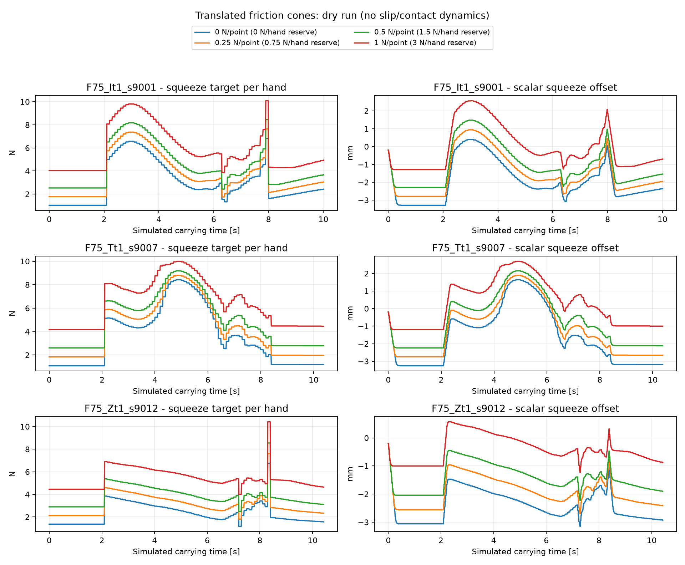

# Coni traslati: confronto offline del 20 ottobre 2026

La traslazione nello spazio delle forze aumenta la compressione richiesta in
modo regolare nelle tre route I/T/Z provate. Tutte le 1.240 allocazioni sono
state accettate dopo la verifica esplicita dei residui. Questo esperimento
verifica allocazione, collegamento al controllore e risposta del loop scalare;
**non misura lo slittamento**, che il backend `DryRun` non simula.

## Verifica della tesi originale di Vitus

Fonte letta direttamente: `TESI_antiG/PAPERS/2026-03 MA_thesis_vitus_becker 3.pdf`,
*Cooperative Contact-Rich Dual-Arm Robot Box Tilting via Haptic-Informed Learning
from Demonstrations*, cap. 5, sezioni 5.3.4-5.3.5, pagine stampate 80-81
(pagine PDF 95-96), equazione 5.23. Controllate anche le immagini delle due pagine.

Usando qui N positivo in compressione per confrontare convenzioni di segno:

| Aspetto | Tesi di Vitus | Questa copia prima dell'esperimento |
|---|---|---|
| Contatti delle mani | Un punto per mano | Tre punti per mano |
| Attrito delle mani | `norm(ft) <= mu*N` | `norm(ft_i) <= (1-r_s)*mu*N_i` |
| Precarico nel solver | `N >= 1 N` per mano, separato dal cono | Nessuno: `f_min` viene ignorato |
| Margine imposto | Nessun restringimento esplicito in eq. 5.23 | `r_s = 0.30` |
| Altri contatti | Cono del pivot a terra | Nessun cono del pivot |
| Costo | `F.T W(theta) F`, 6 componenti di forza | Precisione umana sui 12 componenti dei wrench di flangia |
| Equilibrio | Momento richiesto sul pivot, reazione del pivot da bilancio delle forze | Sei equazioni di equilibrio del wrench sul CoM assunto |

La stessa famiglia di vincoli di Coulomb e l'idea del costo basato sulla
precisione umana sono condivise; i due programmi **non sono identici**.
In particolare, il restringimento attuale non va attribuito all'equazione 5.23
di Vitus. Il minimo di 1 N che esiste ancora in `controller.py` e' un clamp
successivo del target di presa, non il vincolo originale della tesi.

La precedente copia Kinova in `TESI_antiG/lorenzo_data_analysis` contiene ancora
`cone(..., f_min, r_s)`, con floor per punto, cap e slack; anche quella e'
un'adattazione successiva e non sostituisce il controllo della tesi originale.

## Modifica implementata

Parametro: `socp.cone_shift_N`, in **newton per punto attivo**, default `0.0`.
Per ciascun punto attivo:

```text
N_i = -n_i.T f_i
k = (1-r_s)*mu
N_i >= cone_shift_N
norm(ft_i) <= k*(N_i-cone_shift_N)
```

Quindi `N_i >= cone_shift_N + norm(ft_i)/k`. Il vertice cambia nello spazio
delle forze; punti di contatto, normali e bracci di leva fisici restano gli
stessi. Il restringimento `r_s=0.30` e' mantenuto in tutti i confronti: si
isola l'effetto della traslazione. Non e' un nuovo modo di stimare l'attrito.

Con tre punti attivi la riserva normale complessiva vale `3*cone_shift_N` per
mano, oltre alla richiesta d'attrito. Un punto inattivo rimane a forza nulla.
Questa e' una riserva distribuita sui punti, piu' specifica di un floor sulla
sola forza totale della mano. L'effettiva distribuzione sui punti non e'
misurata o comandata separatamente nel robot.

Il controllo numerico a posteriori verifica anche il cono traslato, non solo
quello originale. La formulazione resta DPP e si riusa il programma compilato.
`eta_max` continua a significare `max(norm(ft_i)/(mu*N_i))`: utilizzo del cono
nominale, prima sia del restringimento sia della traslazione.

## Risultati

Presa mediana **richiesta per mano**, in N, durante le fasi con allocazione:

| Route | Shift 0 | Shift 0.25 N/punto | Shift 0.5 N/punto | Shift 1 N/punto |
|---|---:|---:|---:|---:|
| `F75_It1_s9001` | 2.411 | 3.097 | 3.797 | 5.231 |
| `F75_Tt1_s9007` | 2.884 | 3.750 | 4.603 | 6.277 |
| `F75_Zt1_s9012` | 2.016 | 2.831 | 3.662 | 5.235 |
| Riserva nominale per mano | 0 | 0.75 | 1.5 | 3.0 |

Ogni variante: SOCP I **101/101**, T **104/104**, Z **105/105**.
Tutte le 12 sequenze raggiungono `seat_found=True` nel backend semplificato;
nessun jam. Questi esiti non sono una prova di successo fisico nell'inserimento.

Con shift 0.5 N/punto, il massimo utilizzo del cono nominale scende da 0.70
a 0.633 (I), 0.640 (T), 0.621 (Z). La riserva additiva non aumenta il target
esattamente di 1.5 N: il solver ridistribuisce anche le forze e i momenti e le
pose dei contatti cambiano con la risposta del controllore.

Massimi su tutti i risultati accettati:

- Residuo di equilibrio delle forze: `1.04e-5 N` (tolleranza `1e-4 N`).
- Residuo di equilibrio dei momenti: `8.48e-7 Nm` (tolleranza `1e-5 Nm`).
- Violazione del cono traslato: `9.74e-10 N` (tolleranza `1e-4 N`).
- Valore assoluto dell'offset scalare `ds`: `3.29 mm`, limite `60 mm`.

Il solver ha emesso un avviso `optimal_inaccurate` durante la variante I con
shift 1 N; le allocazioni sono state accettate solo dopo il controllo esplicito
dei vincoli. La fattibilita' non si deduce dal solo stato del solver.



## Limiti della prova

- `DryRun` incolla cinematicamente il pezzo alle mani dopo la presa. Non modella
  attrito, slittamento, distacco dei singoli punti o collisioni con i vicini.
- Restituisce momenti misurati nulli. `full_wrench=false` e le route provate
  hanno il controllo scalare: non e' una verifica del tracking di torsione.
- Il loop chiude sulla somma delle compressioni. Il massimo, tra le 12 prove,
  dell'errore p95 fra meta' della somma misurata e il target per mano e' circa
  **2 N**, durante i transitori: fattibilita' del target e tracking sono distinti.
- `mu=1` e' il coefficiente delle route, non una misura dell'attrito reale.
- Il floor del target di 1 N e il pickup di 6 N per mano restano invariati.
- I numeri `PyBullet placed/slip` stampati nel riepilogo della route sono
  metadati delle prove precedenti salvati nel JSON, non risultati di questo dry run.
- Il default operativo resta **shift 0**. I valori provati sono una scansione
  sperimentale, non una calibrazione consigliata per il robot.

Una domanda concreta per Kenzhi: conviene una riserva additiva per ogni punto
del tri-pad, una riserva sulla forza totale della mano, oppure un margine
derivato dall'incertezza misurata sulle forze? Nel primo caso bisogna anche
giustificare che tutti e tre i punti rimangano realmente caricati.

## Riproduzione e file

Con le dipendenze numpy/scipy/cvxpy/PyYAML/matplotlib disponibili:

```powershell
python -m unittest discover -s tests -v
python -m kinova_dual_arm_dmp_insertion.compare_cone_shift
```

La seconda chiamata usa `config/cell.yaml`, le route `c100_five_cut800`, velocita'
normale e shift `[0, 0.25, 0.5, 1]`. Supporta `--config`, `--worlds`, `--shifts`,
`--arm`, `--slow` e `--output`; costruisce esclusivamente il backend offline.
Non modifica il file di configurazione letto e non comunica con ROS.

Su questo PC sono stati usati Python 3.12.14 del runtime Codex e dipendenze
isolate in `tmp/dryrun_deps` (nessuna installazione nel Python del robot).
Le versioni esatte e il config completo sono in `summary.json`.

Per ripetere qui con lo stesso ambiente gia' preparato:

```powershell
$env:PYTHONPATH = (Resolve-Path 'tmp/dryrun_deps').Path
$env:MPLCONFIGDIR = Join-Path (Get-Location) 'tmp/matplotlib'
& 'C:\Users\Lorenzo\.cache\codex-runtimes\codex-primary-runtime\dependencies\python\python.exe' -m kinova_dual_arm_dmp_insertion.compare_cone_shift
```

Per provare un singolo `check`, crea una copia di `config/cell.yaml`, modifica
solo `socp.cone_shift_N` e passala a `main check ... --config <copia.yaml>`.
Non cambiare la geometria dei contatti per applicare la traslazione.

- `summary.csv`, `summary.json`: riepilogo e metadati riproducibili.
- `*_ticks.csv`: target, forze aggregate e offset ad ogni tick.
- `*_allocations.csv`: forze normali per mano, minimo sui punti, residui,
  utilizzo del cono, tempo del solver, stato e ragione dell'eventuale fallimento.
- `*_run.txt`: esito dell'intera sequenza.
- `zero_shift_regression.json`: confronto con il solver originale del commit
  `12d9010` su 24 pose, identici input. Differenza massima fra componenti dei
  wrench di flangia: **0.0**.

Verificato anche l'ingresso CLI normale: `main check F75_Tt1_s9007 --arm
c100_five_cut800 --config tmp/cell_shift0p5.yaml` con una copia del config a
shift 0.5. Risultato: 104/104 allocazioni valide, target mediano 4.6 N/mano.

Sei test analitici passati: carico simmetrico con incremento `3*N0`, precarico
a carico tangenziale nullo, torsione pura trasmessa dal triangolo con riserva,
punti inattivi, rifiuto di una soluzione che soddisfa solo il cono originale,
rifiuto di offset non validi. Verificato anche il riuso del programma DPP.
