# Coni di attrito e floating plate: studio PyBullet

Coni di attrito e floating plate

Studio PyBullet - 24 ottobre 2026
Confronto tra forze pianificate, contatti realizzati e wrench risultante.

**Risultato:** nel banco di prova nominale il margine fisso e quello adattivo completano tutti i 9 casi per ciascun meccanismo. La compliance modifica la distribuzione dei carichi: il floating plate mantiene i contatti ma realizza un wrench meno vicino al riferimento. La fattibilita del SOCP sul modello nominale non certifica le forze dei pad del meccanismo passivo.

Sono conservati **111 casi**, inclusi tutti i fallimenti: 93 raggiungono la fine temporale e 87 soddisfano le soglie finali di 20 mm / 5 gradi. Quattro pilot e quattro verifiche a passo dimezzato sono separati dal denominatore. I tre assetti iniziali sono deterministici; questi conteggi non sono probabilita sperimentali.

| Meccanismo / metodo | Endpoint / 9 | RMSE F [N] | RMSE M [Nm] | Errore finale [mm / deg] |
| --- | --- | --- | --- | --- |
| Tripod rigido / Nessun margine | 3 | 8.55 | 0.307 | 109.02 / 23.17 |
| Tripod rigido / Margine fisso | 9 | 1.77 | 0.216 | 2.50 / 0.60 |
| Tripod rigido / Margine adattivo | 9 | 1.77 | 0.216 | 2.50 / 0.60 |
| Tripod rigido / Wong-inspired | 6 | 1.43 | 0.105 | 12.03 / 0.33 |
| Floating plate / Nessun margine | 0 | 14.74 | 0.362 | 123.29 / 6.13 |
| Floating plate / Margine fisso | 9 | 4.08 | 0.377 | 2.98 / 1.86 |
| Floating plate / Margine adattivo | 9 | 4.09 | 0.377 | 2.98 / 1.87 |
| Floating plate / Wong-inspired | 3 | 2.20 | 0.143 | 30.69 / 0.51 |

Valori continui: mediana dei 9 casi. Per le cadute, RMSE sul solo intervallo in aria registrato prima dello stop: non e un confronto a durata uguale con le run complete. Le soglie 20 mm / 5 deg sono descrittive, definite nell'analisi e non preregistrate. Endpoint significa posa a fine movimento in aria, non inserimento o rilascio dopo appoggio.

**Ambito:** carico noto al pianificatore, traiettoria prescritta, due proxy dinamici del polso e sei contatti sferici. Non e una simulazione dei Gen3, dell'ATI, dello stimatore di Wong o dell'inserimento Kinova. In particolare D=15 Ns/m nel proxy non e il damping 60/80 del controller di laboratorio.

## 1. Modello, informazione e confronto controllato

Il pianificatore riceve massa, CoM, geometria e attrito nominali. Le forze di contatto lette dal simulatore sono diagnostiche: nessun comando indipendente ai pad e nessun ritorno della posa reale al pianificatore.

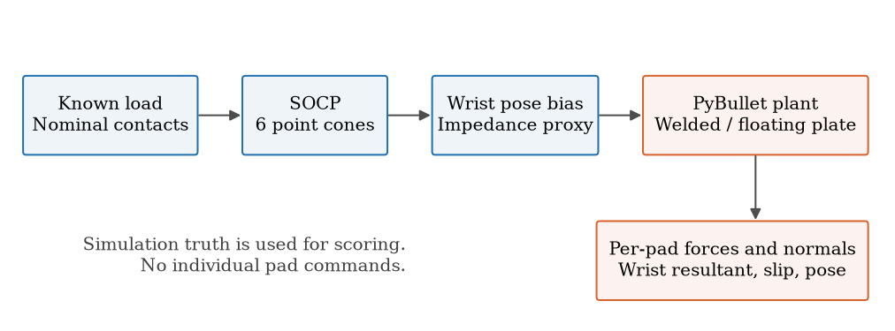

| Parametro | Valore fissato |
| --- | --- |
| Oggetto | Cubo 120 mm; 1.9 kg; CoM [0,0,0], [15,0,0], [15,15,0] mm |
| Tool | 3 sfere per mano, R=10 mm; triangolo r=30 mm; offset 20 mm |
| Floating plate | Periferiche 500 N/m per asse, l0=0; centrale 20000 N/m trasl.; 40/0/0 Nm/rad rot. |
| Polso proxy | K=1500 N/m, D=15 Ns/m; Krot=40 Nm/rad, Drot=1.15 Nms/rad |
| Contatto | mu fisico 0.75; nessun momento locale, rolling/spinning friction nulli; collisione plate disattivata |
| Campionamento | Fisica 0.5 ms; trace 100 Hz; 4.5 s massimi |
| Movimento | Approccio fino a 0.8 s; fixture rimossa a 1 s; tilt 0-15 deg tra 1.5 e 4 s; hold finale |

Per isolare la compliance, il tripod rigido usa la stessa plate con una giunzione saldata al flange: geometria, massa, materiali e controllo del polso restano uguali. Nel floating la plate si muove per effetto delle molle; i tre pad sono solidali alla plate. La rigidezza centrale di tilt e nulla, ma le periferiche danno circa 0.675 Nm/rad: il momento flettente totale non e automaticamente zero.

Realizzazione comune: offset di posizione Fdes/K e offset angolare Mdes/Krot, poi azione elastica e dissipativa sul flange. Si tratta di un canale di impedenza idealizzato senza feedback esterno di forza. Gravita del tool compensata; nessun pavimento o supporto dell'oggetto dopo il rilascio.

## 2. Cosa viene ripreso dai due paper

**[1] Keeping Contact.** Si riprendono distanza dal cono, margine fisso/adattivo, confronto con assenza di margine e misure di scarico/slittamento. Il paper usa un problema planare con pivot ambientale; qui il corpo e in aria con sei contatti puntiformi e bilancio completo. Il costo resta quello TP-GMM di sessione C, solo precisione: non si sostituisce con il costo di sforzo del paper.

Per il pad i, n e la normale uscente dall'oggetto, f la forza sull'oggetto, N=-n dot f e T=||f+N n||. Si valutano eta=T/(mu N) e psi=(mu N-T)/sqrt(1+mu^2). Il vincolo e psi >= rho. Margine adattivo del codice corrente: rho_task=0.25 ||F_task||+1 N, con pesi dei contatti; il termine costante nel paper e 0.5 N. Il margine fisso e calibrato solo sui profili dell'ottimizzatore, prima delle prove fisiche, per pareggiare la media di ||F_L||+||F_R||.

| CoM | rho fisso [N] | Forza media adattiva [N] | Forza media fissa [N] |
| --- | --- | --- | --- |
| centered | 2.0142 | 54.266 | 54.268 |
| planar | 2.0493 | 52.914 | 52.914 |
| spatial | 2.1997 | 52.888 | 52.891 |

In questo movimento la rho adattiva cambia poco con l'angolo: circa 2.014 N al CoM centrato e 2.192-2.202 N al CoM spaziale. Il confronto quasi equivalente al fisso e un risultato atteso di questo banco; non dimostra una superiorita generale del margine adattivo. Le prove di mismatch usano soltanto l'adattivo, quindi non confrontano la robustezza dei tre metodi.

**[2] Wong e colleghi.** Si riprende il limite aggregato sqrt(||Ft||^2+(tau_n/Reff)^2) &lt;= (1-rs) mu N, con Reff=32.8 mm e rs=0.10, e il costo quadratico sui wrench con momenti scalati da Reff. Il paper usa due patch estese 7 x 10 cm; qui e una baseline dichiarata, con lo stesso tool fisico a tre sfere. Non si assegna una coppia locale alle sfere. Il suo vincolo di bending nullo al polo aggregato e una scelta della baseline, non una proprieta generale del floating plate.

Il confronto Wong cambia insieme modello di contatto, costo e restrizione sul bending. Non isola il solo effetto dell'ellisse, e non riproduce le fasi di stima inerziale o gli esperimenti del paper.

## 3. I sei coni: piano e simulazione

Caso dichiarato: CoM [15,15,0] mm, assetto iniziale 0 deg, margine adattivo. Punti blu/arancio: forze realizzate, t>=1.3 s, decomposte usando le normali effettive; tratteggio: testimone SOCP nominale. Area grigia: T<=0.75 N. Le forze ausiliarie del solver non sono sei setpoint attuati.

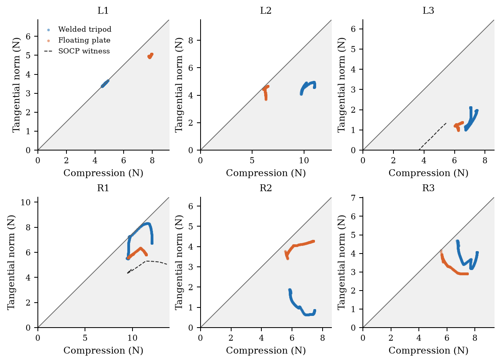

Le forze possono restare dentro i coni pur essendo diverse dal testimone del solver. La distribuzione viene scelta anche dalla deformazione passiva, dalle pose dei due polsi e dalla dinamica. Nel caso rigido un pad sinistro si avvicina alla frontiera mentre altri mantengono riserva; la compliance cambia questa distribuzione.

Bullet impone gia il proprio modello di attrito. Un basso conteggio di forze fuori cono non e una validazione indipendente della legge di Coulomb e non prova assenza di slip. Per questo sono salvati anche carico normale, velocita tangenziale relativa, perdita di contatto e deriva/caduta dell'oggetto.

## 4. La riserva realizzata non coincide con quella imposta

Stesso caso della pagina precedente. psi e calcolata dalle forze reali e dalle normali di contatto; rho e quella richiesta al modello nominale. Una curva sotto rho ha perso la riserva progettata; sotto zero violerebbe il cono. Contatto assente e riserva nulla non sono la stessa condizione.

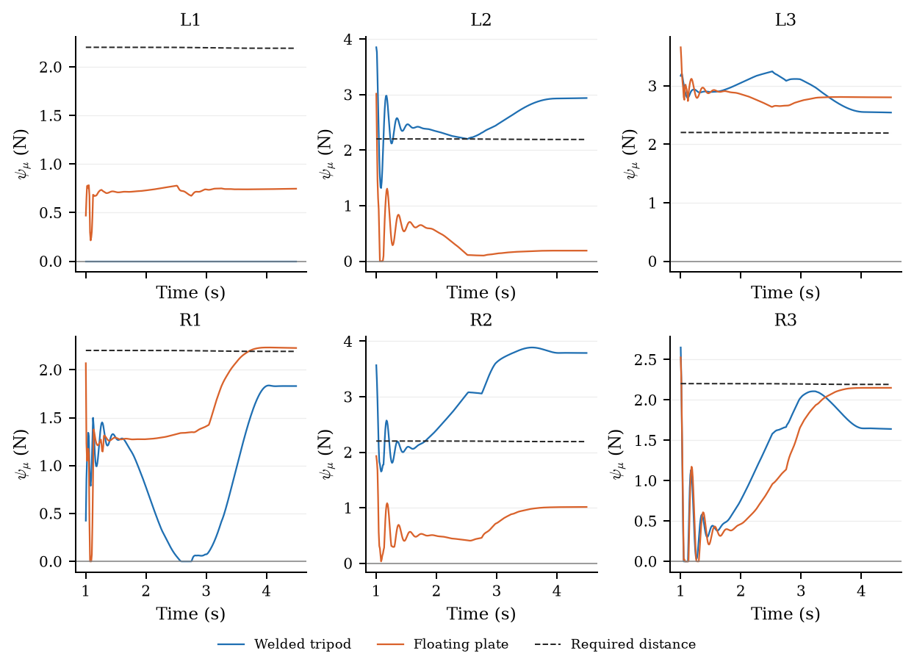

Nel gruppo adattivo, la mediana della frazione campioni-pad con psi&lt;rho e 65.5% nel rigido e 66.3% nel floating. In questi gruppi tutti e sei i contatti rimangono presenti; questi numeri **non sono percentuali di slip o fallimento**.

A mu e normale fissati vale psi(f+delta) >= psi(f)-||delta||. Il codice controlla questa disuguaglianza sui dati salvati. Un margine rho copre una perturbazione di forza entro rho rispetto al testimone nominale; cambiamenti di normale, geometria o mu richiedono verifiche separate. La condizione e sufficiente, non necessaria: una differenza maggiore di rho non implica automaticamente slip.

## 5. Forze risultanti al polso

Sei componenti di forza, world frame, stesso caso adattivo. Le risultanti vengono ricostruite dai contatti. Il riferimento e comune ai due meccanismi; l'RMSE valuta la norma del vettore per mano e poi aggrega tempo e mani.

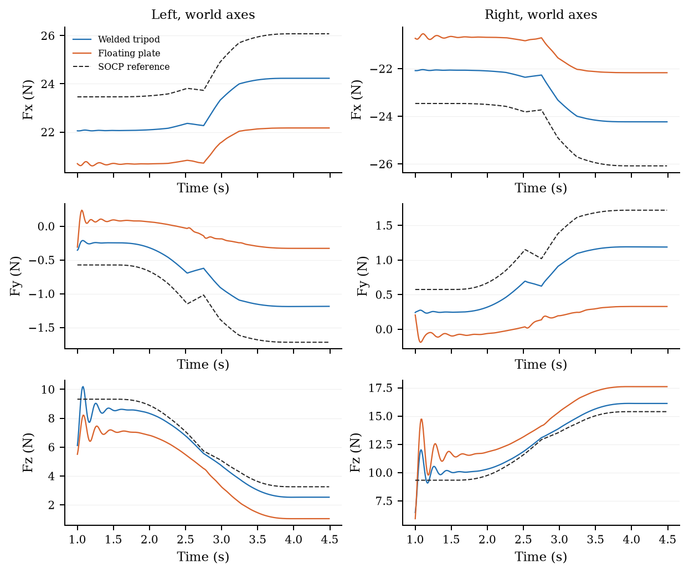

Con gli stessi profili di carico e lo stesso proxy di polso, la mediana RMSE di forza passa da 1.77 N a 4.09 N. La differenza e osservata in questo sistema simulato e non identifica una causa delle oscillazioni dei motori reali.

La risultante virtuale contiene le forze di interazione ricostruite dai contatti. Non e una misura di un giunto ATI simulato: gravita e inerzia del tool non sono incluse come sarebbero in un sensore fisico non compensato. Il dataset mantiene separate le forze native dei pad e la risultante.

## 6. Momenti e trasporto del polo

Momenti world frame trasportati al medesimo flange nominale, con M_nom=M_actual+(p_actual-p_nom) x F. Confrontare momenti presi in poli diversi introdurrebbe un errore geometrico. Non sono momenti locali sulle sfere.

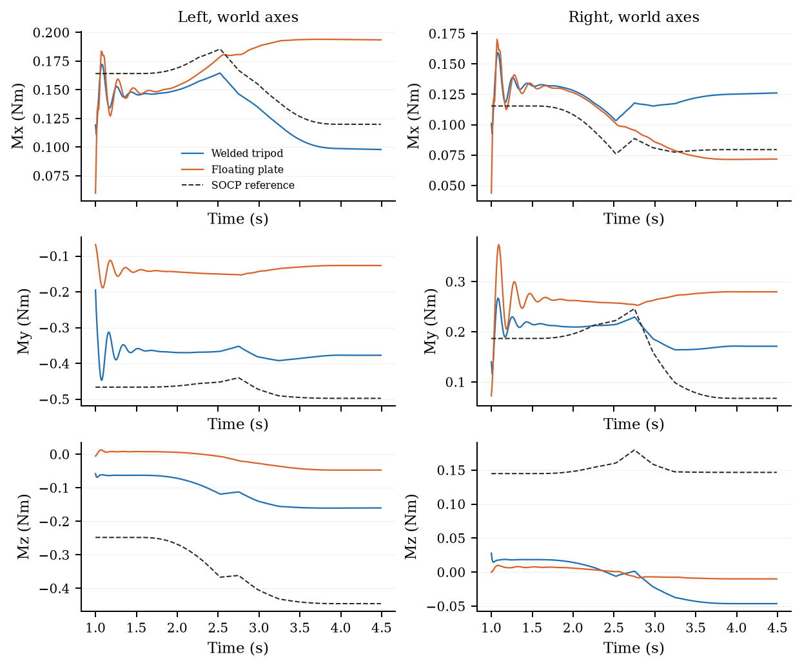

La mediana RMSE di momento e 0.216 Nm nel rigido e 0.377 Nm nel floating. Il fatto che ogni pad trasmetta solo una forza non annulla la coppia risultante del tripod: M=sum((p_i-p_polo) x f_i).

Il pannello supplementare 03_wrist_components mostra compressione, forza tangenziale e torsione al centroide dei tre contatti. Il dataset conserva tutte le sei componenti al flange e i punti di contatto effettivi.

## 7. Tre coni puntiformi e patch aggregata

Sezioni del wrench set ottenute con i tre coni sulle geometrie flat, tilted e faceted del precedente banco di contatto. Forza assiale fissata a 15 N, Fy=0 e bending nullo al centroide. Il confronto con R=30 mm separa parte dell'effetto geometrico da Reff=32.8 mm. Nel caso faceted 15 N e la componente assiale, non la somma delle compressioni locali. La finestra di Ft e limitata a +/-11.25 N.

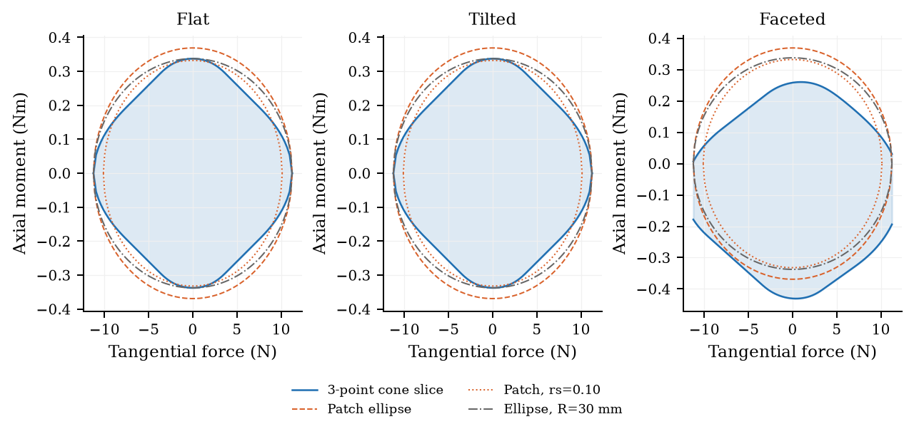

La rotazione rigida di una superficie piana preserva questa sezione nel frame locale. Le normali non parallele della superficie sfaccettata la rendono asimmetrica: l'ellisse non e automaticamente un limite interno conservativo. Queste sono sezioni di fattibilita dei contatti a geometria fissata, non l'intero insieme raggiungibile dal meccanismo passivo e dalle sue molle.

Nel profilo Wong-inspired con CoM spaziale, soltanto 2/7 nodi angolari hanno un testimone nei sei coni puntiformi. Una seconda ottimizzazione diagnostica quantifica fino a 0.319 N di eccesso minimo richiesto sul limite tangenziale. Questa rilassazione serve solo a verificare l'incompatibilita e non viene usata dal controllore.

Caso floating / Wong-inspired / CoM spaziale / assetto 0 deg. A sinistra il risultante rispetto all'ellisse; a destra la massima utilizzazione tra i tre pad. Un indice aggregato favorevole non certifica ciascun cono locale.

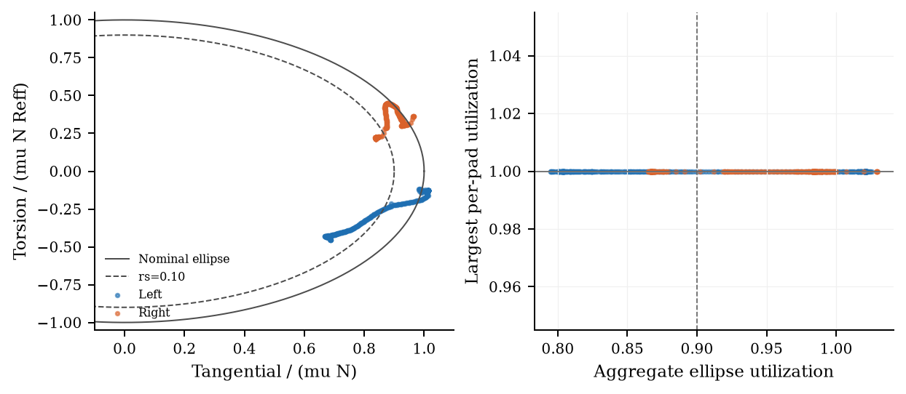

## 8. Perche l'ATI non identifica i tre coni

Esempio algebrico sulla geometria nominale: una coppia di forze interne lungo il segmento fra due pad lascia invariato il wrench al polso ma modifica la distanza dei singoli contatti dal cono. Le ipotesi oltre il limite non rappresentano un equilibrio aderente realizzabile; mostrano cosa il solo wrench non puo escludere.

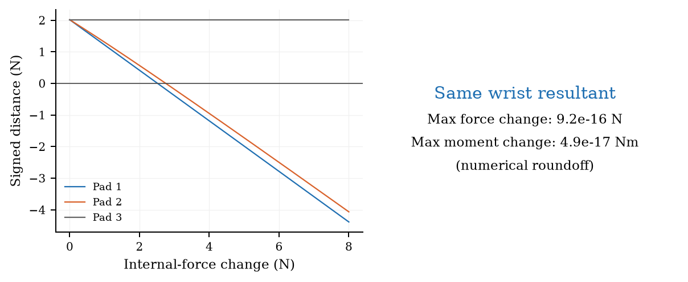

Per una mano f ha 9 componenti e w=Hf ne ha 6. Qui rank(H)=6, quindi lo spazio nullo ha dimensione 3. Anche conoscendo esattamente il risultante, restano possibili redistribuzioni interne. Prima di attraversare il limite esistono gia ripartizioni diverse tutte ammissibili. Sull'hardware l'ATI non distingue queste ripartizioni; in simulazione le possiamo leggere e confrontare direttamente.

Confronto su tutti i 72 casi principali. Endpoint: entro 20 mm e 5 deg, nessuno stop di perdita oggetto. Errori: mediana su 9 assetti/CoM. La baseline Wong non e una replica del sistema del paper; usa la sua patch aggregata sul nostro tool discreto.

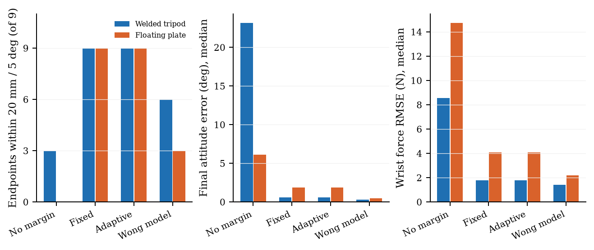

La baseline senza margine perde l'oggetto in 6/9 casi rigidi e 9/9 floating. La fattibilita nominale ai nodi del piano non basta, da sola, per l'esecuzione con un canale di impedenza e un tool passivo. Il risultato e specifico al banco e ai suoi guadagni.

Le mediane possono nascondere i sottogruppi: con Wong-inspired il floating perde i 3 casi centrati; i 3 casi planari sono entro soglia; i 3 casi con CoM spaziale arrivano alla fine ma hanno circa 30-32 mm e 38-42 deg di errore. Nel rigido il CoM spaziale porta a 28-31 mm e 49-55 deg. Non si puo interpretare la piccola mediana angolare globale come buon comportamento in ogni condizione.

## 9. Mismatch e molla centrale 2700 N/m

30 casi aggiuntivi: solo margine adattivo, 3 assetti per condizione e meccanismo. Massa 1.7/2.2 kg nota; massa sottostimata del 10%; CoM reale spaziale ma pianificato centrato; mu pianificato 0.825 contro 0.75 fisico. Non sono prove esaustive di robustezza.

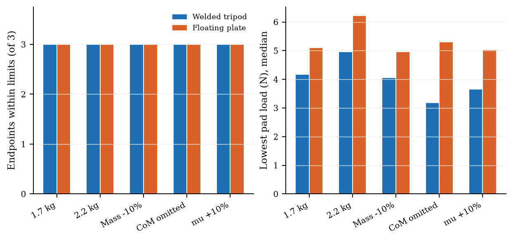

Nella sensibilita separata con **molla centrale assiale 2700 N/m**, le tre periferiche restano 500 N/m: rigidezza assiale totale 4200 N/m, non 2700. Gli endpoint entro soglia sono 9/9; RMSE F mediano 7.86 N, errore finale 4.52 mm / 3.09 deg. Non si e ritoccato il controllo per compensare la cedevolezza.

Screenshot realmente salvati a fine run; CoM spaziale, assetto iniziale 0 deg. Stessa camera: floating con margine adattivo, floating senza margine, floating con centrale 2700. Sono stati registrati anche i checkpoint dopo il rilascio.

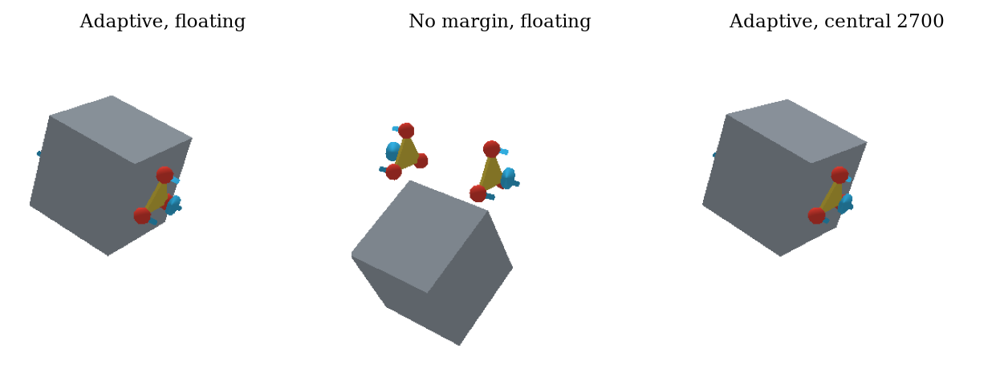

## Dettaglio stress

Tripod rigido / light_known / 3/3
Tripod rigido / heavy_known / 3/3
Tripod rigido / mass_under10 / 3/3
Tripod rigido / com_unmodelled / 3/3
Tripod rigido / mu_over10 / 3/3
Floating plate / light_known / 3/3
Floating plate / heavy_known / 3/3
Floating plate / mass_under10 / 3/3
Floating plate / com_unmodelled / 3/3
Floating plate / mu_over10 / 3/3
## 10. Verifiche numeriche e limiti della conclusione

Le allocazioni dei profili sono state ricontrollate indipendentemente ai 7 nodi angolari: bilancio, compressione e margini per i tre metodi puntiformi; equilibrio, ellisse e bending per Wong. Gli originali e le copie congelate coincidono tramite SHA-256. Il segno delle forze native A/B e verificato dal bilancio di Newton/Eulero e dalla ricostruzione del peso 1.9*9.81=18.639 N dopo rimozione della fixture.

**Limite del comando interpolato:** i wrench world frame vengono interpolati linearmente tra nodi. Su 601 angoli, residuo massimo di forza 6.7e-11 N, momento 0.00499 Nm, deficit massimo di margine 0.0276 N. Quindi la fattibilita esatta ai nodi non e una garanzia continua. Le tracce originali restano inalterate; non e stata corretta retroattivamente la traiettoria.

| Caso | Endpoint dt / dt/2 | Delta posizione [mm] | Delta RMSE F [N] |
| --- | --- | --- | --- |
| floating_centered_0 | True / True | 0.003 | 0.000 |
| floating_wong_spatial_2 | False / False | -0.245 | 0.001 |
| welded_centered_0 | True / True | 0.013 | 0.000 |
| welded_spatial_2 | True / True | -0.008 | 0.002 |

Verifica a 0.25 ms: le quattro classificazioni endpoint restano uguali. I coefficienti fisici degli smorzatori e la registrazione a 100 Hz restano fissi. Il confronto e controllo numerico a posteriori, non tuning o replica indipendente; non prova convergenza di tutti i 111 casi.

**Conclusione utilizzabile in tesi:** "Il modello SOCP fornisce un'allocazione nominalmente ammissibile per una geometria di contatto assunta. Il trasferimento al floating plate viene valutato tramite esecuzione dinamica e analisi delle forze per pad in simulazione; la redistribuzione dovuta alla compliance puo ridurre i margini realizzati. Il wrench risultante al polso, da solo, non certifica i singoli vincoli locali."

Lo studio non identifica il coefficiente reale di attrito, il contatto deformabile dei pad, l'attrito dei motori o la causa delle oscillazioni hardware. Non dimostra validita per oggetti sconosciuti arbitrari. I tre assetti sono deterministici e le superfici sfaccettate entrano nella sola diagnostica geometrica, non nei 111 sollevamenti del cubo. La verifica sperimentale richiede una misura distribuita o stime con incertezza, e confronto D-only separato per il controller Kinova.

## Riferimenti e riproducibilita

[1] Anonymous authors, <i>Keeping Contact: Task-Adaptive Friction Margins for Bimanual Non-Prehensile Manipulation</i>. PDF locale fornito, 8 pagine. SHA-256: 5cf869f81ff87155... [papers/sources.json].

[2] K. I. Wong, L. Yang, Q. Y. Lee, D. Campolo, <i>Industrial Dual-Arm Box Handling via Online Inertial Estimation and Convex Wrench Optimization</i>. PDF locale fornito, 14 pagine. SHA-256: 6b63459ca9e3aa19... [papers/sources.json]. Nessuna assunzione sullo stato di pubblicazione.

Versioni: Python 3.12.14, NumPy 2.5.4, CVXPY 1.9.3, CLARABEL; PyBullet nel runtime locale con engine DIRECT, 120 iterazioni solver e enableConeFriction=1. Un worker fisico per volta; BLAS a un thread. Run manifest e checkpoint identificano input, sorgenti e casi; i dati originali NVIDIA_RUNS non sono stati modificati.

| Artefatto | Contenuto |
| --- | --- |
| PROTOCOL.md / runs_manifest.json | Disegno e 111 condizioni congelate prima della campagna |
| study.py / socp_reference.py / vendor/ | Sorgenti di simulazione; copie inalterate del SOCP e tool |
| runs/<id>/ | Trace e manifold nativi, screenshot, job, esito e hash sorgente |
| metrics.csv / metrics.json / groups.json | Metriche per caso, eccezioni e aggregati; fallimenti inclusi |
| AUDIT.json / WONG_DISCRETE_AUDIT.json | Verifiche indipendenti e incompatibilita patch/discreto |
| capability.py / capability.json | Sezioni geometriche e esempio spazio nullo |
| refinement/ / REFINEMENT_COMPARISON.json | Quattro casi a passo dimezzato, separati dal principale |
| plots.py / figures/ | Grafici vettoriali PDF e PNG |
| SHA256.json | Manifest consegna, include sorgenti, tracce, figure e report |

Riproduzione: usare il Python e le dipendenze documentati in study.py. Il worker preserva le directory gia completate e rifiuta directory incomplete; prima di rilanciare controllare lock, PID e checkpoint. analyze.py, audit.py, audit_wong.py, plots.py e report.py rigenerano soltanto derivati. Non ripulire o sovrascrivere i risultati registrati.
